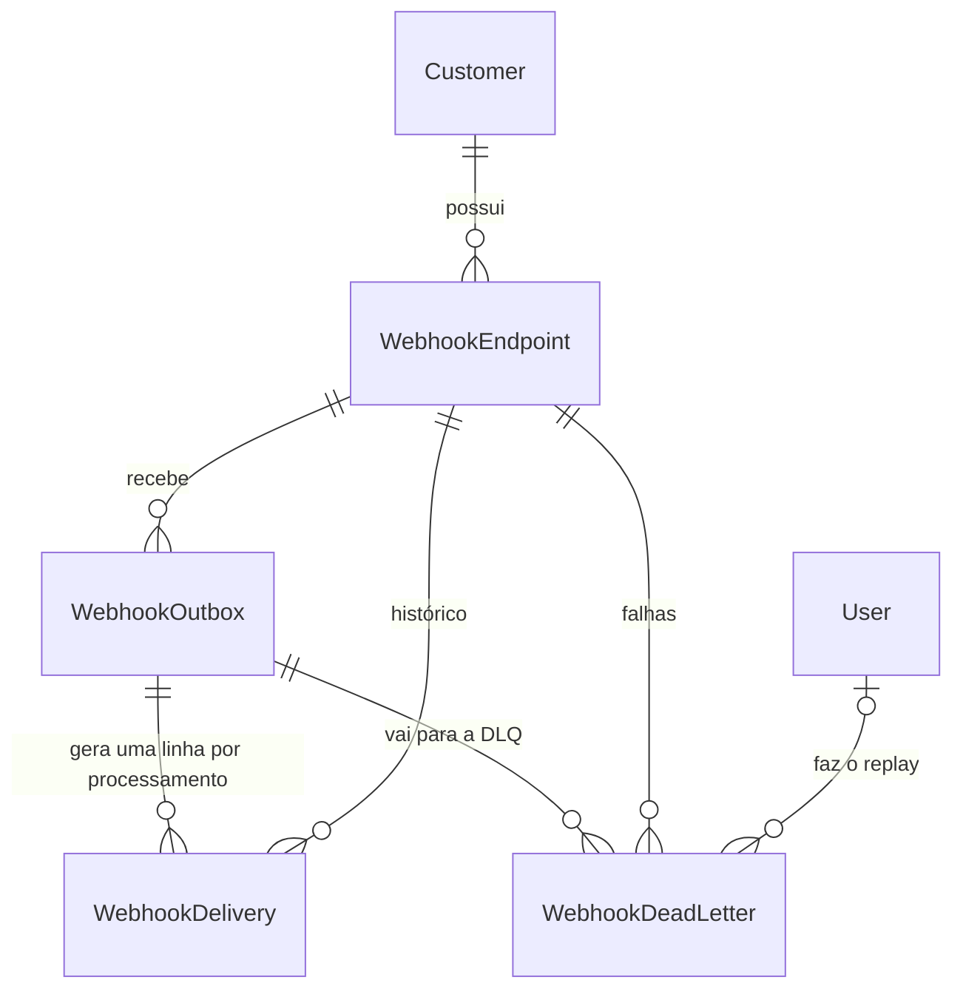
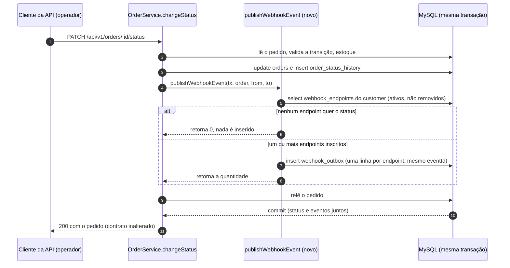
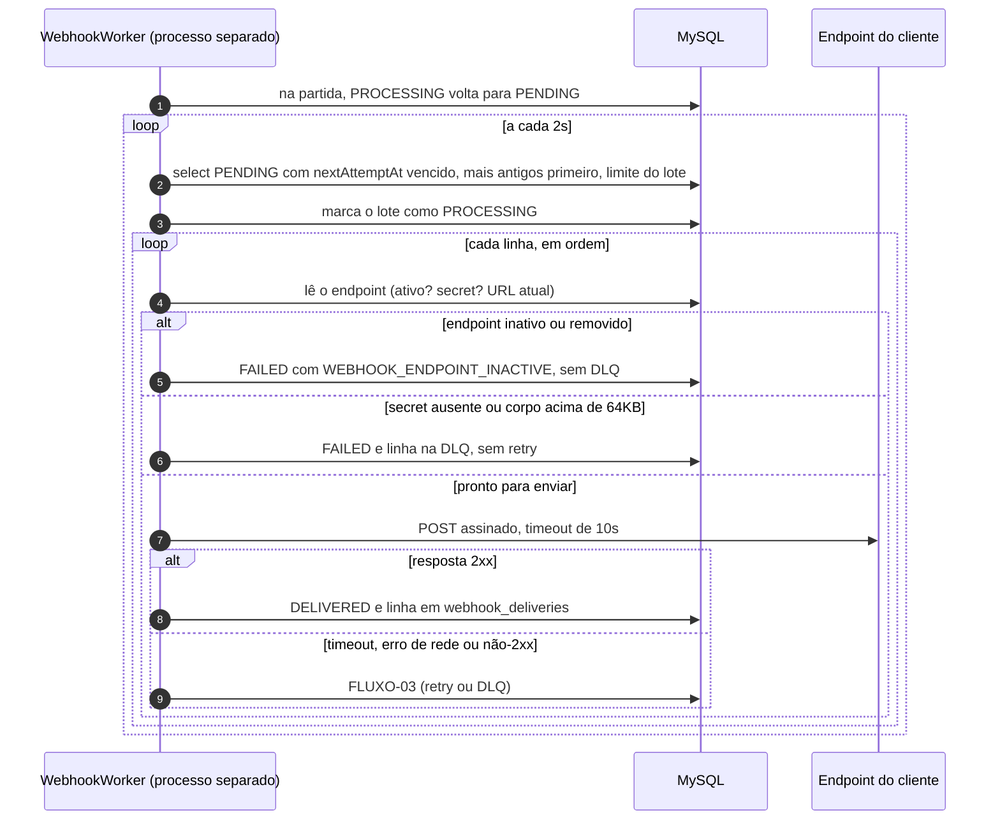
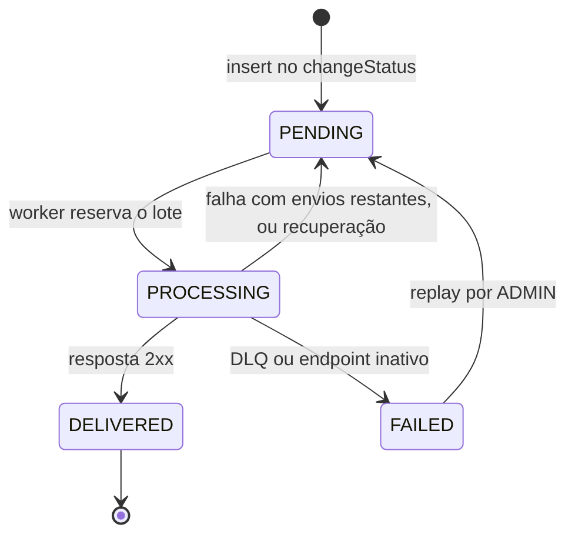
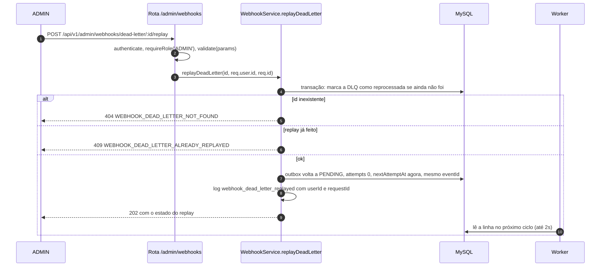
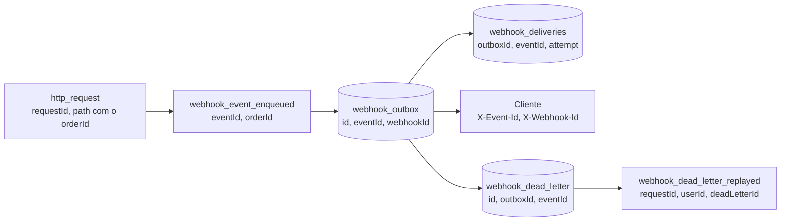

# FDD: Sistema de Webhooks de Notificação de Pedidos

| Campo | Valor |
| --- | --- |
| Feature | Sistema de Webhooks de Notificação de Pedidos (evento `order.status_changed`) |
| Autora | Larissa (Tech Lead). Redação: João Paulo Constantino, com apoio de IA |
| Status | Rascunho para implementação |
| Data | 2026-10-16 |
| Revisores | Bruno e Diego, na sessão de revisão antes de codar ([09:50] Larissa); Sofia, na revisão de segurança antes do deploy ([09:46] Sofia) |
| Documentos | [PRD](./PRD.md) · [RFC](./RFC.md) · [ADRs](./adrs/README.md) |

Este documento diz **como construir**. O porquê de cada decisão está nos ADRs, e a proposta com as questões em aberto, no [RFC](./RFC.md).

**Convenções de leitura**

- `[hh:mm] Nome` aponta para a fala da [transcrição](../TRANSCRICAO.md); `arquivo:Lx-y` aponta para linhas do código atual, conferidas na data deste documento.
- **(novo, a criar)** marca arquivo que ainda não existe. A lista completa está na seção 4.
- **(proposta de implementação)** marca o que a reunião não decidiu e este FDD propõe. Esses pontos podem mudar na revisão sem reabrir nenhum ADR.
- **PC-NN** remete aos "Pontos para confirmação dos revisores" do [RFC](./RFC.md); **OQ-NN**, às questões em aberto do RFC.
- Cada item rastreável tem um ID visível: `OT` (objetivo), `DADOS`, `FLUXO`, `CT` (contrato), `ERR`, `RES`, `OBS`, `INT`, `CAT` (critério de aceite) e `R` (risco).
- Nomes: o payload enviado ao cliente usa `snake_case`, como foi falado em [09:43] Diego. A API de configuração usa `camelCase`, que é o formato atual das respostas (ex.: `subtotalCents`, `totalCents` e `orderNumber` em `tests/orders.test.ts:31-39`). No banco, as tabelas novas usam `snake_case` via `@@map` e as colunas ficam em `camelCase`, como as existentes (`prisma/migrations/20260519182739_init/migration.sql:50-69`).

## 1. Contexto e motivação técnica

**O problema.** Três clientes B2B consultam `GET /orders` de tempos em tempos para descobrir se seus pedidos mudaram, o que deixa a integração "lenta e cara" ([09:00] Marcos). Eles querem ser avisados da mudança, e "qualquer coisa abaixo de 10 segundos já é 'tempo real'" ([09:02] Marcos). O fluxo é só de saída: "Só saindo da gente pra eles" ([09:02] Marcos).

**O que existe hoje no código.**

- A mudança de status acontece em `OrderService.changeStatus` (`src/modules/orders/order.service.ts:126-179`), dentro de `this.prisma.$transaction` (L131). A transação lê o pedido com os itens (L132-135), recusa transição para o mesmo status (L140-146) e transição inválida (L147-149), debita ou repõe estoque quando a transição exige (L151-156), atualiza `orders` (L158), grava a auditoria em `order_status_history` (L159-167) e relê o pedido para a resposta (L169-176).
- As transições válidas estão na máquina de estados de `src/modules/orders/order.status.ts` (`transitions`, L3-10). `PENDING` só aparece como status inicial, gravado na criação do pedido (`order.service.ts:106-113`); nunca é destino de uma transição.
- Não há mecanismo de eventos, fila nem cliente HTTP de saída. `src/modules/` tem só `auth`, `customers`, `orders`, `products` e `users`, e o único entry-point é `src/server.ts`.

**Por que assíncrono, com outbox.** Chamar o cliente dentro dessa transação faria "qualquer cliente lento" travar "mudança de status pra outros pedidos", e um cliente fora do ar não justifica rollback de status ([09:04] Bruno). Por isso o evento é gravado numa tabela de outbox na mesma transação e entregue por um worker em outro processo. O porquê completo está nos ADRs; este FDD só os aplica:

| Decisão | ADR | O que ela fixa para a implementação |
| --- | --- | --- |
| Outbox transacional no MySQL | [ADR-001](./adrs/ADR-001-outbox-transacional-no-mysql.md) | Inserção na transação do `changeStatus`; falha na inserção desfaz a mudança de status |
| Worker separado com polling de 2s | [ADR-002](./adrs/ADR-002-worker-em-processo-separado-com-polling.md) | Entry-point própria, instância única, leitura dos pendentes mais antigos |
| Retry com backoff e DLQ | [ADR-003](./adrs/ADR-003-retry-com-backoff-exponencial-e-dlq.md) | 1 envio inicial + 5 retentativas (1m/5m/30m/2h/12h); tabela `webhook_dead_letter`; replay por ADMIN |
| HMAC-SHA256 com secret por endpoint | [ADR-004](./adrs/ADR-004-assinatura-hmac-sha256-com-secret-por-endpoint.md) | Assinatura do corpo no `X-Signature`; rotação com a antiga válida por 24h |
| At-least-once com `X-Event-Id` | [ADR-005](./adrs/ADR-005-entrega-at-least-once-com-x-event-id.md) | O mesmo `event_id` em retentativas, replay e em todos os endpoints inscritos |
| Reuso dos padrões do projeto | [ADR-006](./adrs/ADR-006-reuso-dos-padroes-existentes-do-projeto.md) | Módulo igual aos outros, `AppError`, Pino, Zod, `requireRole`, UUID; nenhuma dependência nova |
| Payload snapshot com filtro na inserção | [ADR-007](./adrs/ADR-007-payload-snapshot-enxuto-com-filtro-na-insercao.md) | Payload renderizado e filtrado dentro da transação, sem items |

## 2. Objetivos técnicos

Metas verificáveis da implementação. As metas de produto estão no [PRD](./PRD.md).

| ID | Objetivo | Meta mensurável | Como verificar | Fonte |
| --- | --- | --- | --- | --- |
| OT-01 | Latência entre o commit da mudança de status e a 1ª tentativa de entrega | Espera de até 2s do polling, mais a fila do lote; meta de ponta a ponta abaixo de 10s | OBS-01 | [09:02] Marcos, [09:09] Diego, [09:10] Larissa |
| OT-02 | Atomicidade entre status e evento | 0 mudanças de status commitadas sem a linha correspondente na outbox, para cada endpoint ativo inscrito naquele status | CAT-01, CAT-02 | [09:06] Diego, [09:40] Bruno |
| OT-03 | Isolamento da transação de pedidos | 0 chamadas HTTP dentro do `changeStatus`; a transação ganha só 1 leitura dos endpoints do customer e 1 inserção em lote | CAT-01, revisão de código | [09:04] Bruno, [09:34] Bruno |
| OT-04 | Entrega com retry finito | Até 6 envios de cada evento para cada endpoint (1 + 5 retentativas), numa janela de 14h36m; depois, DLQ. Nenhum evento fica pendente para sempre | CAT-08, CAT-09 | [09:15] Diego, [09:17] Larissa |
| OT-05 | Tempo máximo por chamada | 10s por tentativa; acima disso é falha com retry | CAT-07 | [09:42] Diego |
| OT-06 | Tamanho do payload | Corpo de até 64KB; acima disso, DLQ sem retry, sem bloquear a mudança de status | CAT-10 | [09:23] Sofia, [09:24] Larissa |
| OT-07 | Segurança de transporte e origem | 100% das entregas assinadas com HMAC-SHA256 e 100% das URLs cadastradas em `https` | CAT-04, CAT-06 | [09:22] Sofia, [09:23] Sofia |
| OT-08 | Sem stack nova | 0 dependências npm novas; 0 serviços de infraestrutura novos | `package.json` sem diff em `dependencies` | [09:07] Diego, [09:29] Bruno |

## 3. Escopo e exclusões

**Incluso nesta entrega**

| Item | Onde está neste FDD | Fonte |
| --- | --- | --- |
| Evento `order.status_changed`, gravado na outbox dentro do `changeStatus` | FLUXO-01, INT-01 | [09:40] Bruno, [09:43] Diego |
| Filtro de status por endpoint, aplicado na inserção | FLUXO-01, CT-01 | [09:33] Marcos, [09:34] Bruno |
| Worker em processo separado com polling de 2s | FLUXO-02, INT-09 | [09:10] Larissa, [09:11] Diego |
| Assinatura HMAC-SHA256, secret por endpoint e rotação | CT-05, CT-08, FLUXO-05 | [09:22] Sofia |
| Retry 1m/5m/30m/2h/12h e DLQ em tabela separada | FLUXO-03, FLUXO-04 | [09:17] Larissa, [09:18] Diego |
| Replay manual da DLQ, só para ADMIN e com registro de quem fez | CT-07 | [09:36] Sofia, [09:36] Larissa |
| CRUD da configuração (cadastrar, listar, editar, remover) | CT-01 a CT-04 | [09:31] Marcos, [09:33] Bruno |
| Histórico das últimas 100 entregas de um webhook | CT-06 | [09:34] Marcos |
| Recusa de URL sem `https` e de payload acima de 64KB | CT-01, FLUXO-02 | [09:23] Sofia, [09:24] Larissa |

**Fora desta entrega**

| Item | Situação | Fonte |
| --- | --- | --- |
| Evento na criação do pedido | Não emitido nesta fase. O ponto de integração decidido é o `changeStatus`, e a criação grava o histórico inicial `null → PENDING` por outro caminho (`order.service.ts:106-113`). Leitura adotada depois da reunião, registrada no [ADR-007](./adrs/ADR-007-payload-snapshot-enxuto-com-filtro-na-insercao.md) | [09:40] Bruno |
| Webhooks de entrada (cliente enviando para o OMS) | Descartado | [09:02] Marcos |
| Email ao cliente depois de falhas seguidas | Adiado: "Talvez próxima fase, depois que a gente medir o impacto" (OQ-03 do RFC) | [09:37] Larissa |
| Rate limiting de saída por cliente | Em observação: "observar e decidir depois" (OQ-01 do RFC) | [09:39] Larissa |
| Dashboard visual para o cliente | Fora: "Painel é projeto separado do time de frontend" | [09:40] Larissa |
| Arquivamento das linhas entregues | Fora do escopo desta feature (OQ-05 do RFC) | [09:08] Diego |
| Mais de um worker em paralelo | Adiado: "problema do futuro, não agora" (OQ-02 do RFC) | [09:13] Diego |
| Exactly-once | Descartado | [09:25] Diego |
| Items do pedido no payload | Descartado: o cliente consulta `GET /orders/:id` | [09:43] Diego |
| Autorização do CRUD por dono do customer | Adiado: "Mais pra frente a gente pode endurecer" (OQ-04 do RFC) | [09:37] Sofia |
| Endpoint para listar a DLQ | Não previsto. O id da DLQ sai no log e no histórico de entregas (ver PC-05 do RFC) | [09:18] Diego |
| Métricas e tracing com biblioteca dedicada | Fora: "Não vamos botar nada novo". Ver seção 10 | [09:29] Bruno |

## 4. Arquivos novos (a criar)

Nenhum destes arquivos existe hoje. Eles não fazem parte do código base e não servem como origem `CODIGO` no tracker. Os arquivos existentes que mudam estão na seção 11.

| Caminho | Responsabilidade | Origem do nome |
| --- | --- | --- |
| `src/worker.ts` (novo, a criar) | Entry-point do worker: carrega `env` e o Prisma client do processo, inicia o loop e trata `SIGINT`/`SIGTERM` | [09:11] Larissa, [09:28] Bruno |
| `src/modules/webhooks/webhook.routes.ts` (novo, a criar) | `buildWebhookRouter` (CT-01 a CT-06) e `buildWebhookAdminRouter` (CT-07) | Padrão do módulo, [09:27] Bruno |
| `src/modules/webhooks/webhook.controller.ts` (novo, a criar) | `WebhookController`: handlers `RequestHandler` com `try/catch` e `next(err)` | Padrão do módulo, [09:27] Bruno |
| `src/modules/webhooks/webhook.service.ts` (novo, a criar) | `WebhookService`: regras do CRUD, validação de `https`, geração e rotação da secret, replay | Padrão do módulo, [09:27] Bruno |
| `src/modules/webhooks/webhook.repository.ts` (novo, a criar) | `WebhookRepository`: acesso às quatro tabelas novas pela API | Padrão do módulo, [09:27] Bruno |
| `src/modules/webhooks/webhook.schemas.ts` (novo, a criar) | Schemas Zod de params, query e body | Padrão do módulo, [09:27] Bruno |
| `src/modules/webhooks/webhook.worker.ts` (novo, a criar) | `WebhookWorker`: polling, envio, retry, DLQ, recuperação na partida e parada controlada | [09:28] Bruno (o outro nome citado, `src/modules/webhooks/webhook.processor.ts` (novo, a criar), não é usado) |
| `src/modules/webhooks/webhook.publisher.ts` (novo, a criar) | `publishWebhookEvent(tx, order, fromStatus, toStatus)`, chamada pelo `changeStatus` | Função: [09:41] Bruno. Nome do arquivo: proposta de organização |
| `src/modules/webhooks/webhook.signer.ts` (novo, a criar) | Geração da secret e cálculo do `X-Signature` | Proposta de organização |
| `src/modules/webhooks/webhook.errors.ts` (novo, a criar) | Classes de erro da API (ERR-01 a ERR-05) e códigos de entrega (ERR-10 a ERR-16) | Proposta de organização |
| `prisma/migrations/<timestamp>_webhooks/migration.sql` (novo, a criar) | Migration aditiva gerada por `npm run db:migrate` a partir dos models da seção 5 | Padrão de `prisma/migrations/` |
| `tests/webhooks.test.ts` (novo, a criar) | Testes de integração dos critérios da seção 13 | Padrão de `tests/orders.test.ts` |

`publisher`, `signer` e `errors` não foram citados na reunião: são propostas de organização para manter cada arquivo com uma responsabilidade. Juntar `publisher` e `signer` ao `webhook.service.ts` também atende às decisões.

## 5. Modelo de dados

Quatro tabelas novas e um enum em `prisma/schema.prisma`, no padrão do arquivo: id `String @id @default(uuid()) @db.Char(36)` ([09:51] Larissa: "UUID, segue o padrão do resto do projeto"), tabela em `snake_case` via `@@map`, colunas em `camelCase` e `@@index` explícito nas chaves estrangeiras (como `Order`, `prisma/schema.prisma:74-97`). A reunião nomeou `webhook_outbox` ([09:06] Diego) e `webhook_dead_letter` ([09:18] Diego); `webhook_endpoints` e `webhook_deliveries` são nomes propostos.



### DADOS-01 a DADOS-06: models Prisma

```prisma
// DADOS-01: estados da outbox ([09:08] Diego: pendente, processando, falhou, entregue)
enum WebhookOutboxStatus {
  PENDING
  PROCESSING
  DELIVERED
  FAILED
}

// DADOS-02: configuração do webhook ([09:21] Bruno: url + secret + customer_id + estado ativo)
model WebhookEndpoint {
  id                      String    @id @default(uuid()) @db.Char(36)
  customerId              String    @db.Char(36)
  url                     String    @db.VarChar(2048)
  secret                  String    @db.VarChar(255)
  previousSecret          String?   @db.VarChar(255)
  previousSecretExpiresAt DateTime?
  events                  Json
  active                  Boolean   @default(true)
  deletedAt               DateTime?
  createdAt               DateTime  @default(now())
  updatedAt               DateTime  @updatedAt

  customer    Customer            @relation(fields: [customerId], references: [id])
  outbox      WebhookOutbox[]
  deliveries  WebhookDelivery[]
  deadLetters WebhookDeadLetter[]

  @@index([customerId])
  @@map("webhook_endpoints")
}

// DADOS-03: outbox, uma linha por evento x endpoint inscrito
model WebhookOutbox {
  id            String              @id @default(uuid()) @db.Char(36)
  eventId       String              @db.Char(36)
  webhookId     String              @db.Char(36)
  orderId       String              @db.Char(36)
  eventType     String              @db.VarChar(64)
  payload       Json
  status        WebhookOutboxStatus @default(PENDING)
  attempts      Int                 @default(0)
  nextAttemptAt DateTime            @default(now())
  lastError     String?             @db.VarChar(64)
  createdAt     DateTime            @default(now())
  updatedAt     DateTime            @updatedAt

  webhook     WebhookEndpoint     @relation(fields: [webhookId], references: [id])
  deliveries  WebhookDelivery[]
  deadLetters WebhookDeadLetter[]

  @@unique([eventId, webhookId])
  @@index([status, createdAt])
  @@index([webhookId])
  @@index([orderId])
  @@map("webhook_outbox")
}

// DADOS-04: histórico de entregas ([09:34] Marcos)
model WebhookDelivery {
  id             String   @id @default(uuid()) @db.Char(36)
  outboxId       String   @db.Char(36)
  webhookId      String   @db.Char(36)
  eventId        String   @db.Char(36)
  attempt        Int
  success        Boolean
  responseStatus Int?
  responseBody   String?  @db.Text
  durationMs     Int
  errorCode      String?  @db.VarChar(64)
  deadLetterId   String?  @db.Char(36)
  createdAt      DateTime @default(now())

  outbox  WebhookOutbox   @relation(fields: [outboxId], references: [id])
  webhook WebhookEndpoint @relation(fields: [webhookId], references: [id])

  @@index([webhookId, createdAt])
  @@index([outboxId])
  @@map("webhook_deliveries")
}

// DADOS-05: DLQ em tabela separada ([09:18] Diego: payload, motivo da falha e timestamp)
model WebhookDeadLetter {
  id            String    @id @default(uuid()) @db.Char(36)
  outboxId      String    @db.Char(36)
  webhookId     String    @db.Char(36)
  eventId       String    @db.Char(36)
  payload       Json
  reason        String    @db.VarChar(64)
  lastErrorCode String?   @db.VarChar(64)
  failedAt      DateTime  @default(now())
  replayedAt    DateTime?
  replayedById  String?   @db.Char(36)

  outbox     WebhookOutbox   @relation(fields: [outboxId], references: [id])
  webhook    WebhookEndpoint @relation(fields: [webhookId], references: [id])
  replayedBy User?           @relation("DeadLetterReplayedBy", fields: [replayedById], references: [id])

  @@index([webhookId])
  @@index([outboxId])
  @@index([failedAt])
  @@map("webhook_dead_letter")
}

// DADOS-06: relações inversas nos models existentes (exigidas pelo Prisma)
// model Customer { ... webhookEndpoints WebhookEndpoint[] }
// model User     { ... replayedDeadLetters WebhookDeadLetter[] @relation("DeadLetterReplayedBy") }
```

### Regras por tabela

**DADOS-02 `webhook_endpoints`**

| Campo | Regra | Origem |
| --- | --- | --- |
| `customerId` | Não vem do JWT; vem no body do cadastro. A reunião deixou "no body ou no path", e o body segue `createOrderSchema` (proposta de implementação; ver CT-01). FK para `customers` | [09:32] Larissa |
| `url` | `https` obrigatório (ERR-02) | [09:23] Sofia |
| `secret` | Gerada pela plataforma; devolvida só no cadastro e na rotação. Precisa ser recuperável, porque o HMAC é recalculado a cada envio. A forma de guardá-la (em claro ou cifrada) fica para a revisão de segurança (ver PC-04 do RFC); se houver cifragem, ela fica isolada no `webhook.signer.ts` (novo, a criar) e no repository | [09:31] Marcos, [09:46] Sofia |
| `previousSecret`, `previousSecretExpiresAt` | Secret anterior e o fim da sua validade (rotação + 24h). Só existe uma secret anterior por vez (proposta de implementação) | [09:21] Sofia |
| `events` | Lista JSON de status, com ao menos um item, sem repetição, só entre os status que podem ser destino de transição: `PAID`, `PROCESSING`, `SHIPPED`, `DELIVERED`, `CANCELLED`. Obrigatória e validada no Zod (proposta de implementação; a reunião não tratou lista vazia) | [09:33] Marcos |
| `active` | Editável via PATCH. Endpoint inativo não recebe eventos novos e tem os pendentes encerrados pelo worker (ERR-16) | [09:21] Bruno |
| `deletedAt` | Remoção lógica: o DELETE preenche `deletedAt` e `active = false`. O registro sai da listagem, mas histórico e DLQ continuam no banco (proposta de implementação) | [09:33] Bruno, [09:18] Diego ("evidence pra debug e reprocessamento") |

`events` fica em JSON, e não numa tabela de junção: o `publishWebhookEvent` lê os endpoints ativos do customer e filtra a lista em memória (proposta de implementação). A escolha supõe poucos endpoints por customer; se isso mudar, o filtro pode ir para o SQL com `JSON_CONTAINS`.

**DADOS-03 `webhook_outbox`**

| Campo | Regra | Origem |
| --- | --- | --- |
| `eventId` | UUID gerado uma vez por mudança de status e repetido em todas as linhas daquela mudança, uma por endpoint inscrito. Unicidade em (`eventId`, `webhookId`) | [09:25] Diego; ver [ADR-005](./adrs/ADR-005-entrega-at-least-once-com-x-event-id.md) |
| `payload` | Snapshot `snake_case` renderizado na inserção (formato em CT-08) | [09:52] Bruno |
| `status` | `PENDING` → `PROCESSING` → `DELIVERED` ou `FAILED`; falha com tentativas restantes volta a `PENDING` (FLUXO-03) | [09:08] Diego |
| `attempts` | Envios já feitos para este endpoint (0 a 6) | [09:17] Larissa |
| `nextAttemptAt` | Quando a linha pode ser lida de novo; `now()` na inserção, `now() + espera` depois de uma falha (proposta de implementação) | [09:17] Diego |
| `lastError` | Último código de erro de entrega (ERR-10 a ERR-16) | proposta de implementação |
| `orderId` | Sem FK para `orders` (proposta de implementação). Motivo: `DELETE /orders/:id` apaga pedidos `CANCELLED` (`order.service.ts:181-192`), e `CANCELLED` pode ser destino de evento. Com FK `RESTRICT`, esse delete passaria a falhar com `P2003`, que o `errorMiddleware` não trata (`error.middleware.ts:37-54`) e devolve 500; com `CASCADE`, apagaria a evidência da DLQ | código atual |

Índices: `(status, createdAt)` atende "índice no campo de status" e "em created_at" ([09:08] Diego) e a leitura do worker, que filtra `PENDING` e ordena pelos mais antigos ([09:09] Diego). Juntar os dois num índice composto é proposta de implementação.

**DADOS-04 `webhook_deliveries`**

- Uma linha **por processamento** de uma linha da outbox: cada tentativa HTTP e também os encerramentos sem chamada (payload grande, secret ausente, endpoint inativo). Assim o histórico mostra sucesso ou falha de cada envio, como pediu o Marcos ([09:34] Marcos), e o id da DLQ aparece nele (`deadLetterId`, ver PC-05 do RFC).
- `responseBody` guarda no máximo os primeiros 4.096 caracteres da resposta (proposta de implementação; a reunião não definiu limite).
- O payload não é copiado para cada tentativa: a API o lê da linha da outbox pela relação `outbox` (proposta de implementação).

**DADOS-05 `webhook_dead_letter`**

- `reason`: o código que levou à DLQ: `WEBHOOK_MAX_ATTEMPTS_EXCEEDED`, `WEBHOOK_PAYLOAD_TOO_LARGE` ou `WEBHOOK_SECRET_REQUIRED`. `lastErrorCode` guarda o erro da última tentativa quando o motivo é esgotamento.
- `replayedAt` e `replayedById` registram o replay no banco, além do log exigido em [09:36] Sofia. Cada linha da DLQ aceita um único replay; se o evento esgotar as tentativas de novo, entra uma linha nova na DLQ (as duas regras são proposta de implementação).

**DADOS-06 relações inversas.** O Prisma exige o lado inverso de cada relação: `Customer` (`prisma/schema.prisma:40-54`) ganha `webhookEndpoints` e `User` (`prisma/schema.prisma:25-38`) ganha `replayedDeadLetters`. Nenhuma coluna das tabelas existentes muda.

## 6. Fluxos detalhados

### FLUXO-01: criação do evento na outbox

Acontece dentro da transação do `changeStatus`, sem nenhuma chamada HTTP ([09:40] Bruno, [09:41] Bruno).



1. `OrderService.changeStatus` abre `this.prisma.$transaction` (`order.service.ts:131`), valida, mexe no estoque e grava `orders` e `order_status_history` (L132-167). Nada disso muda.
2. **Novo:** logo depois do `orderStatusHistory.create` (L159-167) e antes da releitura do pedido (L169), o service chama `await publishWebhookEvent(tx, order, from, to)`. O `order` é o objeto lido em L132-135, antes do update: `id`, `orderNumber`, `customerId` e `totalCents` não mudam com a troca de status, e `from`/`to` estão em L138-139.
3. A função busca os endpoints do customer com `active = true` e `deletedAt = null` e mantém só os que têm `to` em `events`. Se nenhum quiser o status, retorna sem inserir: "Se nenhum webhook do customer quer aquele status, nem insere" ([09:34] Bruno).
4. Gera **um** `eventId` (UUID) e renderiza o snapshot do payload uma vez ([09:52] Larissa, [09:52] Bruno). O `timestamp` do payload é o momento da mudança de status, calculado nesta chamada (formato em CT-08).
5. Insere uma linha em `webhook_outbox` por endpoint inscrito, todas com o mesmo `eventId`, `status = PENDING`, `attempts = 0` e `nextAttemptAt = now()`.
6. Qualquer exceção sobe para o `$transaction`, e o Prisma desfaz tudo, inclusive a mudança de status: "Se a outbox falhar de inserir, rollback" ([09:40] Bruno).
7. Log `webhook_event_enqueued` (seção 10). Ele é emitido dentro da transação; a única operação depois dele é a releitura do pedido (L169-176), então um rollback posterior é improvável, mas possível. A fonte de verdade é a tabela, não o log.

```ts
// src/modules/webhooks/webhook.publisher.ts (novo, a criar)
import type { Order, OrderStatus, Prisma } from '@prisma/client';
import { v4 as uuidv4 } from 'uuid';
import { logger } from '../../shared/logger/index.js';

export const ORDER_STATUS_CHANGED = 'order.status_changed';

type OrderSnapshotSource = Pick<Order, 'id' | 'orderNumber' | 'customerId' | 'totalCents'>;

export async function publishWebhookEvent(
  tx: Prisma.TransactionClient, // TxClient (order.service.ts:24) não é exportado
  order: OrderSnapshotSource,
  fromStatus: OrderStatus,
  toStatus: OrderStatus,
): Promise<number> {
  const endpoints = await tx.webhookEndpoint.findMany({
    where: { customerId: order.customerId, active: true, deletedAt: null },
    select: { id: true, events: true },
  });
  const subscribed = endpoints.filter((e) => (e.events as OrderStatus[]).includes(toStatus));
  if (subscribed.length === 0) return 0;

  const eventId = uuidv4();
  const payload = {
    event_id: eventId,
    event_type: ORDER_STATUS_CHANGED,
    timestamp: new Date().toISOString(),
    order_id: order.id,
    order_number: order.orderNumber,
    from_status: fromStatus,
    to_status: toStatus,
    customer_id: order.customerId,
    total_cents: order.totalCents,
  };

  await tx.webhookOutbox.createMany({
    data: subscribed.map((e) => ({
      eventId,
      webhookId: e.id,
      orderId: order.id,
      eventType: ORDER_STATUS_CHANGED,
      payload,
    })),
  });
  logger.info({ eventId, orderId: order.id, toStatus, endpoints: subscribed.length }, 'webhook_event_enqueued');
  return subscribed.length;
}
```

### FLUXO-02: processamento pelo worker

O worker roda em outro processo ([09:11] Diego), com entry-point `src/worker.ts` (novo, a criar) no molde de `src/server.ts` ([09:11] Larissa). A lógica fica em `src/modules/webhooks/webhook.worker.ts` (novo, a criar) ([09:28] Bruno).



1. **Partida.** `src/worker.ts` (novo, a criar) usa o `env` de `src/config/env.ts`, o `prisma` de `src/config/database.ts:10` e o `logger` de `src/shared/logger/index.ts:32`. Num processo separado, o singleton `prisma` já é uma instância própria com a mesma `DATABASE_URL` ([09:30] Bruno). Chamar `createPrismaClient()` (`database.ts:4-8`) também atende, mas criaria um segundo client no processo, porque o módulo instancia o singleton ao ser importado.
2. **Recuperação** (proposta de implementação). Antes do primeiro ciclo, todas as linhas `PROCESSING` voltam para `PENDING`. Com um único worker ([09:12] Diego), só podem ser restos de uma execução interrompida. Um eventual reenvio é coberto pelo at-least-once ([09:24] Diego).
3. **Leitura.** A cada ciclo, busca as linhas `PENDING` com `nextAttemptAt <= now()`, ordenadas por `createdAt` crescente, até o tamanho do lote: "busca os eventos pendentes mais antigos" ([09:09] Diego), "em batch pequeno" ([09:08] Diego). O lote é uma constante de 10 linhas (proposta de implementação; a reunião não deu número).
4. **Reserva.** Marca o lote como `PROCESSING` com `updateMany` condicionado a `status = PENDING`.
5. **Processamento sequencial**, na ordem lida, uma linha por vez. Processar em paralelo teria o mesmo efeito de vários workers, que perdem a garantia de ordem ([09:12] Diego). Para cada linha:
   1. lê o endpoint pela chave `webhookId`. A URL usada é a atual do cadastro; o payload é o snapshot da inserção (proposta de implementação);
   2. endpoint inativo ou removido: encerra com `FAILED` e `WEBHOOK_ENDPOINT_INACTIVE` (ERR-16), sem retry e sem DLQ;
   3. endpoint sem secret utilizável: `FAILED` e DLQ com `WEBHOOK_SECRET_REQUIRED` (ERR-14). É uma guarda defensiva, já que toda secret é gerada no cadastro;
   4. serializa o payload com `JSON.stringify`; se o corpo passar de 64KB (65.536 bytes em UTF-8), vai para a DLQ com `WEBHOOK_PAYLOAD_TOO_LARGE` (ERR-13), sem retry. A mudança de status já foi commitada e não é afetada;
   5. assina o corpo e monta os headers (CT-08);
   6. envia com `fetch` nativo, `method: 'POST'`, `redirect: 'manual'` (um redirect conta como não-2xx, e assim a regra do `https` não é contornada; proposta de implementação) e `signal: AbortSignal.timeout(10_000)` ([09:42] Diego);
   7. resposta 2xx: `DELIVERED`, `attempts + 1` e uma linha em `webhook_deliveries` com `success = true`. Qualquer outra resposta, timeout ou erro de rede: FLUXO-03. Tratar só 2xx como sucesso é proposta de implementação; a reunião só definiu o timeout.
6. **Espera.** Terminado o lote, o worker espera 2s e começa o ciclo seguinte ([09:10] Larissa: "Worker em polling, 2s"). Os ciclos não se sobrepõem: a espera começa ao fim do ciclo (proposta de implementação).
7. **Erro no ciclo** (por exemplo, banco indisponível): log `webhook_worker_cycle_failed`, tentativa de devolver para `PENDING` as linhas do lote ainda em `PROCESSING`, e novo ciclo depois de 2s. O que ficar preso é recuperado no passo 2 da próxima partida.
8. **Parada controlada** (`SIGINT`/`SIGTERM`, como `src/server.ts:20-21`): o worker para de pegar linhas, termina o envio em andamento (no máximo 10s), devolve as linhas restantes do lote para `PENDING`, chama `prisma.$disconnect()` e sai com código 0.

```ts
// src/modules/webhooks/webhook.worker.ts (novo, a criar): constantes e ciclo
const POLL_INTERVAL_MS = 2_000; // [09:09] Diego
const REQUEST_TIMEOUT_MS = 10_000; // [09:42] Diego
const BACKOFF_MS = [60_000, 300_000, 1_800_000, 7_200_000, 43_200_000]; // 1m/5m/30m/2h/12h
const MAX_SENDS = 1 + BACKOFF_MS.length; // 6 envios de cada evento para cada endpoint
const MAX_PAYLOAD_BYTES = 64 * 1024; // 64KB
const BATCH_SIZE = 10; // proposta de implementação
const RESPONSE_BODY_LIMIT = 4_096; // proposta de implementação

async runCycle(): Promise<void> {
  const due = await this.prisma.webhookOutbox.findMany({
    where: { status: 'PENDING', nextAttemptAt: { lte: new Date() } },
    orderBy: { createdAt: 'asc' },
    take: BATCH_SIZE,
  });
  if (due.length === 0) return;
  await this.prisma.webhookOutbox.updateMany({
    where: { id: { in: due.map((row) => row.id) }, status: 'PENDING' },
    data: { status: 'PROCESSING' },
  });
  for (const row of due) {
    if (this.stopping) break;
    await this.processRow(row);
  }
}

async processRow(row: WebhookOutbox): Promise<void> {
  const endpoint = await this.prisma.webhookEndpoint.findUnique({ where: { id: row.webhookId } });
  if (!endpoint || !endpoint.active || endpoint.deletedAt) {
    return this.close(row, 'WEBHOOK_ENDPOINT_INACTIVE', { deadLetter: false });
  }
  if (!endpoint.secret) return this.close(row, 'WEBHOOK_SECRET_REQUIRED', { deadLetter: true });

  const body = JSON.stringify(row.payload);
  if (Buffer.byteLength(body, 'utf8') > MAX_PAYLOAD_BYTES) {
    return this.close(row, 'WEBHOOK_PAYLOAD_TOO_LARGE', { deadLetter: true });
  }

  const sentAt = new Date();
  const started = performance.now();
  try {
    const res = await fetch(endpoint.url, {
      method: 'POST',
      headers: buildHeaders(row, endpoint, body, sentAt), // CT-08
      body,
      redirect: 'manual',
      signal: AbortSignal.timeout(REQUEST_TIMEOUT_MS),
    });
    const responseBody = (await res.text()).slice(0, RESPONSE_BODY_LIMIT);
    const durationMs = Math.round(performance.now() - started);
    if (res.ok) return this.markDelivered(row, res.status, responseBody, durationMs);
    return this.registerFailure(row, 'WEBHOOK_DELIVERY_HTTP_ERROR', { status: res.status, responseBody, durationMs });
  } catch (err) {
    const durationMs = Math.round(performance.now() - started);
    const code = (err as Error).name === 'TimeoutError' ? 'WEBHOOK_DELIVERY_TIMEOUT' : 'WEBHOOK_DELIVERY_NETWORK_ERROR';
    return this.registerFailure(row, code, { durationMs });
  }
}
```

### FLUXO-03: retry com backoff

Decidido em [09:17] Larissa: "5 tentativas, backoff 1m/5m/30m/2h/12h". A contagem adotada é **1 envio inicial + 5 retentativas**, ou seja, no máximo 6 envios de cada evento para cada endpoint (conta e leitura no [ADR-003](./adrs/ADR-003-retry-com-backoff-exponencial-e-dlq.md); confirmação dos revisores em PC-01 do RFC).

| Envio | Quando é feito | Se falhar, espera | `attempts` depois da falha | Tempo desde a 1ª falha |
| --- | --- | --- | --- | --- |
| 1 | Até 2s depois do commit, mais a fila do lote | 1m | 1 | 0 |
| 2 | 1m depois da falha anterior | 5m | 2 | 1m |
| 3 | 5m depois | 30m | 3 | 6m |
| 4 | 30m depois | 2h | 4 | 36m |
| 5 | 2h depois | 12h | 5 | 2h36m |
| 6 | 12h depois | DLQ (`WEBHOOK_MAX_ATTEMPTS_EXCEEDED`) | 6 | **14h36m** |

A espera conta a partir do fim da tentativa que falhou; o envio real pode atrasar até 2s por causa do polling. Em cada falha, numa transação:

1. grava a linha em `webhook_deliveries` (`success = false`, `errorCode`, status e corpo da resposta, quando houver, e `durationMs`);
2. se `attempts < 6`: `status = PENDING`, `attempts` incrementado, `nextAttemptAt = now() + espera` e `lastError = errorCode`; log `webhook_retry_scheduled`;
3. se `attempts = 6`: FLUXO-04.

Não passam pelo retry, porque repetir daria o mesmo resultado: `WEBHOOK_PAYLOAD_TOO_LARGE` e `WEBHOOK_SECRET_REQUIRED` (direto para a DLQ) e `WEBHOOK_ENDPOINT_INACTIVE` (encerrado sem DLQ). Para `WEBHOOK_PAYLOAD_TOO_LARGE`, essa regra é a leitura registrada no ADR-003 para o "erro caso ultrapasse" de [09:24] Larissa.

```ts
// src/modules/webhooks/webhook.worker.ts (novo, a criar): falha com ou sem envios restantes
async registerFailure(row: WebhookOutbox, errorCode: DeliveryErrorCode, result: AttemptResult): Promise<void> {
  const attempts = row.attempts + 1;
  if (attempts >= MAX_SENDS) {
    return this.moveToDeadLetter(row, attempts, 'WEBHOOK_MAX_ATTEMPTS_EXCEEDED', errorCode, result);
  }
  const nextAttemptAt = new Date(Date.now() + BACKOFF_MS[attempts - 1]);
  await this.prisma.$transaction([
    this.prisma.webhookDelivery.create({ data: toDelivery(row, attempts, errorCode, result) }),
    this.prisma.webhookOutbox.update({
      where: { id: row.id },
      data: { status: 'PENDING', attempts, nextAttemptAt, lastError: errorCode },
    }),
  ]);
  this.logger.warn({ eventId: row.eventId, outboxId: row.id, webhookId: row.webhookId, attempt: attempts, errorCode, nextAttemptAt }, 'webhook_retry_scheduled');
}
```



### FLUXO-04: DLQ e replay

**Entrada na DLQ.** Acontece na 6ª falha ou nos erros determinísticos (ERR-13, ERR-14). Numa única transação interativa:

1. cria a linha em `webhook_dead_letter` com `payload`, `reason`, `lastErrorCode` e `failedAt` ([09:18] Diego: "com a payload, motivo da falha e timestamp");
2. grava a linha de `webhook_deliveries` daquele processamento com `deadLetterId` preenchido;
3. marca a linha da outbox como `FAILED`, com `attempts` e `lastError`.

Depois do commit, log `webhook_moved_to_dead_letter` com o `deadLetterId`. É por esse log e pelo histórico de entregas (CT-06) que o ADMIN descobre o id para o replay, sem endpoint de listagem da DLQ (ver PC-05 do RFC).

**Replay** (CT-07), "Recoloca na outbox como pendente" ([09:18] Diego):



1. A rota exige `authenticate` e `requireRole('ADMIN')` ([09:36] Larissa: "a gente reaproveita o requireRole que já existe"). OPERATOR recebe 403.
2. Numa transação, `updateMany` em `webhook_dead_letter` com `where: { id, replayedAt: null }`, gravando `replayedAt = now()` e `replayedById = req.user.id`. Se nenhuma linha mudar, uma leitura pelo id decide entre 404 e 409. O `where` condicional também evita replay duplo por dois ADMINs ao mesmo tempo (proposta de implementação).
3. Na mesma transação, a linha da outbox (`outboxId`) volta para `PENDING`, com `attempts = 0`, `nextAttemptAt = now()` e `lastError = null`. O `eventId` não muda: o cliente deduplica pelo mesmo id ([09:25] Diego). Zerar `attempts` dá ao evento de novo os 6 envios (proposta de implementação).
4. Log `webhook_dead_letter_replayed` com `userId`, `requestId`, `deadLetterId`, `outboxId`, `eventId` e `webhookId`: "o endpoint de admin tem que logar quem fez o replay, pra auditoria" ([09:36] Sofia).
5. Se o endpoint estiver inativo ou removido, o worker encerra a linha com `WEBHOOK_ENDPOINT_INACTIVE` no próximo ciclo. Para reprocessar de fato, um endpoint inativo precisa ser reativado antes (CT-03); um endpoint removido não pode ser reativado, e o replay só encerra a linha.

### FLUXO-05: rotação da secret

"Endpoint pro cliente conseguir pedir nova secret pela API. Quando ele rotaciona, a antiga fica válida por 24 horas em paralelo" ([09:21] Sofia).

1. `POST /api/v1/webhooks/:id/secret/rotate` (CT-05). O service carrega o endpoint (removido = 404 `WEBHOOK_NOT_FOUND`).
2. Gera a nova secret (`generateSecret()`, CT-08) e grava, numa única atualização: `previousSecret = secret atual`, `previousSecretExpiresAt = now() + 24h`, `secret = nova`.
3. Uma nova rotação dentro da janela troca a secret anterior pela que estava em uso; a mais antiga deixa de valer na hora. Só existe uma secret anterior por vez (proposta de implementação).
4. O worker, a cada envio, inclui a assinatura com a secret anterior enquanto `previousSecretExpiresAt > X-Timestamp`. Depois disso, só a nova. As duas assinaturas no mesmo header são a proposta a validar na revisão de segurança (ver PC-02 do RFC).
5. A resposta devolve a nova secret uma única vez. Log `webhook_secret_rotated` sem a secret (seção 10).

### FLUXO-06: desativação e remoção do endpoint

1. `PATCH` com `active: false` (CT-03) ou `DELETE` (CT-04, que também preenche `deletedAt`).
2. Eventos novos param na hora, porque o filtro na inserção ignora endpoints inativos (FLUXO-01, passo 3).
3. Linhas já na outbox são encerradas pelo worker quando vencem: `FAILED`, `lastError = WEBHOOK_ENDPOINT_INACTIVE`, uma linha em `webhook_deliveries`, sem DLQ (proposta de implementação). Uma linha em espera de retry (por exemplo, 12h) só é encerrada quando a espera vence; se o endpoint for reativado antes, o retry continua normalmente.
4. Histórico e DLQ do endpoint continuam no banco. A rota de histórico (CT-06) continua respondendo para endpoints removidos.

## 7. Contratos públicos

**Convenções comuns aos endpoints da API (CT-01 a CT-07)**

- Prefixo `/api/v1`, montado em `src/app.ts:67`. Corpo JSON em `camelCase`.
- Autenticação: `Authorization: Bearer <JWT>`, validada por `authenticate` (`src/middlewares/auth.middleware.ts:27-47`). Sem token ou com token inválido: `401 UNAUTHORIZED`.
- Autorização: CT-01 a CT-06 aceitam qualquer role autenticada, "Por enquanto sim" ([09:37] Sofia). CT-07 exige `ADMIN` ([09:36] Larissa).
- Erros no formato atual do `errorMiddleware` (`src/middlewares/error.middleware.ts:15-24`): `{ "error": { "code", "message", "details"? } }`. Falha de schema Zod vira `400 VALIDATION_ERROR` com `details` em lista de `{ path, message }` (`src/middlewares/validate.middleware.ts:25-33`).
- Toda resposta traz `X-Request-Id`, gerado ou repassado pelo `requestLogger` (`src/middlewares/request-logger.middleware.ts:6-8`).
- **Representação do webhook** (CT-01 a CT-03): `id`, `customerId`, `url`, `events`, `active`, `previousSecretExpiresAt`, `createdAt`, `updatedAt`. `secret` e `previousSecret` **nunca** aparecem nela; a secret só sai em CT-01 e CT-05.

| ID | Método e rota | Auth | Sucesso | Erros | Fonte |
| --- | --- | --- | --- | --- | --- |
| CT-01 | `POST /api/v1/webhooks` | autenticado | 201, com a `secret` | 400, 401, 404 | [09:31] Marcos |
| CT-02 | `GET /api/v1/webhooks?customerId=` | autenticado | 200, lista paginada sem secret | 400, 401 | [09:33] Bruno |
| CT-03 | `PATCH /api/v1/webhooks/:id` | autenticado | 200 | 400, 401, 404 | [09:33] Bruno |
| CT-04 | `DELETE /api/v1/webhooks/:id` | autenticado | 204 | 400, 401, 404 | [09:33] Bruno |
| CT-05 | `POST /api/v1/webhooks/:id/secret/rotate` | autenticado | 200, com a nova `secret` | 400, 401, 404 | [09:21] Sofia |
| CT-06 | `GET /api/v1/webhooks/:id/deliveries` | autenticado | 200, até 100 entregas | 400, 401, 404 | [09:34] Marcos |
| CT-07 | `POST /api/v1/admin/webhooks/dead-letter/:id/replay` | `ADMIN` | 202 | 400, 401, 403, 404, 409 | [09:18] Diego, [09:36] Sofia |
| CT-08 | Saída: `POST <url do endpoint>` | HMAC no `X-Signature` | o cliente responde 2xx em até 10s | timeout, rede, não-2xx | [09:43] Diego, [09:44] Diego |

A rota de CT-06 foi dita pelo Marcos, e a de CT-07, pelo Diego. As rotas de CT-01 a CT-04 aplicam o padrão REST dos módulos existentes ao "Endpoint POST" do Marcos ([09:31] Marcos) e aos verbos citados pelo Bruno ([09:33] Bruno). O path de CT-05, `/secret/rotate`, é proposta de implementação: a reunião decidiu que o endpoint existe, não o path.

**Schemas Zod** (`src/modules/webhooks/webhook.schemas.ts` (novo, a criar)):

```ts
import { z } from 'zod';
import { OrderStatus } from '@prisma/client';
import { allowedTransitions } from '../orders/order.status.js';

// Status que podem ser destino de transição: PAID, CANCELLED, PROCESSING, SHIPPED, DELIVERED.
// Derivado de allowedTransitions (exportada), porque o mapa `transitions` não é exportado.
export const SUBSCRIBABLE_STATUSES = [
  ...new Set(Object.values(OrderStatus).flatMap((status) => allowedTransitions(status))),
];

const eventsSchema = z
  .array(z.nativeEnum(OrderStatus))
  .min(1, 'events must contain at least one status')
  .refine((list) => list.every((s) => SUBSCRIBABLE_STATUSES.includes(s)), {
    message: 'events accepts only PAID, PROCESSING, SHIPPED, DELIVERED or CANCELLED',
  })
  .transform((list) => [...new Set(list)]);

const urlSchema = z.string().url().max(2048); // formato; o https é checado no service (ERR-02)

export const webhookIdParamSchema = z.object({ id: z.string().uuid() });
export const deadLetterIdParamSchema = z.object({ id: z.string().uuid() });

export const createWebhookSchema = z.object({
  customerId: z.string().uuid(),
  url: urlSchema,
  events: eventsSchema,
});

export const updateWebhookSchema = z
  .object({ url: urlSchema.optional(), events: eventsSchema.optional(), active: z.boolean().optional() })
  .refine((body) => Object.keys(body).length > 0, { message: 'at least one field is required' });

export const listWebhooksQuerySchema = z.object({
  customerId: z.string().uuid(),
  page: z.coerce.number().int().min(1).default(1),
  pageSize: z.coerce.number().int().min(1).max(100).default(20),
});
```

A recusa de `http` foi pedida como "erro de validação" no "schema Zod" ([09:23] Sofia), e o código `WEBHOOK_INVALID_URL` foi citado pelo Bruno ([09:28] Bruno). Para ter os dois, o Zod valida o formato da URL e o `WebhookService` checa o protocolo e lança `WebhookInvalidUrlError` (HTTP 400). Se a regra ficasse só no Zod, a resposta seria `VALIDATION_ERROR` e o código `WEBHOOK_INVALID_URL` nunca apareceria.

### CT-01: cadastrar webhook

```http
POST /api/v1/webhooks HTTP/1.1
Host: api.oms.example
Authorization: Bearer <JWT>
Content-Type: application/json

{
  "customerId": "6f1c2a9e-3b4d-4c5e-8f70-1a2b3c4d5e6f",
  "url": "https://erp.atlas.example/webhooks/oms",
  "events": ["SHIPPED", "DELIVERED"]
}
```

Resposta `201 Created`:

```json
{
  "id": "3f1a8c2e-7d6b-4e5f-9a01-b2c3d4e5f607",
  "customerId": "6f1c2a9e-3b4d-4c5e-8f70-1a2b3c4d5e6f",
  "url": "https://erp.atlas.example/webhooks/oms",
  "events": ["SHIPPED", "DELIVERED"],
  "active": true,
  "previousSecretExpiresAt": null,
  "secret": "9c4e1a7f3b2d8e6a0f5c9b1d7e3a2f8c6b4d0e9a1c7f5b3e2d8a6c4f0b9e1d7a",
  "createdAt": "2026-10-20T13:58:02.341Z",
  "updatedAt": "2026-10-20T13:58:02.341Z"
}
```

Erro `400` com URL `http`:

```json
{
  "error": {
    "code": "WEBHOOK_INVALID_URL",
    "message": "Webhook URL must use https",
    "details": { "url": "http://erp.atlas.example/webhooks/oms" }
  }
}
```

| Status | Código | Quando |
| --- | --- | --- |
| 201 | — | Cadastro criado |
| 400 | `VALIDATION_ERROR` | `customerId` não é UUID, URL malformada, `events` vazio, com status desconhecido ou com `PENDING` |
| 400 | `WEBHOOK_INVALID_URL` | URL sem `https` (ERR-02) |
| 401 | `UNAUTHORIZED` | Sem token ou token inválido |
| 404 | `NOT_FOUND` | Customer inexistente, via `NotFoundError('Customer')`, como em `src/modules/customers/customer.service.ts:23-27` |

**Semântica.** Não é idempotente: cada chamada cria um cadastro com secret própria. Um customer pode ter vários cadastros, inclusive com a mesma URL ([09:44] Sofia: "pra cliente que tem vários"); não há checagem de URL duplicada (proposta de implementação). A secret é gerada pela plataforma e devolvida só aqui ([09:31] Marcos). Sobre o customer, a reunião fechou que ele é "passado no body ou no path. Não vem do JWT" ([09:32] Larissa); este FDD usa o body, como `createOrderSchema` (`src/modules/orders/order.schemas.ts:11-16`), e deixa o path para o id do webhook (proposta de implementação). O cadastro vale só para mudanças de status futuras (filtro na inserção). Escreve em `webhook_endpoints`.

### CT-02: listar os webhooks de um customer

```http
GET /api/v1/webhooks?customerId=6f1c2a9e-3b4d-4c5e-8f70-1a2b3c4d5e6f&page=1&pageSize=20 HTTP/1.1
Host: api.oms.example
Authorization: Bearer <JWT>
```

Resposta `200 OK`, no formato de `paginated()` (`src/shared/http/response.ts:22-24`):

```json
{
  "data": [
    {
      "id": "3f1a8c2e-7d6b-4e5f-9a01-b2c3d4e5f607",
      "customerId": "6f1c2a9e-3b4d-4c5e-8f70-1a2b3c4d5e6f",
      "url": "https://erp.atlas.example/webhooks/oms",
      "events": ["SHIPPED", "DELIVERED"],
      "active": true,
      "previousSecretExpiresAt": null,
      "createdAt": "2026-10-20T13:58:02.341Z",
      "updatedAt": "2026-10-20T13:58:02.341Z"
    }
  ],
  "pagination": { "page": 1, "pageSize": 20, "total": 1, "totalPages": 1 }
}
```

Erro `400` sem `customerId`:

```json
{
  "error": {
    "code": "VALIDATION_ERROR",
    "message": "Validation failed",
    "details": [{ "path": "customerId", "message": "Required" }]
  }
}
```

| Status | Código | Quando |
| --- | --- | --- |
| 200 | — | Lista, possivelmente vazia |
| 400 | `VALIDATION_ERROR` | `customerId` ausente ou não UUID; `page`/`pageSize` fora da faixa |
| 401 | `UNAUTHORIZED` | Sem token ou token inválido |

**Semântica.** Só leitura e idempotente. `customerId` vai na query, e a paginação segue `page`/`pageSize`, como em `GET /orders` (`src/modules/orders/order.schemas.ts:23-30`); as duas escolhas são proposta de implementação. Customer inexistente devolve lista vazia, como `GET /orders?customerId=` faz hoje. Endpoints removidos não aparecem. Ordenação por `createdAt` decrescente, como `OrderRepository.list` (proposta de implementação). Nunca devolve a secret.

### CT-03: editar webhook

```http
PATCH /api/v1/webhooks/3f1a8c2e-7d6b-4e5f-9a01-b2c3d4e5f607 HTTP/1.1
Host: api.oms.example
Authorization: Bearer <JWT>
Content-Type: application/json

{
  "url": "https://erp.atlas.example/v2/webhooks/oms",
  "events": ["PROCESSING", "SHIPPED", "DELIVERED"],
  "active": true
}
```

Resposta `200 OK`:

```json
{
  "id": "3f1a8c2e-7d6b-4e5f-9a01-b2c3d4e5f607",
  "customerId": "6f1c2a9e-3b4d-4c5e-8f70-1a2b3c4d5e6f",
  "url": "https://erp.atlas.example/v2/webhooks/oms",
  "events": ["PROCESSING", "SHIPPED", "DELIVERED"],
  "active": true,
  "previousSecretExpiresAt": null,
  "createdAt": "2026-10-20T13:58:02.341Z",
  "updatedAt": "2026-10-20T15:12:40.905Z"
}
```

Erro `404` com id inexistente ou removido:

```json
{
  "error": {
    "code": "WEBHOOK_NOT_FOUND",
    "message": "Webhook not found"
  }
}
```

| Status | Código | Quando |
| --- | --- | --- |
| 200 | — | Atualizado |
| 400 | `VALIDATION_ERROR` | Body vazio, campo inválido ou `id` não UUID |
| 400 | `WEBHOOK_INVALID_URL` | Nova URL sem `https` |
| 401 | `UNAUTHORIZED` | Sem token ou token inválido |
| 404 | `WEBHOOK_NOT_FOUND` | Id inexistente ou endpoint removido (ERR-01) |

**Semântica.** Idempotente: o mesmo body leva ao mesmo estado. Aceita `url`, `events` e `active`, todos opcionais, com pelo menos um presente. `customerId` e `secret` não são editáveis (a secret muda só por CT-05). `active` é o "estado ativo" da configuração ([09:21] Bruno): com `false`, o endpoint para de receber eventos novos e os pendentes são encerrados pelo worker (FLUXO-06). `events` vale só para mudanças futuras, porque o filtro é aplicado na inserção. `url` e `active` são lidos pelo worker a cada envio, então também afetam linhas já pendentes (proposta de implementação).

### CT-04: remover webhook

```http
DELETE /api/v1/webhooks/3f1a8c2e-7d6b-4e5f-9a01-b2c3d4e5f607 HTTP/1.1
Host: api.oms.example
Authorization: Bearer <JWT>
```

Resposta `204 No Content`, sem corpo, como `DELETE /orders/:id` (`src/modules/orders/order.controller.ts:48-55`).

Erro `404` em id inexistente ou já removido:

```json
{
  "error": {
    "code": "WEBHOOK_NOT_FOUND",
    "message": "Webhook not found"
  }
}
```

| Status | Código | Quando |
| --- | --- | --- |
| 204 | — | Removido |
| 400 | `VALIDATION_ERROR` | `id` não UUID |
| 401 | `UNAUTHORIZED` | Sem token ou token inválido |
| 404 | `WEBHOOK_NOT_FOUND` | Id inexistente ou já removido |

**Semântica.** Remoção lógica (proposta de implementação): preenche `deletedAt` e grava `active = false`. O endpoint sai da listagem, não recebe eventos novos e tem os pendentes encerrados com `WEBHOOK_ENDPOINT_INACTIVE` (FLUXO-06). Histórico e DLQ ficam preservados, porque a DLQ serve de "evidence pra debug e reprocessamento" ([09:18] Diego). Repetir o DELETE devolve 404: o efeito é o mesmo, mas a resposta muda.

### CT-05: rotacionar a secret

```http
POST /api/v1/webhooks/3f1a8c2e-7d6b-4e5f-9a01-b2c3d4e5f607/secret/rotate HTTP/1.1
Host: api.oms.example
Authorization: Bearer <JWT>
```

Resposta `200 OK`:

```json
{
  "id": "3f1a8c2e-7d6b-4e5f-9a01-b2c3d4e5f607",
  "secret": "5a0e7c3f9b1d6e2a8c4f0b7d3e9a5c1f6b2d8e4a0c7f3b9d5e1a6c2f8b4d0e7a",
  "previousSecretExpiresAt": "2026-10-21T16:20:05.118Z"
}
```

Erro `404`:

```json
{
  "error": {
    "code": "WEBHOOK_NOT_FOUND",
    "message": "Webhook not found"
  }
}
```

| Status | Código | Quando |
| --- | --- | --- |
| 200 | — | Nova secret gerada |
| 400 | `VALIDATION_ERROR` | `id` não UUID |
| 401 | `UNAUTHORIZED` | Sem token ou token inválido |
| 404 | `WEBHOOK_NOT_FOUND` | Id inexistente ou endpoint removido |

**Semântica.** Sem body. Não é idempotente: cada chamada gera uma secret nova e reinicia a janela. A secret anterior continua válida até `previousSecretExpiresAt` (rotação + 24h), e durante a janela o worker envia as duas assinaturas (FLUXO-05). Funciona também com o endpoint inativo.

### CT-06: histórico de entregas

```http
GET /api/v1/webhooks/3f1a8c2e-7d6b-4e5f-9a01-b2c3d4e5f607/deliveries HTTP/1.1
Host: api.oms.example
Authorization: Bearer <JWT>
```

Resposta `200 OK` (o `payload` de cada item é o snapshot enviado ao cliente, por isso fica em `snake_case`):

```json
{
  "data": [
    {
      "id": "d1e2f3a4-b5c6-4d7e-8f90-a1b2c3d4e5f6",
      "outboxId": "c5d6e7f8-0a1b-4c2d-9e3f-4a5b6c7d8e9f",
      "eventId": "7b0c2f0e-9a1d-4c3b-8e5f-6a7b8c9d0e1f",
      "attempt": 6,
      "success": false,
      "responseStatus": 503,
      "responseBody": "Service Unavailable",
      "durationMs": 87,
      "errorCode": "WEBHOOK_DELIVERY_HTTP_ERROR",
      "deadLetterId": "e9f8d7c6-b5a4-4321-8fed-cba987654321",
      "createdAt": "2026-10-21T04:39:21.533Z",
      "payload": {
        "event_id": "7b0c2f0e-9a1d-4c3b-8e5f-6a7b8c9d0e1f",
        "event_type": "order.status_changed",
        "timestamp": "2026-10-20T14:03:20.512Z",
        "order_id": "a7e4c1d2-5b6f-4890-a1b2-c3d4e5f60718",
        "order_number": "ORD-000123",
        "from_status": "PROCESSING",
        "to_status": "SHIPPED",
        "customer_id": "6f1c2a9e-3b4d-4c5e-8f70-1a2b3c4d5e6f",
        "total_cents": 18000
      }
    },
    {
      "id": "f0a1b2c3-d4e5-4f60-8a7b-9c0d1e2f3a4b",
      "outboxId": "b4c5d6e7-f809-4a1b-8c2d-3e4f5a6b7c8d",
      "eventId": "5e6f7a8b-9c0d-4e1f-8a2b-3c4d5e6f7a8b",
      "attempt": 1,
      "success": true,
      "responseStatus": 200,
      "responseBody": "ok",
      "durationMs": 143,
      "errorCode": null,
      "deadLetterId": null,
      "createdAt": "2026-10-19T10:15:02.004Z",
      "payload": {
        "event_id": "5e6f7a8b-9c0d-4e1f-8a2b-3c4d5e6f7a8b",
        "event_type": "order.status_changed",
        "timestamp": "2026-10-19T10:15:00.871Z",
        "order_id": "0c1d2e3f-4a5b-4c6d-8e7f-8091a2b3c4d5",
        "order_number": "ORD-000118",
        "from_status": "SHIPPED",
        "to_status": "DELIVERED",
        "customer_id": "6f1c2a9e-3b4d-4c5e-8f70-1a2b3c4d5e6f",
        "total_cents": 4590
      }
    }
  ]
}
```

Erro `404` com id inexistente:

```json
{
  "error": {
    "code": "WEBHOOK_NOT_FOUND",
    "message": "Webhook not found"
  }
}
```

| Status | Código | Quando |
| --- | --- | --- |
| 200 | — | Lista com até 100 itens, possivelmente vazia |
| 400 | `VALIDATION_ERROR` | `id` não UUID |
| 401 | `UNAUTHORIZED` | Sem token ou token inválido |
| 404 | `WEBHOOK_NOT_FOUND` | Id inexistente |

**Semântica.** Só leitura. Devolve as 100 entregas mais recentes do webhook, em `createdAt` decrescente e sem paginação: "esses são os últimos 100 webhooks que vocês mandaram pra mim, sucesso/falha, payload, response, tempo de resposta" ([09:34] Marcos). Cada item é um processamento da outbox (DADOS-04): uma tentativa HTTP ou um encerramento sem chamada, que vem com `responseStatus` nulo e `durationMs` 0. `deadLetterId` aparece no item que levou o evento à DLQ e é o id usado em CT-07. Responde também para endpoints removidos, porque o histórico é preservado (proposta de implementação). A leitura usa o índice `(webhookId, createdAt)`.

### CT-07: replay de evento da DLQ (ADMIN)

```http
POST /api/v1/admin/webhooks/dead-letter/e9f8d7c6-b5a4-4321-8fed-cba987654321/replay HTTP/1.1
Host: api.oms.example
Authorization: Bearer <JWT de um usuário ADMIN>
```

Resposta `202 Accepted`:

```json
{
  "deadLetterId": "e9f8d7c6-b5a4-4321-8fed-cba987654321",
  "outboxId": "c5d6e7f8-0a1b-4c2d-9e3f-4a5b6c7d8e9f",
  "eventId": "7b0c2f0e-9a1d-4c3b-8e5f-6a7b8c9d0e1f",
  "webhookId": "3f1a8c2e-7d6b-4e5f-9a01-b2c3d4e5f607",
  "outboxStatus": "PENDING",
  "replayedAt": "2026-10-21T09:12:44.018Z",
  "replayedById": "0d9c8b7a-6f5e-4d3c-8b2a-1f0e9d8c7b6a"
}
```

Erro `403` com um usuário OPERATOR (mensagem de `requireRole`, `src/middlewares/auth.middleware.ts:55-58`):

```json
{
  "error": {
    "code": "FORBIDDEN",
    "message": "Insufficient permissions"
  }
}
```

Erro `409` em replay repetido:

```json
{
  "error": {
    "code": "WEBHOOK_DEAD_LETTER_ALREADY_REPLAYED",
    "message": "Dead letter entry was already replayed",
    "details": {
      "replayedAt": "2026-10-21T09:12:44.018Z",
      "replayedById": "0d9c8b7a-6f5e-4d3c-8b2a-1f0e9d8c7b6a"
    }
  }
}
```

| Status | Código | Quando |
| --- | --- | --- |
| 202 | — | Evento recolocado na outbox; a entrega acontece no próximo ciclo do worker |
| 400 | `VALIDATION_ERROR` | `id` não UUID |
| 401 | `UNAUTHORIZED` | Sem token ou token inválido |
| 403 | `FORBIDDEN` | Usuário sem role `ADMIN` |
| 404 | `WEBHOOK_DEAD_LETTER_NOT_FOUND` | Id da DLQ inexistente (ERR-04) |
| 409 | `WEBHOOK_DEAD_LETTER_ALREADY_REPLAYED` | Linha da DLQ já reprocessada (ERR-05) |

**Semântica.** Sem body. 202 porque a entrega é assíncrona (proposta de implementação). O mesmo `eventId` é mantido, e o cliente deduplica se já tinha processado o evento ([09:25] Diego). Muda `webhook_dead_letter` (`replayedAt`, `replayedById`) e `webhook_outbox` (`PENDING`, `attempts = 0`) numa transação e registra quem fez no log ([09:36] Sofia). A segunda chamada sobre o mesmo id devolve 409: cada linha da DLQ é reprocessada uma vez, e uma nova falha gera uma linha nova na DLQ (FLUXO-04).

### CT-08: entrega ao cliente (saída)

O worker envia um `POST` para a `url` do endpoint. O corpo vai **compacto**, exatamente como sai de `JSON.stringify`, e é sobre esses bytes que a assinatura é calculada. O exemplo abaixo é real: com a secret do exemplo de CT-01, o HMAC-SHA256 do corpo dá exatamente o valor do `X-Signature`.

```http
POST /webhooks/oms HTTP/1.1
Host: erp.atlas.example
Content-Type: application/json
X-Event-Id: 7b0c2f0e-9a1d-4c3b-8e5f-6a7b8c9d0e1f
X-Webhook-Id: 3f1a8c2e-7d6b-4e5f-9a01-b2c3d4e5f607
X-Timestamp: 2026-10-20T14:03:21.087Z
X-Signature: sha256=ff4f327ee11319c6b83685531578f409c426a53d5a814b63e34d9518107533ba

{"event_id":"7b0c2f0e-9a1d-4c3b-8e5f-6a7b8c9d0e1f","event_type":"order.status_changed","timestamp":"2026-10-20T14:03:20.512Z","order_id":"a7e4c1d2-5b6f-4890-a1b2-c3d4e5f60718","order_number":"ORD-000123","from_status":"PROCESSING","to_status":"SHIPPED","customer_id":"6f1c2a9e-3b4d-4c5e-8f70-1a2b3c4d5e6f","total_cents":18000}
```

O mesmo corpo, formatado só para leitura:

```json
{
  "event_id": "7b0c2f0e-9a1d-4c3b-8e5f-6a7b8c9d0e1f",
  "event_type": "order.status_changed",
  "timestamp": "2026-10-20T14:03:20.512Z",
  "order_id": "a7e4c1d2-5b6f-4890-a1b2-c3d4e5f60718",
  "order_number": "ORD-000123",
  "from_status": "PROCESSING",
  "to_status": "SHIPPED",
  "customer_id": "6f1c2a9e-3b4d-4c5e-8f70-1a2b3c4d5e6f",
  "total_cents": 18000
}
```

**Campos do payload** ([09:43] Diego):

| Campo | Tipo | Valor | Origem no código |
| --- | --- | --- | --- |
| `event_id` | string (UUID) | O mesmo do `X-Event-Id`; igual em retentativas, replay e em todos os endpoints inscritos | `webhook_outbox.eventId` |
| `event_type` | string | Sempre `order.status_changed` nesta fase | constante `ORDER_STATUS_CHANGED` |
| `timestamp` | string ISO 8601 | Momento da mudança de status, gravado no snapshot. Não muda entre tentativas (leitura registrada no [ADR-007](./adrs/ADR-007-payload-snapshot-enxuto-com-filtro-na-insercao.md)) | `publishWebhookEvent` |
| `order_id` | string (UUID) | Id do pedido | `Order.id` |
| `order_number` | string | Número legível, formato `ORD-000123` | `Order.orderNumber`, gerado em `order.service.ts:245-254` |
| `from_status`, `to_status` | string (`OrderStatus`) | Status anterior e novo | `from` e `to` de `order.service.ts:138-139` |
| `customer_id` | string (UUID) | Customer dono do pedido | `Order.customerId` |
| `total_cents` | inteiro | Total do pedido em centavos | `Order.totalCents` |

"os campos básicos da order tipo total_cents" ([09:43] Diego) não fecha uma lista. Esta versão leva só `total_cents`, o exemplo citado; `subtotal_cents` e `discount_cents` podem entrar na revisão sem quebrar clientes que ignoram campos desconhecidos (proposta de implementação). Items não entram: "Não manda items pra não inflar" ([09:43] Diego).

**Headers** ([09:44] Diego, [09:44] Sofia):

| Header | Valor | Observação |
| --- | --- | --- |
| `Content-Type` | `application/json` | — |
| `X-Event-Id` | UUID do evento | Chave de deduplicação do cliente ([09:25] Diego) |
| `X-Webhook-Id` | Id do endpoint | "pra cliente que tem vários conseguir saber qual cadastro caiu naquele envio" ([09:44] Sofia) |
| `X-Timestamp` | ISO 8601 do envio | "timestamp do envio" ([09:44] Diego): muda a cada tentativa e não entra na assinatura. O formato ISO 8601 é proposta de implementação |
| `X-Signature` | `sha256=<hex>` | HMAC-SHA256 do corpo bruto com a secret do endpoint ([09:22] Sofia). O prefixo `sha256=` e a codificação hexadecimal são proposta de implementação. Na janela de rotação vão duas assinaturas separadas por vírgula, a nova primeiro: `sha256=<hex nova>,sha256=<hex antiga>` (ver PC-02 do RFC) |

Se esse envio caísse numa janela de rotação, com a secret de CT-01 como a atual e `2b8f6d4a0c9e7b5f3a1d8c6e4b2f0a9d7c5e3b1f8a6d4c2e0b9f7a5d3c1e8b6f` como a anterior, o mesmo corpo sairia com:

```http
X-Signature: sha256=ff4f327ee11319c6b83685531578f409c426a53d5a814b63e34d9518107533ba,sha256=d2841dc35f61ea929eea261fe43d3e8a09f3362c0b30a7680bd3c7351f28deb6
```

**Resposta esperada do cliente.** Qualquer 2xx em até 10s confirma a entrega; o corpo da resposta é ignorado e guardado truncado no histórico. Qualquer outro status (inclusive 3xx, já que o worker não segue redirect), timeout ou erro de rede é falha e segue o FLUXO-03.

**Assinatura no worker e verificação no cliente.** O código do worker fica em `src/modules/webhooks/webhook.signer.ts` (novo, a criar); a função de verificação do segundo trecho serve de exemplo para a documentação do portal ([09:26] Marcos):

```ts
// src/modules/webhooks/webhook.signer.ts (novo, a criar)
import { createHmac, randomBytes } from 'node:crypto';
import type { WebhookEndpoint } from '@prisma/client';

export function generateSecret(): string {
  return randomBytes(32).toString('hex'); // 64 caracteres hex (proposta de implementação)
}

function sign(body: string, secret: string): string {
  return `sha256=${createHmac('sha256', secret).update(body, 'utf8').digest('hex')}`;
}

export function buildSignatureHeader(
  body: string,
  endpoint: Pick<WebhookEndpoint, 'secret' | 'previousSecret' | 'previousSecretExpiresAt'>,
  sentAt: Date,
): string {
  const signatures = [sign(body, endpoint.secret)];
  if (endpoint.previousSecret && endpoint.previousSecretExpiresAt && endpoint.previousSecretExpiresAt > sentAt) {
    signatures.push(sign(body, endpoint.previousSecret));
  }
  return signatures.join(',');
}
```

```ts
// Lado do cliente (exemplo para o portal): usar o corpo bruto recebido, sem re-serializar o JSON.
import { createHmac, timingSafeEqual } from 'node:crypto';

export function isValidSignature(rawBody: string, header: string, secret: string): boolean {
  const expected = Buffer.from(`sha256=${createHmac('sha256', secret).update(rawBody, 'utf8').digest('hex')}`);
  return header.split(',').some((candidate) => {
    const received = Buffer.from(candidate.trim());
    return received.length === expected.length && timingSafeEqual(received, expected);
  });
}
```

## 8. Matriz de erros

Todos os códigos novos usam o prefixo `WEBHOOK_` ("Prefixo WEBHOOK_ pra tudo do módulo", [09:29] Larissa). A reunião citou três: "WEBHOOK_NOT_FOUND, WEBHOOK_INVALID_URL, WEBHOOK_SECRET_REQUIRED, etc." ([09:28] Bruno). Os demais nomes são proposta de implementação. Erros genéricos que já existem são reaproveitados como estão ([09:30] Larissa: "reuso máximo do que já existe").

### Erros da API (resposta HTTP via `errorMiddleware`)

| ID | Código | HTTP | Classe (nova) | Estende | Quando | Fonte |
| --- | --- | --- | --- | --- | --- | --- |
| ERR-01 | `WEBHOOK_NOT_FOUND` | 404 | `WebhookNotFoundError` | `AppError` (`src/shared/errors/app-error.ts:3-16`). Não estende `NotFoundError` (`http-errors.ts:27-31`), que fixa o código `NOT_FOUND` | Id de webhook inexistente; em CT-03, CT-04 e CT-05, também endpoint removido | [09:28] Bruno |
| ERR-02 | `WEBHOOK_INVALID_URL` | 400 | `WebhookInvalidUrlError` | `BadRequestError` (`http-errors.ts:3-7`), que aceita código próprio com HTTP 400 | URL com protocolo diferente de `https:`, checado no service em CT-01 e CT-03 | [09:23] Sofia, [09:28] Bruno |
| ERR-04 | `WEBHOOK_DEAD_LETTER_NOT_FOUND` | 404 | `WebhookDeadLetterNotFoundError` | `AppError` | Id da DLQ inexistente em CT-07 | [09:18] Diego (rota com `:id`) |
| ERR-05 | `WEBHOOK_DEAD_LETTER_ALREADY_REPLAYED` | 409 | `WebhookDeadLetterAlreadyReplayedError` | `ConflictError` (`http-errors.ts:33-37`), no molde de `InvalidStatusTransitionError` (L45-53) | Linha da DLQ com `replayedAt` preenchido (proposta de implementação, para manter a auditoria um replay por linha) | [09:36] Sofia |

**ERR-03 não é criado.** Um código para filtro de status inválido seria redundante: a lista `events` é validada no Zod e responde `400 VALIDATION_ERROR` com o campo em `details`, como qualquer outro campo do body (`validate.middleware.ts:25-33`). A numeração fica reservada para não renumerar o resto.

**Erros existentes reaproveitados** (`src/shared/errors/http-errors.ts`):

| Código | HTTP | Classe | Onde aparece no módulo |
| --- | --- | --- | --- |
| `VALIDATION_ERROR` | 400 | `ValidationError` (L9-13), lançado pelo `validate` | Qualquer falha de schema em CT-01 a CT-07 |
| `UNAUTHORIZED` | 401 | `UnauthorizedError` (L15-19), lançado por `authenticate` | Todas as rotas da API |
| `FORBIDDEN` | 403 | `ForbiddenError` (L21-25), lançado por `requireRole` | CT-07 com usuário que não é `ADMIN` |
| `NOT_FOUND` | 404 | `NotFoundError('Customer')` (L27-31) | CT-01 com customer inexistente |
| `INTERNAL_SERVER_ERROR` | 500 | resposta padrão do `errorMiddleware` (`error.middleware.ts:56-64`) | Erro não previsto |

```ts
// src/modules/webhooks/webhook.errors.ts (novo, a criar)
import { AppError, BadRequestError, ConflictError } from '../../shared/errors/index.js';

export class WebhookNotFoundError extends AppError {
  constructor() {
    super('Webhook not found', 404, 'WEBHOOK_NOT_FOUND');
  }
}

export class WebhookInvalidUrlError extends BadRequestError {
  constructor(url: string) {
    super('Webhook URL must use https', 'WEBHOOK_INVALID_URL', { url });
  }
}

export class WebhookDeadLetterNotFoundError extends AppError {
  constructor() {
    super('Dead letter entry not found', 404, 'WEBHOOK_DEAD_LETTER_NOT_FOUND');
  }
}

export class WebhookDeadLetterAlreadyReplayedError extends ConflictError {
  constructor(replayedAt: Date, replayedById: string | null) {
    super('Dead letter entry was already replayed', 'WEBHOOK_DEAD_LETTER_ALREADY_REPLAYED', { replayedAt, replayedById });
  }
}

// Códigos de entrega: não viram resposta HTTP. Ficam em webhook_deliveries.errorCode,
// webhook_outbox.lastError e webhook_dead_letter.reason / lastErrorCode.
export const DELIVERY_ERROR_CODES = [
  'WEBHOOK_DELIVERY_TIMEOUT',
  'WEBHOOK_DELIVERY_HTTP_ERROR',
  'WEBHOOK_DELIVERY_NETWORK_ERROR',
  'WEBHOOK_PAYLOAD_TOO_LARGE',
  'WEBHOOK_SECRET_REQUIRED',
  'WEBHOOK_MAX_ATTEMPTS_EXCEEDED',
  'WEBHOOK_ENDPOINT_INACTIVE',
] as const;
export type DeliveryErrorCode = (typeof DELIVERY_ERROR_CODES)[number];
```

As classes ficam no módulo e não entram no barrel `src/shared/errors/index.ts`, que continua sem mudança (proposta de implementação). O `errorMiddleware` já serializa qualquer `AppError` com `code`, `message` e `details` (`error.middleware.ts:15-24`): "Vai pegar nossos erros sem precisar mudar nada" ([09:29] Bruno).

### Erros de entrega (gravados pelo worker, não são resposta HTTP)

| ID | Código | Retry? | DLQ? | Quando | Fonte |
| --- | --- | --- | --- | --- | --- |
| ERR-10 | `WEBHOOK_DELIVERY_TIMEOUT` | Sim | Só se for a 6ª falha | Sem resposta completa em 10s (`AbortSignal.timeout` rejeita com `TimeoutError`) | [09:42] Diego: "a gente trata como falha e marca pra retry" |
| ERR-11 | `WEBHOOK_DELIVERY_HTTP_ERROR` | Sim | Só se for a 6ª falha | Resposta fora da faixa 2xx, inclusive 3xx e 4xx (proposta de implementação: só 2xx é sucesso) | [09:15] Diego (falha segue para o backoff) |
| ERR-12 | `WEBHOOK_DELIVERY_NETWORK_ERROR` | Sim | Só se for a 6ª falha | DNS, conexão recusada, falha de TLS ou conexão encerrada antes da resposta | [09:14] Larissa: "Se o cliente tá offline" |
| ERR-13 | `WEBHOOK_PAYLOAD_TOO_LARGE` | Não | Sim, na hora | Corpo serializado acima de 64KB | [09:23] Sofia, [09:24] Larissa |
| ERR-14 | `WEBHOOK_SECRET_REQUIRED` | Não | Sim, na hora | Endpoint sem secret utilizável (guarda defensiva; a secret é sempre gerada no cadastro) | [09:28] Bruno (código citado; o uso como guarda é proposta de implementação) |
| ERR-15 | `WEBHOOK_MAX_ATTEMPTS_EXCEEDED` | — | É o `reason` da DLQ | 6º envio falhou (1 + 5 retentativas) | [09:15] Diego, [09:17] Larissa |
| ERR-16 | `WEBHOOK_ENDPOINT_INACTIVE` | Não | Não; a linha vira `FAILED` | Endpoint desativado ou removido quando a linha é processada (proposta de implementação) | [09:21] Bruno ("estado ativo" na configuração) |

Na 6ª falha, o `errorCode` da entrega e o `lastErrorCode` da DLQ guardam o erro real daquela tentativa (ERR-10, ERR-11 ou ERR-12), e o `reason` da DLQ é `WEBHOOK_MAX_ATTEMPTS_EXCEEDED`.

## 9. Estratégias de resiliência

| ID | Mecanismo | Valor ou regra | Onde | Fonte |
| --- | --- | --- | --- | --- |
| RES-01 | Transação sem rede | O `changeStatus` só ganha 1 leitura e 1 inserção em lote; nenhuma chamada HTTP | FLUXO-01 | [09:04] Bruno, [09:40] Bruno |
| RES-02 | Isolamento de processo | Worker em processo próprio; reiniciar ou reimplantar a API não interrompe as entregas, e vice-versa | `src/worker.ts` (novo, a criar) | [09:11] Diego |
| RES-03 | Polling | Ciclo a cada 2s, sem sobreposição de ciclos | FLUXO-02 | [09:09] Diego, [09:10] Larissa |
| RES-04 | Lote pequeno e sequencial | 10 linhas por ciclo (proposta de implementação), processadas uma a uma em ordem de `createdAt` | FLUXO-02 | [09:08] Diego, [09:12] Diego |
| RES-05 | Timeout | 10s por envio, via `AbortSignal.timeout(10_000)`, cobrindo conexão, resposta e leitura do corpo | FLUXO-02, ERR-10 | [09:42] Diego |
| RES-06 | Retry com backoff | Esperas de 1m/5m/30m/2h/12h; no máximo 6 envios de cada evento para cada endpoint; janela de 14h36m | FLUXO-03 | [09:17] Diego, [09:17] Larissa |
| RES-07 | DLQ | Tabela separada; esgotamento ou erro determinístico (ERR-13, ERR-14) | FLUXO-04 | [09:18] Diego |
| RES-08 | Replay manual | Só `ADMIN`; mesmo `eventId`; contador de envios zerado | CT-07 | [09:18] Diego, [09:36] Sofia |
| RES-09 | Idempotência no cliente | At-least-once; o cliente descarta repetições pelo `X-Event-Id` | CT-08 | [09:24] Diego, [09:25] Diego |
| RES-10 | Recuperação de linhas presas | Na partida do worker, `PROCESSING` volta para `PENDING` (proposta de implementação) | FLUXO-02, passo 2 | [09:12] Diego (instância única) |
| RES-11 | Parada controlada | `SIGINT`/`SIGTERM`: termina o envio em andamento (até 10s), devolve o resto do lote e desconecta, no molde de `src/server.ts:13-21` | FLUXO-02, passo 8 | [09:11] Larissa |
| RES-12 | Transições atômicas no worker | Entrega registrada, mudança de estado da outbox e linha da DLQ gravadas na mesma transação (proposta de implementação) | FLUXO-03, FLUXO-04 | `src/modules/orders/order.service.ts:131` (padrão de `$transaction` do projeto) |
| RES-13 | Sem seguir redirect | `redirect: 'manual'`; um 3xx conta como falha (proposta de implementação) | FLUXO-02, ERR-11 | [09:23] Sofia (só `https`) |
| RES-14 | Limite de tamanho | 64KB, medido no worker; acima disso, DLQ sem retry e sem afetar a mudança de status | FLUXO-02, ERR-13 | [09:24] Larissa |

**Fallback.** Não há fallback automático nesta fase: o email depois de falhas seguidas ficou para depois ([09:37] Larissa). O fallback é a DLQ com replay manual (RES-07, RES-08). Para o cliente, `GET /orders` e `GET /orders/:id` continuam funcionando como hoje, e "Se o cliente quiser detalhes, ele bate no GET /orders/:id depois" ([09:43] Diego).

**Limitações conhecidas**

- **Ordem.** "Não é garantia de ordering global, só por order_id e enquanto for single-worker" ([09:13] Larissa). Mesmo assim, um evento em espera de retry pode ser ultrapassado pelo evento seguinte do mesmo pedido, que não está em espera. Não há bloqueio por pedido; o cliente reconcilia pelo `timestamp` e pelo `to_status` do payload, ou por `GET /orders/:id` (ver PC-03 do RFC).
- **Fila única.** Como o worker processa uma linha por vez, um endpoint lento ocupa até 10s por envio e atrasa as linhas seguintes do lote, inclusive de outros clientes. No pior caso, um lote de 10 linhas leva cerca de 100s, e a meta de 10s deixa de valer naquele intervalo. OBS-01 e OBS-03 mostram quando isso acontece; paralelizar exige resolver a ordem por pedido (OQ-02 do RFC).
- **Rajadas.** Sem rate limiting, "50 pedidos mudando de status em um minuto" viram 50 chamadas ([09:38] Diego). Fica em observação (OQ-01 do RFC).
- **Duplicatas.** Um envio pode ser repetido se o worker cair entre receber o 2xx e gravar `DELIVERED`, ou se o cliente processar a requisição e a resposta chegar depois dos 10s. É o custo aceito do at-least-once ([ADR-005](./adrs/ADR-005-entrega-at-least-once-com-x-event-id.md)).

## 10. Observabilidade

Sem stack nova: "o logger, que é Pino, já tá no projeto inteiro. Não vamos botar nada novo" ([09:29] Bruno). Métricas saem de consultas SQL às tabelas novas e de logs estruturados; tracing é feito por IDs de correlação. Prometheus e OpenTelemetry não entram nesta fase. Os limiares de alerta abaixo são sugestões (proposta de implementação).

### Métricas

| ID | Métrica | Como medir | Meta ou alerta sugerido | Fonte da meta |
| --- | --- | --- | --- | --- |
| OBS-01 | Latência do evento até o fim da 1ª tentativa | `webhook_deliveries.createdAt` (com `attempt = 1`) menos `webhook_outbox.createdAt` | Meta: abaixo de 10s. Alerta: máximo da última hora acima de 10s | [09:02] Marcos |
| OBS-02 | Backlog vencido | Linhas `PENDING` com `nextAttemptAt` vencido | Alerta: crescendo em 3 heartbeats seguidos (worker não dá vazão) | proposta |
| OBS-03 | Idade do pendente vencido mais antigo | Agora menos o menor `nextAttemptAt` vencido | Alerta: acima de 60s (worker parado ou fila presa num endpoint lento) | proposta |
| OBS-04 | Sucesso na 1ª tentativa | Fração de `webhook_deliveries` com `attempt = 1` e `success = true`, por webhook e por dia | Acompanhamento; queda indica cliente instável | proposta |
| OBS-05 | DLQ aberta | Linhas de `webhook_dead_letter` com `replayedAt` nulo, por `reason` | Alerta: qualquer entrada nova, para o ADMIN avaliar o replay | [09:18] Diego (DLQ como evidência) |
| OBS-06 | Duração das respostas | `durationMs` de `webhook_deliveries`, máximo e média por webhook | Endpoints perto de 10s são candidatos a timeout | [09:34] Marcos ("tempo de resposta") |
| OBS-07 | Envios por evento entregue | Distribuição de `attempts` das linhas `DELIVERED` | Acompanhamento da janela de retry | proposta |
| OBS-08 | Volume por endpoint | Entregas por webhook por minuto | Insumo para decidir o rate limiting (OQ-01 do RFC) | [09:39] Diego ("A gente observa e implementa se virar problema") |

O Prisma grava `DateTime` em UTC, por isso as consultas usam `UTC_TIMESTAMP(3)`:

```sql
-- OBS-02 e OBS-03: backlog vencido e idade do mais antigo, em segundos
SELECT COUNT(*) AS due_pending,
       TIMESTAMPDIFF(SECOND, MIN(`nextAttemptAt`), UTC_TIMESTAMP(3)) AS oldest_due_age_s
FROM `webhook_outbox`
WHERE `status` = 'PENDING' AND `nextAttemptAt` <= UTC_TIMESTAMP(3);

-- OBS-05: DLQ ainda não reprocessada, por motivo
SELECT `reason`, COUNT(*) AS entries
FROM `webhook_dead_letter`
WHERE `replayedAt` IS NULL
GROUP BY `reason`;

-- OBS-01: latência até o fim da 1ª tentativa na última hora, em ms
SELECT d.`webhookId`,
       AVG(TIMESTAMPDIFF(MICROSECOND, o.`createdAt`, d.`createdAt`)) / 1000 AS avg_ms,
       MAX(TIMESTAMPDIFF(MICROSECOND, o.`createdAt`, d.`createdAt`)) / 1000 AS max_ms
FROM `webhook_deliveries` d
JOIN `webhook_outbox` o ON o.`id` = d.`outboxId`
WHERE d.`attempt` = 1 AND d.`createdAt` >= UTC_TIMESTAMP(3) - INTERVAL 1 HOUR
GROUP BY d.`webhookId`;
```

**OBS-09 heartbeat do worker** (proposta de implementação). A cada 30 ciclos (cerca de 60s), o worker roda as consultas de OBS-02, OBS-03 e OBS-05 e emite `webhook_worker_heartbeat` com `duePending`, `oldestDueAgeS` e `deadLetterOpen`. Assim o alerta sai do agregador de logs que já recebe o Pino, sem biblioteca nova. A ausência do heartbeat também indica worker parado.

### Logs

Pino, com o `logger` de `src/shared/logger/index.ts:32`, mensagens em `snake_case` como as existentes (`server_started`, `http_request`). No worker, `logger.child({ component: 'webhook-worker' })`: o `base.service` é fixo em `order-management-api` (L20), e o campo `component` separa os logs dos dois processos sem mudar o logger (proposta de implementação).

**OBS-10 eventos de log**

| Mensagem | Nível | Quando | Campos |
| --- | --- | --- | --- |
| `webhook_event_enqueued` | info | FLUXO-01, linhas inseridas | `eventId`, `orderId`, `toStatus`, `endpoints` |
| `webhook_worker_started` | info | Partida do worker | `pollIntervalMs`, `batchSize`, `recovered` (linhas devolvidas a `PENDING`) |
| `webhook_delivery_succeeded` | info | Resposta 2xx | `eventId`, `outboxId`, `webhookId`, `orderId`, `attempt`, `statusCode`, `durationMs` |
| `webhook_retry_scheduled` | warn | Falha com envios restantes | os anteriores + `errorCode`, `nextAttemptAt` |
| `webhook_moved_to_dead_letter` | error | Entrada na DLQ | os anteriores + `deadLetterId`, `reason` |
| `webhook_delivery_skipped` | warn | Endpoint inativo ou removido | `eventId`, `outboxId`, `webhookId`, `errorCode` |
| `webhook_dead_letter_replayed` | info | CT-07 | `userId`, `requestId`, `deadLetterId`, `outboxId`, `eventId`, `webhookId` |
| `webhook_secret_rotated` | info | CT-05 | `webhookId`, `userId`, `requestId`, `previousSecretExpiresAt` |
| `webhook_endpoint_created`, `webhook_endpoint_updated`, `webhook_endpoint_deleted` | info | CT-01, CT-03, CT-04 | `webhookId`, `customerId`, `userId`, `requestId` (proposta de implementação, ver R-08) |
| `webhook_worker_cycle_failed` | error | Erro no ciclo | `err` |
| `webhook_worker_heartbeat` | info | OBS-09 | `duePending`, `oldestDueAgeS`, `deadLetterOpen` |
| `shutdown_initiated` | info | `SIGINT`/`SIGTERM`, como em `src/server.ts:14` | `signal` |

O log de replay atende "tem que logar quem fez o replay, pra auditoria" ([09:36] Sofia). O `userId` vem de `req.user.id` (preenchido por `authenticate`, `auth.middleware.ts:42`) e o `requestId`, de `req.id` (`request-logger.middleware.ts:7`).

**OBS-11 o que nunca vai para o log** (proposta de implementação, a validar na revisão de segurança, [09:46] Sofia):

- secret e secret anterior: incluir `secret`, `previousSecret`, `*.secret` e `*.previousSecret` em `redactPaths` (`src/shared/logger/index.ts:4-11`). Como as regras atuais, `*.` cobre só um nível; por isso, nunca logar o objeto do endpoint inteiro;
- o header `X-Signature` e o corpo enviado ao cliente: o histórico já guarda o payload na outbox.

### Tracing

**OBS-12 correlação por IDs.** Não há tracing distribuído nesta fase; o rastro de um evento é montado pelos IDs que já existem ou que a feature cria:



- Na API, o `requestId` (`request-logger.middleware.ts:6-7`) já sai no `http_request` e entra nos logs de CT-01 a CT-07.
- `publishWebhookEvent` não recebe o `req`, porque a assinatura combinada é `(tx, order, fromStatus, toStatus)` ([09:41] Bruno). A ligação entre a mudança de status e o evento é o `orderId`, presente no `path` do `http_request` e no `webhook_event_enqueued`.
- Do evento em diante, `eventId` e `outboxId` ligam outbox, entregas, DLQ e logs. O `eventId` é o mesmo `X-Event-Id` que o cliente recebe: com ele, o suporte acha o evento a partir de uma reclamação do cliente.

## 11. Integração com o sistema existente

Todos os caminhos desta seção existem no repositório; linhas e símbolos foram conferidos no código atual. Arquivos que ainda não existem estão na seção 4. Dos arquivos existentes, mudam: `src/modules/orders/order.service.ts` (uma chamada), `prisma/schema.prisma` (aditivo), `src/app.ts` e `src/routes/index.ts` (composição), `package.json` (scripts), `tests/setup.ts` (limpeza) e, como proposta, `src/shared/logger/index.ts` (redact). Os demais servem de molde ou são usados como estão.

| ID | Arquivo existente | O que existe hoje (linha e símbolo) | Como o módulo de webhooks se integra | Muda? |
| --- | --- | --- | --- | --- |
| INT-01 | `src/modules/orders/order.service.ts` | `OrderService.changeStatus` (L126-179), com `$transaction` (L131), pedido lido em L132-135, `from`/`to` em L138-139, `orderStatusHistory.create` em L159-167 e releitura em L169-176. `type TxClient = Prisma.TransactionClient` (L24) é local, não exportado. Construtor em L26-30; `create` em L50-124 | Ganha o import de `publishWebhookEvent` e uma chamada entre L167 e L169, dentro da mesma transação ([09:40] Bruno, [09:41] Bruno). A função tipa o `tx` como `Prisma.TransactionClient` importado de `@prisma/client`, porque `TxClient` não é exportado. O construtor e `src/app.ts:42-44` não mudam ([09:41] Diego: "Não precisa injetar repository inteiro"). `create` não muda: a criação não emite evento | Sim, 2 linhas |
| INT-02 | `src/modules/orders/order.status.ts` | `transitions` (L3-10, **não exportado**); `canTransition` (L12-14), `allowedTransitions` (L16-18) e `isTerminal` (L20-22), exportadas | `webhook.schemas.ts` (novo, a criar) deriva os status aceitos no filtro chamando `allowedTransitions` para cada `OrderStatus`, sem exportar `transitions` e sem duplicar a máquina de estados | Não |
| INT-03 | `prisma/schema.prisma` | `UserRole` (L11-14), `OrderStatus` (L16-23), `User` (L25-38), `Customer` (L40-54), `Order` (L74-97) com `@@index` (L92-95) e `@@map` (L96) | Acrescenta o enum `WebhookOutboxStatus` e os 4 models da seção 5, no mesmo padrão de id, índice e `@@map`. `Customer` e `User` ganham só as relações inversas (DADOS-06) | Sim, aditivo |
| INT-04 | `src/shared/errors/app-error.ts`, `src/shared/errors/http-errors.ts`, `src/shared/errors/index.ts` | `AppError` (`app-error.ts:3-16`, construtor em L8 com `statusCode` e `errorCode`); `BadRequestError` (`http-errors.ts:3-7`), `NotFoundError` com código fixo `NOT_FOUND` (L27-31), `ConflictError` (L33-37), `InvalidStatusTransitionError` (L45-53) e `InsufficientStockError` (L55-63); barrel em `index.ts:1-13` | `webhook.errors.ts` (novo, a criar) importa do barrel e cria as classes da seção 8 no molde de `InvalidStatusTransitionError` ([09:28] Bruno). `WEBHOOK_NOT_FOUND` estende `AppError`, não `NotFoundError` | Não |
| INT-05 | `src/middlewares/auth.middleware.ts`, `src/modules/users/user.routes.ts` | `AuthUser` (`auth.middleware.ts:6-10`), `authenticate` (L27-47), `requireRole` (L49-61). Único uso de `requireRole` hoje: `user.routes.ts:12-18` | `buildWebhookRouter` usa `router.use(authenticate)`; `buildWebhookAdminRouter` usa `authenticate` e `requireRole('ADMIN')`, como em `user.routes.ts` ([09:36] Larissa) | Não |
| INT-06 | `src/middlewares/error.middleware.ts`, `src/middlewares/validate.middleware.ts` | `errorMiddleware` (`error.middleware.ts:14-65`): `AppError` em L15-24, `ZodError` em L26-35, Prisma `P2002`/`P2025` em L37-54. `validate` (`validate.middleware.ts:11-37`) converte `ZodError` em `ValidationError` (L25-33) | Os erros novos saem no formato atual sem mudança ([09:29] Bruno). As rotas usam `validate({ params, query, body })` com os schemas de CT-01 a CT-07 | Não |
| INT-07 | `src/shared/logger/index.ts`, `src/middlewares/request-logger.middleware.ts` | `redactPaths` (`logger/index.ts:4-11`), `base.service` fixo (L20), `logger` (L32). `requestLogger` gera o `requestId` (`request-logger.middleware.ts:6-7`) e loga `http_request` (L14-24) | API e worker usam o mesmo `logger`; o worker usa um child com `component`. `requestId` e `userId` entram nos logs de CT-01 a CT-07. `redactPaths` ganha `secret`, `previousSecret`, `*.secret` e `*.previousSecret` (OBS-11, proposta de implementação) | Sim, só `redactPaths` (proposta) |
| INT-08 | `src/config/database.ts`, `src/config/env.ts` | `createPrismaClient` (`database.ts:4-8`) e o singleton `prisma` (L10). `envSchema` (`env.ts:3-10`) com `DATABASE_URL` (L7) e `JWT_SECRET` obrigatório (L8); `loadEnv` encerra o processo se faltar variável (L14-25); `env` (L27) | O worker importa o `prisma`, que no processo dele é uma instância própria com a mesma `DATABASE_URL` ([09:30] Bruno), e o mesmo `env`. Nenhuma variável nova; o worker também precisa de `JWT_SECRET`, porque o `env` exige | Não |
| INT-09 | `src/server.ts` | `bootstrap` (L6-22), `shutdown` com `$disconnect` (L13-18), `SIGINT`/`SIGTERM` (L20-21), `bootstrap().catch` com `logger.fatal` (L24-27) | Molde de `src/worker.ts` (novo, a criar) ([09:11] Larissa): mesmo bootstrap, mesmos sinais e mesmo tratamento de falha na partida | Não |
| INT-10 | `src/app.ts`, `src/routes/index.ts` | `buildControllers` (`app.ts:26-53`), com `customerService` em L35 e o objeto retornado em L46-52; `app.use('/api/v1', ...)` em L67. `Controllers` (`routes/index.ts:13-19`) e `buildApiRouter` (L21-31) | `buildControllers` instancia `WebhookRepository`, `WebhookService` (recebendo o `customerService` já criado) e `WebhookController`, e devolve `webhooks`. `Controllers` ganha `webhooks`; `buildApiRouter` monta `/webhooks` e `/admin/webhooks` | Sim |
| INT-11 | `src/modules/orders/order.routes.ts`, `src/modules/orders/order.schemas.ts`, `src/modules/orders/order.controller.ts`, `src/modules/orders/order.repository.ts` | `buildOrderRouter` (`order.routes.ts:12-27`), com `PATCH /:id/status` em L19-23. `orderIdParamSchema` (`order.schemas.ts:4`), `createOrderSchema` (L11-16), `listOrdersQuerySchema` (L23-30). `OrderController` (`order.controller.ts:6-56`). `OrderRepository` recebendo o `PrismaClient` (`order.repository.ts:18-19`) | Modelos para routes, schemas, controller e repository do módulo ([09:27] Bruno). O contrato de `PATCH /orders/:id/status` não muda | Não |
| INT-12 | `src/shared/http/response.ts` | `PaginatedResponse` (L8-11) e `paginated()` (L22-24) | CT-02 responde com `paginated()` | Não |
| INT-13 | `package.json` | `engines.node >= 20` (L7-9); scripts `dev` (L11) e `start` (L13); `dependencies` (L25-34), com `uuid` em L32 | Dois scripts novos, `worker` e `dev:worker`, no padrão de `start` e `dev` ([09:11] Larissa: "npm run worker"). Nenhuma dependência nova | Sim, só `scripts` |
| INT-14 | `tests/setup.ts`, `tests/helpers/factories.ts`, `vitest.config.ts`, `tests/orders.test.ts` | Limpeza das tabelas no `beforeEach` (`setup.ts:8-16`); `getTestApp` (`factories.ts:10-15`), `createTestCustomer` (L42-60), `bootstrapAuthenticatedUser(role)` (L76-83); execução serial (`vitest.config.ts:10-17`); teste de `PATCH /status` (`orders.test.ts:59-87`) | O `beforeEach` limpa as 4 tabelas novas antes das existentes, por causa das FKs. `tests/webhooks.test.ts` (novo, a criar) usa as factories, inclusive `bootstrapAuthenticatedUser('ADMIN')` para CT-07 | Sim, só `setup.ts` |
| INT-15 | `prisma/migrations/20260519182739_init/migration.sql` | `CREATE TABLE orders` (L50-69), colunas em camelCase (`customerId` em L53, `createdAt` em L60); FKs em L110-125 | Referência de nomes de coluna e de FK. A migration nova é separada e aditiva; a inicial não muda | Não |
| INT-16 | `src/modules/customers/customer.service.ts` | `getById` lança `NotFoundError('Customer')` (L23-27); `delete` faz remoção física (L60-63) | CT-01 chama `customerService.getById` para validar o customer. Um customer com webhooks passa a não poder ser removido, como já acontece com quem tem pedidos (seção 12) | Não |
| INT-17 | `docker-compose.yml` | `image: mysql:8.0` (L3) | Mesmo banco; nenhum serviço novo ([09:07] Diego) | Não |
| INT-18 | `.env.example` | `DATABASE_URL` (L5) | O worker lê o mesmo `.env` da API ([09:30] Bruno: "mesma DATABASE_URL") | Não |

**INT-01 em detalhe: a mudança no `changeStatus`**

```ts
// src/modules/orders/order.service.ts
import { publishWebhookEvent } from '../webhooks/webhook.publisher.js'; // novo import

// dentro de changeStatus, no $transaction (L131):
      await tx.orderStatusHistory.create({ /* L159-167, sem mudança */ });
      await publishWebhookEvent(tx, order, from, to); // nova linha
      const refreshed = await tx.order.findUnique({ /* L169-176, sem mudança */ });
```

**INT-10 em detalhe: composição e rotas**

```ts
// src/app.ts, dentro de buildControllers (L26-53)
const webhookRepository = new WebhookRepository(prisma);
const webhookService = new WebhookService(webhookRepository, customerService, prisma);
const webhookController = new WebhookController(webhookService);
// ...e no objeto retornado (L46-52): webhooks: webhookController

// src/routes/index.ts
export type Controllers = { /* L13-19 */ webhooks: WebhookController };
router.use('/webhooks', buildWebhookRouter(controllers.webhooks));
router.use('/admin/webhooks', buildWebhookAdminRouter(controllers.webhooks));

// src/modules/webhooks/webhook.routes.ts (novo, a criar), no molde de order.routes.ts
export function buildWebhookRouter(controller: WebhookController): Router {
  const router = Router();
  router.use(authenticate);
  router.post('/', validate({ body: createWebhookSchema }), controller.create);
  router.get('/', validate({ query: listWebhooksQuerySchema }), controller.list);
  router.patch('/:id', validate({ params: webhookIdParamSchema, body: updateWebhookSchema }), controller.update);
  router.delete('/:id', validate({ params: webhookIdParamSchema }), controller.remove);
  router.post('/:id/secret/rotate', validate({ params: webhookIdParamSchema }), controller.rotateSecret);
  router.get('/:id/deliveries', validate({ params: webhookIdParamSchema }), controller.listDeliveries);
  return router;
}

export function buildWebhookAdminRouter(controller: WebhookController): Router {
  const router = Router();
  router.use(authenticate, requireRole('ADMIN'));
  router.post('/dead-letter/:id/replay', validate({ params: deadLetterIdParamSchema }), controller.replayDeadLetter);
  return router;
}
```

O `WebhookService` recebe o `PrismaClient` no construtor, como o `OrderService` (`order.service.ts:26-30`), para abrir a transação do replay (FLUXO-04).

**INT-13 em detalhe: scripts a acrescentar em `package.json`**

```json
{
  "scripts": {
    "worker": "node --env-file=.env dist/worker.js",
    "dev:worker": "tsx watch --env-file=.env src/worker.ts"
  }
}
```

O `build` atual (`tsc -p tsconfig.build.json`, `package.json:12`) já compila tudo em `src/**/*.ts` (`tsconfig.build.json`), então gera `dist/worker.js` sem mudança de configuração.

**INT-14 em detalhe: limpeza nos testes**

```ts
// tests/setup.ts, beforeEach (L8-16): as 4 linhas novas entram antes das existentes
await prisma.webhookDelivery.deleteMany();
await prisma.webhookDeadLetter.deleteMany();
await prisma.webhookOutbox.deleteMany();
await prisma.webhookEndpoint.deleteMany();
await prisma.orderStatusHistory.deleteMany(); // L9 em diante, sem mudança
```

## 12. Dependências e compatibilidade

**Bibliotecas e runtime: nenhuma dependência npm nova** ([09:29] Bruno, [09:30] Larissa)

| Necessidade | Solução | Onde já está |
| --- | --- | --- |
| Cliente HTTP com timeout | `fetch` e `AbortSignal.timeout`, nativos do Node | `engines.node >= 20` (`package.json:7-9`) |
| HMAC-SHA256 e geração da secret | `createHmac` e `randomBytes` de `node:crypto` | Node |
| UUID do evento | `uuid` 11.0.3, `v4` | `package.json:32`; já usado em `src/middlewares/request-logger.middleware.ts:2` |
| Validação, logs, banco, HTTP | `zod` 3.23.8, `pino` 9.5.0, `@prisma/client` 5.22.0, `express` 4.21.1 | `package.json:25-34` |

`pino-http` (`package.json:31`) está nas dependências, mas não é importado em `src/` nem em `tests/`; esta feature também não o usa.

**Banco de dados**

- MySQL 8.0, o mesmo da aplicação (`docker-compose.yml:3`).
- Migration nova e aditiva, gerada por `npm run db:migrate` (`package.json:14`): 4 tabelas, FKs para `customers` e `users` e entre as tabelas novas. Nenhuma tabela existente é alterada. Para desfazer, basta remover as 4 tabelas, porque nada existente depende delas.

**Compatibilidade com o que já existe**

| Ponto | Efeito |
| --- | --- |
| Contratos de `/orders` | Inalterados. `PATCH /orders/:id/status` (`order.routes.ts:19-23`) devolve o mesmo corpo, e `tests/orders.test.ts` deve passar sem mudança (CAT-16) |
| Latência do `PATCH /orders/:id/status` | Mais 1 leitura de `webhook_endpoints` em toda mudança de status, e mais 1 inserção em lote quando há inscritos |
| Novo modo de falha do `PATCH /orders/:id/status` | Se a inserção na outbox falhar, a mudança de status falha junto (500), por decisão ([09:40] Bruno) |
| `DELETE /orders/:id` | Não é afetado: `webhook_outbox.orderId` não tem FK (DADOS-03) |
| `DELETE /customers/:id` | Um customer com webhooks cadastrados, mesmo removidos, passa a não poder ser apagado: a FK `RESTRICT` gera `P2003`, que o `errorMiddleware` não trata (`error.middleware.ts:37-54`) e responde 500. É o mesmo comportamento de hoje para customer com pedidos (`orders_customerId_fkey ... ON DELETE RESTRICT`, `migration.sql:110`). Fica como está nesta fase (proposta de implementação) |

**Implantação**

1. Aplicar a migration.
2. Subir a API com a chamada a `publishWebhookEvent`. Até o worker subir, os eventos se acumulam como `PENDING`, sem perda.
3. Subir o worker com `npm run worker`, em **uma única instância**: duas instâncias quebrariam a ordem por pedido ([09:12] Diego) e poderiam enviar a mesma linha duas vezes, porque a reserva do lote não foi desenhada para concorrência.
4. Para reverter: parar o worker e voltar a versão da API. As linhas pendentes ficam na tabela e são entregues quando o worker voltar.

**Configuração.** Nenhuma variável de ambiente nova: 2s, 10s, as esperas de 1m/5m/30m/2h/12h, 64KB e o lote ficam como constantes em `webhook.worker.ts` (novo, a criar). Torná-las configuráveis exigiria mexer em `src/config/env.ts` e fica para depois (proposta de implementação).

**Dependências de pessoas e de processo**

- Revisão de segurança da Sofia, de pelo menos dois dias úteis antes do deploy, sobre "HMAC e geração de secret" ([09:46] Sofia), dentro das 3 sprints ([09:47] Larissa). Ela fecha PC-02 (duas assinaturas na rotação) e PC-04 (armazenamento da secret) do RFC, além das propostas de redact (OBS-11).
- Sessão de revisão deste design com Bruno e Diego antes de começar a codar ([09:50] Larissa).
- Clientes: verificar o `X-Signature` com o corpo bruto (aceitando duas assinaturas na janela de rotação), deduplicar pelo `X-Event-Id` e responder 2xx em até 10s. A documentação no portal do desenvolvedor é do Marcos ([09:26] Marcos, [09:40] Marcos).

**Sequência de implementação**, na ordem da estimativa da Larissa ([09:46] Larissa):

| Bloco da estimativa | Seções deste FDD |
| --- | --- |
| "Modelagem de outbox e DLQ é uma sprint" | 5 (modelo), INT-03, INT-15, FLUXO-01 |
| "Worker e retry é uma sprint" | FLUXO-02 a FLUXO-04, seção 9, `src/worker.ts` (novo, a criar) |
| "CRUD de configuração e deliveries é meio sprint" | CT-01 a CT-07, seção 8 |
| "Integração no order.service e testes ponta a ponta é mais meio" | INT-01, INT-14, seção 13 |
| "HMAC, schemas, validações, mais um pouco" | CT-08, FLUXO-05, schemas de CT-01 a CT-03 |

## 13. Critérios de aceite técnicos

Todos viram testes em `tests/webhooks.test.ts` (novo, a criar), com Vitest e Supertest contra o MySQL de teste, como `tests/orders.test.ts`, e com execução serial (`vitest.config.ts:10-17`).

**Como testar o worker sem rede e sem esperar horas** (proposta de implementação): o `WebhookWorker` recebe no construtor, opcionalmente, a função de `fetch` e um relógio (`now()`), com padrão no `fetch` global e em `new Date()`. O teste chama `runCycle()` diretamente, com um `fetch` falso que devolve a resposta desejada ou rejeita com `TimeoutError`, e avança o relógio para vencer cada espera.

| ID | Dado | Quando | Então | Cobre |
| --- | --- | --- | --- | --- |
| CAT-01 | Customer com 2 endpoints ativos inscritos em `PAID` | `PATCH /api/v1/orders/:id/status` de `PENDING` para `PAID` | 200 com o mesmo corpo de hoje; 2 linhas `PENDING` em `webhook_outbox`, com `attempts = 0`, o mesmo `eventId` e `webhookId` diferentes; `payload` com os 9 campos de CT-08, `from_status = PENDING` e `to_status = PAID` | FLUXO-01, OT-02 |
| CAT-02 | Endpoint inscrito e `publishWebhookEvent` forçado a lançar (`vi.mock` do módulo) | `PATCH` de status | Resposta 500; status do pedido, `order_status_history`, estoque e `webhook_outbox` sem mudança (rollback) | FLUXO-01 passo 6, OT-02 |
| CAT-03 | Endpoint inscrito só em `SHIPPED`; outro inscrito em `PAID`, mas inativo; um terceiro removido | `PATCH` para `PAID`; e, à parte, `POST /api/v1/orders` | Nenhuma linha em `webhook_outbox` em nenhum dos casos | FLUXO-01 passo 3 |
| CAT-04 | Usuário autenticado | `POST /api/v1/webhooks` com URL `http://`; com URL malformada; com `events: []`; com `events: ["PENDING"]`; com customer inexistente; sem token | 400 `WEBHOOK_INVALID_URL`; 400 `VALIDATION_ERROR` com `path` `url`; 400 `VALIDATION_ERROR`; 400 `VALIDATION_ERROR`; 404 `NOT_FOUND`; 401 `UNAUTHORIZED` | CT-01, ERR-02, OT-07 |
| CAT-05 | Webhook recém-criado | `POST` (CT-01), depois `GET` (CT-02) e `PATCH` (CT-03) | Só o `POST` traz `secret` (64 caracteres hexadecimais); `GET` e `PATCH` não têm as chaves `secret` nem `previousSecret`; os logs capturados não contêm o valor da secret | CT-01, CT-02, OBS-11 |
| CAT-06 | Linha `PENDING` e `fetch` falso respondendo 200 | `runCycle()` | Linha `DELIVERED` com `attempts = 1`; 1 linha em `webhook_deliveries` com `success = true`. A requisição capturada tem corpo igual a `JSON.stringify(payload)`, `Content-Type: application/json`, `X-Event-Id` igual ao `eventId`, `X-Webhook-Id` igual ao id do endpoint, `X-Timestamp` em ISO 8601 e `X-Signature` igual a `sha256=` + HMAC-SHA256 do corpo com a secret | FLUXO-02, CT-08, OT-07 |
| CAT-07 | Linha `PENDING` e `fetch` falso rejeitando com `TimeoutError` | `runCycle()` | Linha `PENDING`, `attempts = 1`, `lastError = WEBHOOK_DELIVERY_TIMEOUT`, `nextAttemptAt` = agora + 1m; entrega com o mesmo `errorCode`. O `fetch` recebeu um `signal` de 10s | ERR-10, RES-05, OT-05 |
| CAT-08 | `fetch` falso sempre respondendo 503 | 5 ciclos, avançando o relógio até cada `nextAttemptAt` | `attempts` vai de 1 a 5, e as esperas gravadas são 1m, 5m, 30m, 2h e 12h; a linha continua `PENDING` | FLUXO-03, OT-04 |
| CAT-09 | A mesma linha, com `attempts = 5` | 6º ciclo com falha | Linha `FAILED` com `attempts = 6`; 1 linha em `webhook_dead_letter` com `reason = WEBHOOK_MAX_ATTEMPTS_EXCEEDED`, `lastErrorCode = WEBHOOK_DELIVERY_HTTP_ERROR` e o payload; a última entrega tem `deadLetterId`; log `webhook_moved_to_dead_letter` com o `deadLetterId`; nenhum 7º envio | FLUXO-04, ERR-15, OT-04 |
| CAT-10 | Linha cujo payload serializado tem 65.537 bytes (inserida direto pelo Prisma) | `runCycle()` | Nenhuma chamada ao `fetch`; linha `FAILED`; DLQ com `reason = WEBHOOK_PAYLOAD_TOO_LARGE`; nenhum retry | ERR-13, RES-14, OT-06 |
| CAT-11 | Linha `PENDING` de um endpoint com `active = false` (e, em outro caso, com `deletedAt`) | `runCycle()` | Nenhuma chamada ao `fetch`; linha `FAILED` com `lastError = WEBHOOK_ENDPOINT_INACTIVE`; nenhuma linha na DLQ; 1 linha em `webhook_deliveries` | ERR-16, FLUXO-06 |
| CAT-12 | Linha na DLQ | `POST .../dead-letter/:id/replay` como OPERATOR; depois como ADMIN; depois de novo como ADMIN; e com um id inexistente | 403 `FORBIDDEN` sem mudança no banco; 202, linha da outbox `PENDING` com `attempts = 0` e o mesmo `eventId`, DLQ com `replayedAt` e `replayedById` do ADMIN e log `webhook_dead_letter_replayed` com `userId`; 409 `WEBHOOK_DEAD_LETTER_ALREADY_REPLAYED`; 404 `WEBHOOK_DEAD_LETTER_NOT_FOUND` | CT-07, FLUXO-04 |
| CAT-13 | Webhook com secret A | `POST .../secret/rotate`; envio antes de `previousSecretExpiresAt`; envio depois | 200 com secret B ≠ A e `previousSecretExpiresAt` = agora + 24h; `X-Signature` com 2 assinaturas separadas por vírgula (B, depois A), ambas verificáveis; depois da janela, só a assinatura com B | CT-05, FLUXO-05 |
| CAT-14 | Webhook com 105 entregas registradas | `GET .../deliveries`; com id inexistente; com o webhook removido | 100 itens em `createdAt` decrescente, cada um com o `payload`; 404 `WEBHOOK_NOT_FOUND`; 200 | CT-06 |
| CAT-15 | Linhas `PROCESSING` deixadas por uma execução interrompida | Partida do worker e um ciclo | As linhas voltam a `PENDING` e são enviadas com o mesmo `eventId` | RES-10 |
| CAT-16 | Suíte atual | `npm test` com a feature | `tests/orders.test.ts` e `tests/auth.test.ts` passam sem alteração; só `tests/setup.ts` muda | INT-01, INT-14 |
| CAT-17 | Webhook ativo | `DELETE`; depois `GET` (CT-02), `PATCH`, `DELETE` e rotação no mesmo id; à parte, `PATCH` com `{}` | 204; o webhook some da lista; 404 `WEBHOOK_NOT_FOUND` nos três; 400 `VALIDATION_ERROR` | CT-03, CT-04, ERR-01 |

## 14. Riscos e mitigação

Riscos técnicos da implementação. Probabilidade e impacto são estimativas deste FDD; os riscos de produto estão no [PRD](./PRD.md).

| ID | Risco | Prob. | Impacto | Mitigação | Fonte |
| --- | --- | --- | --- | --- | --- |
| R-01 | A outbox cresce sem arquivamento e a leitura do worker fica lenta | Média | Médio | Índice `(status, createdAt)`, leitura só de pendentes vencidos e com limite (FLUXO-02); OBS-02 e OBS-03. O arquivamento ficou fora (OQ-05 do RFC) | [09:07] Bruno, [09:08] Diego |
| R-02 | Worker parado ou travado: eventos se acumulam sem entrega | Média | Alto | Os eventos não se perdem (ficam `PENDING`); heartbeat e alerta de idade do pendente (OBS-09, OBS-03); recuperação na partida (RES-10) | [09:06] Diego, [09:11] Diego |
| R-03 | Um endpoint lento ocupa a fila única e atrasa os outros clientes | Média | Médio | Timeout de 10s (RES-05) e lote de 10; OBS-01 e OBS-06 mostram o endpoint culpado. Paralelizar depende de OQ-02 do RFC | [09:42] Diego, [09:12] Diego |
| R-04 | O cliente processa o mesmo evento mais de uma vez | Média | Médio | Mesmo `X-Event-Id` em retentativas, replay e recuperação; deduplicação documentada no portal | [09:25] Diego, [09:26] Marcos |
| R-05 | Eventos do mesmo pedido chegam fora de ordem sob retry | Baixa | Baixo | Limitação documentada (seção 9); `timestamp` e `to_status` no payload; `GET /orders/:id` para reconciliar (ver PC-03 do RFC) | [09:13] Larissa, [09:14] Marcos |
| R-06 | Vazamento de secret | Baixa | Alto | Secret por endpoint; rotação com 24h de convivência; secret só em CT-01 e CT-05; redact no log (OBS-11); revisão de segurança antes do deploy | [09:22] Diego, [09:21] Sofia |
| R-07 | Uma falha na inserção da outbox derruba a mudança de status | Baixa | Alto | Comportamento decidido. A inserção é mínima (1 leitura e 1 inserção em lote, sem rede, com payload pequeno) e coberta por CAT-02 | [09:40] Bruno |
| R-08 | Qualquer usuário autenticado gerencia os webhooks de qualquer customer, porque `User` não tem vínculo com `Customer` (`prisma/schema.prisma:25-38`) | Média | Médio | Aceito "Por enquanto sim"; logs de CT-01, CT-03 e CT-04 com `userId` (proposta de implementação); endurecimento em OQ-04 do RFC | [09:37] Sofia |
| R-09 | Uma rajada de mudanças de status sobrecarrega o cliente | Média | Médio | OBS-08 mede o volume por endpoint; rate limiting em observação (OQ-01 do RFC) | [09:38] Diego |
| R-10 | URL `https` válida apontando para um endereço interno da rede do OMS | Baixa | Alto | Não discutido na reunião. Esta entrega não bloqueia endereços; o ponto é sugerido para a revisão de segurança | [09:23] Sofia (só a regra do `https` foi decidida) |
| R-11 | Cliente fora do ar por mais de 14h36m perde a entrega automática | Baixa | Médio | DLQ com alerta (OBS-05) e replay manual (CT-07); aceito pelo PM | [09:17] Marcos |
| R-12 | Duas instâncias do worker sobem por engano | Baixa | Médio | Regra de instância única na implantação (seção 12); a reserva condicionada a `PENDING` reduz, mas não elimina, o envio duplicado | [09:12] Diego |
