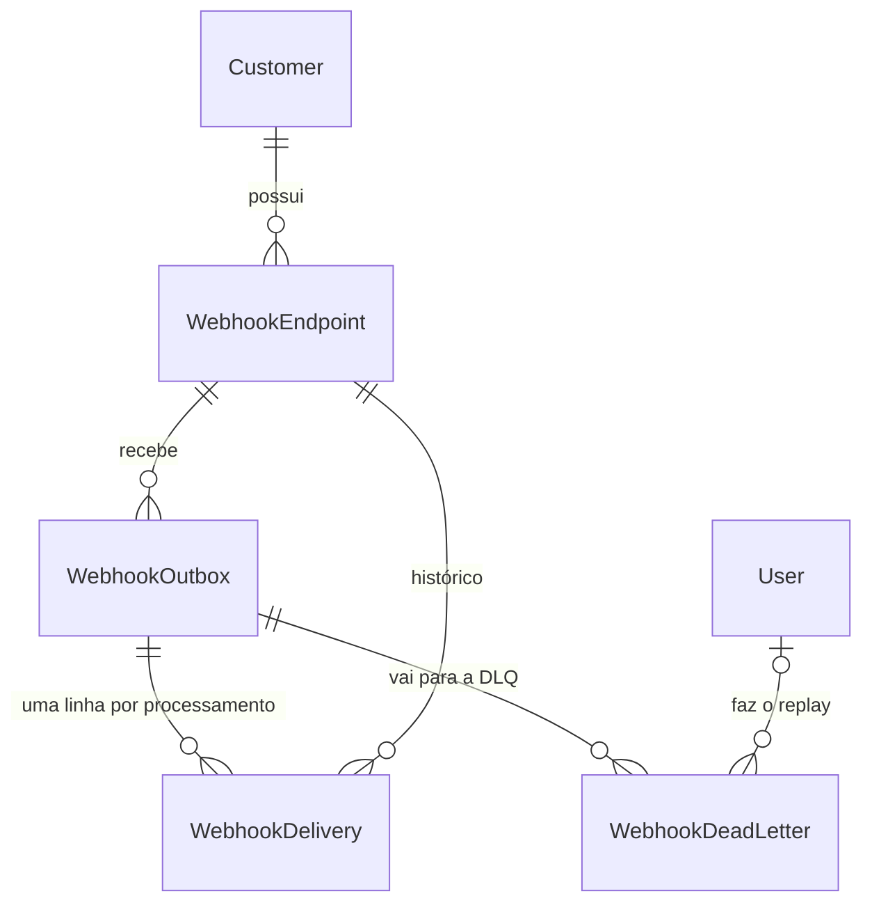
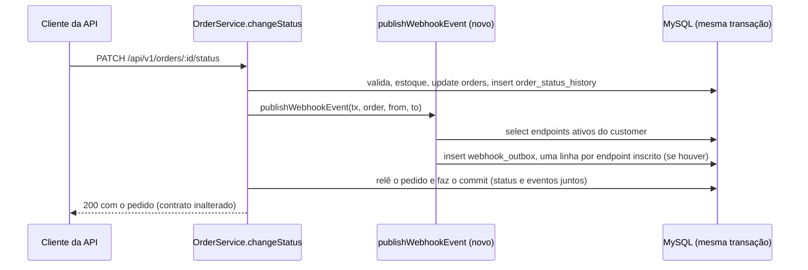
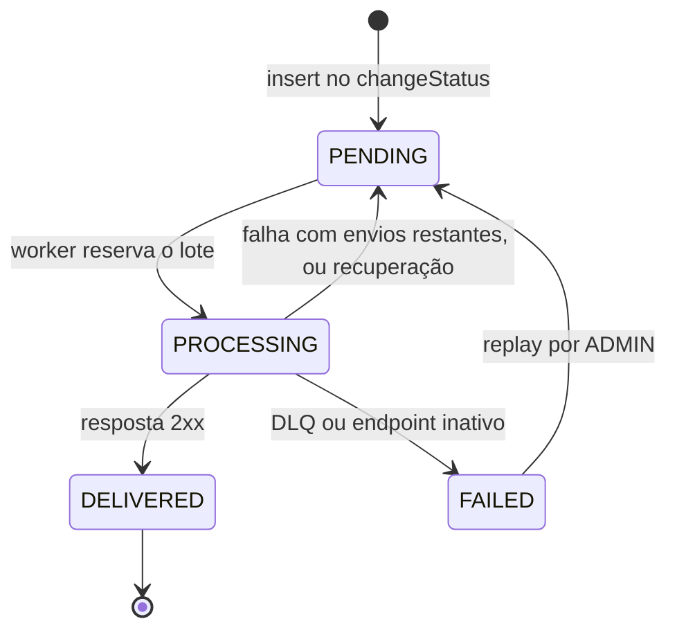
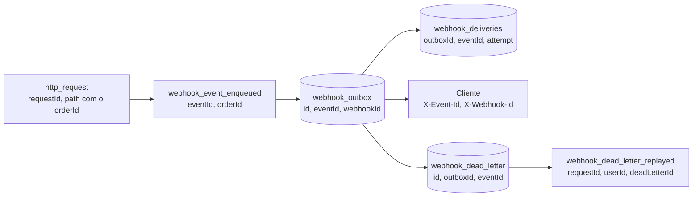

# FDD: Sistema de Webhooks de Notificação de Pedidos

| Campo | Valor |
| --- | --- |
| Feature | Sistema de Webhooks de Notificação de Pedidos (evento `order.status_changed`) |
| Autora | Larissa (Tech Lead). Redação: João Paulo Constantino, com apoio de IA |
| Status | Rascunho para implementação |
| Data | 2026-10-16 |
| Revisores | Bruno e Diego, na sessão de revisão antes de codar ([09:50] Larissa); Sofia, na revisão de segurança antes do deploy ([09:46] Sofia) |
| Documentos | [PRD](./PRD.md) · [RFC](./RFC.md) · [ADRs](./adrs/README.md) |

Este documento diz **como construir**. O porquê de cada decisão está nos ADRs; as questões em aberto, no [RFC](./RFC.md).

**Convenções**

- `[hh:mm] Nome` aponta para a [transcrição](../TRANSCRICAO.md); `arquivo:Lx-y`, para linhas do código atual.
- **(novo, a criar)**: arquivo que ainda não existe (lista na seção 4). **(proposta de implementação)**: o que a reunião não decidiu; pode mudar na revisão sem reabrir ADR.
- **PC-NN** e **OQ-NN** remetem aos pontos para confirmação e às questões em aberto do [RFC](./RFC.md). IDs deste documento: `OT`, `DADOS`, `FLUXO`, `CT`, `ERR`, `RES`, `OBS`, `INT`, `CAT` e `R`.
- Nomes: payload para o cliente em `snake_case` ([09:43] Diego); API de configuração em `camelCase`, como as respostas atuais (`tests/orders.test.ts:31-39`); tabelas novas em `snake_case` via `@@map`, colunas em `camelCase`, como as existentes (`prisma/migrations/20260519182739_init/migration.sql:50-69`).

## 1. Contexto e motivação técnica

**Problema.** Três clientes B2B consultam `GET /orders` de tempos em tempos para saber se os pedidos mudaram, o que deixa a integração "lenta e cara" ([09:00] Marcos). Para eles, "qualquer coisa abaixo de 10 segundos já é 'tempo real'" ([09:02] Marcos). O fluxo é só de saída ([09:02] Marcos).

**Código atual.** A mudança de status acontece em `OrderService.changeStatus` (`src/modules/orders/order.service.ts:126-179`), dentro de `this.prisma.$transaction` (L131): valida a transição (L140-149), mexe no estoque (L151-156), atualiza `orders` (L158), grava `order_status_history` (L159-167) e relê o pedido (L169-176). As transições válidas estão em `src/modules/orders/order.status.ts` (L3-10); `PENDING` só é status inicial, gravado na criação (`order.service.ts:106-113`). Não há eventos, fila nem cliente HTTP de saída, e o único entry-point é `src/server.ts`.

**Por que assíncrono.** Uma chamada HTTP dentro dessa transação faria "qualquer cliente lento" travar "mudança de status pra outros pedidos" ([09:04] Bruno). Por isso o evento vai para uma outbox na mesma transação, e um worker em outro processo faz a entrega. O porquê de cada escolha está nos ADRs que este FDD aplica:

- [ADR-001](./adrs/ADR-001-outbox-transacional-no-mysql.md): outbox na transação do `changeStatus`; falha na inserção desfaz a mudança de status.
- [ADR-002](./adrs/ADR-002-worker-em-processo-separado-com-polling.md): worker em processo separado, instância única, polling de 2s.
- [ADR-003](./adrs/ADR-003-retry-com-backoff-exponencial-e-dlq.md): 1 envio inicial + 5 retentativas (1m/5m/30m/2h/12h), DLQ em tabela e replay por ADMIN.
- [ADR-004](./adrs/ADR-004-assinatura-hmac-sha256-com-secret-por-endpoint.md): HMAC-SHA256 do corpo no `X-Signature`, secret por endpoint, a antiga válida por 24h após a rotação.
- [ADR-005](./adrs/ADR-005-entrega-at-least-once-com-x-event-id.md): at-least-once, com o mesmo `event_id` em retentativas, replay e todos os endpoints inscritos.
- [ADR-006](./adrs/ADR-006-reuso-dos-padroes-existentes-do-projeto.md): módulo no padrão dos outros, com `AppError`, Pino, Zod, `requireRole` e UUID; nenhuma dependência nova.
- [ADR-007](./adrs/ADR-007-payload-snapshot-enxuto-com-filtro-na-insercao.md): payload snapshot sem items, renderizado e filtrado na inserção.

## 2. Objetivos técnicos

Metas verificáveis da implementação; as de produto estão no [PRD](./PRD.md).

| ID | Objetivo | Meta mensurável | Como verificar | Fonte |
| --- | --- | --- | --- | --- |
| OT-01 | Latência do commit da mudança de status até a 1ª tentativa | Até 2s de polling, mais a fila do lote; ponta a ponta abaixo de 10s | OBS-01 | [09:02] Marcos, [09:09] Diego, [09:10] Larissa |
| OT-02 | Atomicidade entre status e evento | 0 mudanças de status commitadas sem a linha na outbox para cada endpoint ativo inscrito naquele status | CAT-01, CAT-02 | [09:06] Diego, [09:40] Bruno |
| OT-03 | Isolamento da transação de pedidos | 0 chamadas HTTP no `changeStatus`; a transação ganha só 1 leitura dos endpoints e 1 inserção em lote | CAT-01, revisão de código | [09:04] Bruno, [09:34] Bruno |
| OT-04 | Retry finito | Até 6 envios de cada evento para cada endpoint (1 + 5 retentativas), numa janela de 14h36m; depois, DLQ | CAT-08, CAT-09 | [09:15] Diego, [09:17] Larissa |
| OT-05 | Tempo máximo por chamada | 10s por tentativa; acima disso, falha com retry | CAT-07 | [09:42] Diego |
| OT-06 | Tamanho do payload | Até 64KB; acima disso, DLQ sem retry e sem bloquear a mudança de status | CAT-10 | [09:23] Sofia, [09:24] Larissa |
| OT-07 | Segurança de origem e transporte | 100% das entregas assinadas com HMAC-SHA256; 100% das URLs em `https` | CAT-04, CAT-06 | [09:22] Sofia, [09:23] Sofia |
| OT-08 | Sem stack nova | 0 dependências npm e 0 serviços de infraestrutura novos | `package.json` sem diff em `dependencies` | [09:07] Diego, [09:29] Bruno |

## 3. Escopo e exclusões

**Incluso nesta entrega**

- Evento `order.status_changed` gravado na outbox dentro do `changeStatus`, com filtro de status por endpoint aplicado na inserção (FLUXO-01; [09:40] Bruno, [09:34] Bruno).
- Worker em processo separado, com polling de 2s (FLUXO-02; [09:10] Larissa).
- HMAC-SHA256 com secret por endpoint e rotação (CT-05, CT-08, FLUXO-05; [09:22] Sofia).
- Retry 1m/5m/30m/2h/12h, DLQ em tabela separada e replay só por ADMIN, com registro de quem fez (FLUXO-03, FLUXO-04, CT-07; [09:17] Larissa, [09:36] Sofia).
- CRUD da configuração e histórico das últimas 100 entregas (CT-01 a CT-06; [09:31] Marcos, [09:33] Bruno, [09:34] Marcos).
- Recusa de URL sem `https` e de payload acima de 64KB (CT-01, FLUXO-02; [09:23] Sofia, [09:24] Larissa).

**Fora desta entrega**

| Item | Situação | Fonte |
| --- | --- | --- |
| Evento na criação do pedido | Não emitido: a criação grava `null → PENDING` por outro caminho (`order.service.ts:106-113`); leitura registrada no [ADR-007](./adrs/ADR-007-payload-snapshot-enxuto-com-filtro-na-insercao.md) | [09:40] Bruno |
| Webhooks de entrada | Descartado | [09:02] Marcos |
| Email ao cliente após falhas seguidas | "Talvez próxima fase, depois que a gente medir o impacto" (OQ-03 do RFC) | [09:37] Larissa |
| Rate limiting de saída | "observar e decidir depois" (OQ-01 do RFC) | [09:39] Larissa |
| Dashboard para o cliente | "Painel é projeto separado do time de frontend" | [09:40] Larissa |
| Arquivamento das linhas entregues | Fora do escopo desta feature (OQ-05 do RFC) | [09:08] Diego |
| Vários workers em paralelo | "problema do futuro, não agora" (OQ-02 do RFC) | [09:13] Diego |
| Exactly-once | Descartado | [09:25] Diego |
| Items do pedido no payload | Descartado; o cliente consulta `GET /orders/:id` | [09:43] Diego |
| Autorização do CRUD por dono do customer | "Mais pra frente a gente pode endurecer" (OQ-04 do RFC) | [09:37] Sofia |
| Endpoint para listar a DLQ | Não previsto (PC-05 do RFC) | [09:18] Diego |
| Biblioteca de métricas ou tracing | "Não vamos botar nada novo" (seção 10) | [09:29] Bruno |

## 4. Arquivos novos (a criar)

Nenhum destes arquivos existe hoje, e nenhum serve como origem `CODIGO` no tracker. Os existentes que mudam estão na seção 11.

| Caminho | Responsabilidade |
| --- | --- |
| `src/worker.ts` (novo, a criar) | Entry-point do worker: carrega `env` e o Prisma client do processo, inicia o loop, trata `SIGINT`/`SIGTERM` |
| `src/modules/webhooks/webhook.routes.ts` (novo, a criar) | `buildWebhookRouter` (CT-01 a CT-06) e `buildWebhookAdminRouter` (CT-07) |
| `src/modules/webhooks/webhook.controller.ts` (novo, a criar) | `WebhookController`: handlers com `try/catch` e `next(err)` |
| `src/modules/webhooks/webhook.service.ts` (novo, a criar) | `WebhookService`: CRUD, checagem de `https`, secret, rotação e replay |
| `src/modules/webhooks/webhook.repository.ts` (novo, a criar) | `WebhookRepository`: acesso às tabelas novas pela API |
| `src/modules/webhooks/webhook.schemas.ts` (novo, a criar) | Schemas Zod (seção 7) |
| `src/modules/webhooks/webhook.worker.ts` (novo, a criar) | `WebhookWorker`: polling, envio, retry, DLQ, recuperação, parada controlada |
| `src/modules/webhooks/webhook.publisher.ts` (novo, a criar) | `publishWebhookEvent`, chamada pelo `changeStatus` |
| `src/modules/webhooks/webhook.signer.ts` (novo, a criar) | Geração da secret e cálculo do `X-Signature` |
| `src/modules/webhooks/webhook.errors.ts` (novo, a criar) | Classes de erro e códigos de entrega (seção 8) |
| `prisma/migrations/<timestamp>_webhooks/migration.sql` (novo, a criar) | Migration aditiva gerada por `npm run db:migrate` |
| `tests/webhooks.test.ts` (novo, a criar) | Testes da seção 13, no padrão de `tests/orders.test.ts` |

Origem dos nomes: o entry-point do worker vem de [09:11] Larissa; o módulo segue o padrão dos existentes ([09:27] Bruno); `webhook.worker.ts` é de [09:28] Bruno, que também citou `src/modules/webhooks/webhook.processor.ts` (novo, a criar), nome não usado; a função `publishWebhookEvent` é de [09:41] Bruno. Os arquivos `publisher`, `signer` e `errors` são propostas de organização, e juntá-los ao `webhook.service.ts` também atende às decisões.

## 5. Modelo de dados

Quatro tabelas e um enum novos em `prisma/schema.prisma`, no padrão do arquivo: id UUID `@db.Char(36)` ([09:51] Larissa), `@@map` e `@@index` nas chaves estrangeiras, como `Order` (`prisma/schema.prisma:74-97`). A reunião nomeou `webhook_outbox` ([09:06] Diego) e `webhook_dead_letter` ([09:18] Diego); `webhook_endpoints` e `webhook_deliveries` são nomes propostos.



### DADOS-01 a DADOS-06: models Prisma

```prisma
// DADOS-01
enum WebhookOutboxStatus {
  PENDING
  PROCESSING
  DELIVERED
  FAILED
}

// DADOS-02
model WebhookEndpoint {
  id                      String    @id @default(uuid()) @db.Char(36)
  customerId              String    @db.Char(36)
  url                     String    @db.VarChar(2048)
  secret                  String    @db.VarChar(255)
  previousSecret          String?   @db.VarChar(255)
  previousSecretExpiresAt DateTime?
  events                  Json
  active                  Boolean   @default(true)
  deletedAt               DateTime?
  createdAt               DateTime  @default(now())
  updatedAt               DateTime  @updatedAt
  customer    Customer            @relation(fields: [customerId], references: [id])
  outbox      WebhookOutbox[]
  deliveries  WebhookDelivery[]
  deadLetters WebhookDeadLetter[]
  @@index([customerId])
  @@map("webhook_endpoints")
}

// DADOS-03
model WebhookOutbox {
  id            String              @id @default(uuid()) @db.Char(36)
  eventId       String              @db.Char(36)
  webhookId     String              @db.Char(36)
  orderId       String              @db.Char(36)
  eventType     String              @db.VarChar(64)
  payload       Json
  status        WebhookOutboxStatus @default(PENDING)
  attempts      Int                 @default(0)
  nextAttemptAt DateTime            @default(now())
  lastError     String?             @db.VarChar(64)
  createdAt     DateTime            @default(now())
  updatedAt     DateTime            @updatedAt
  webhook     WebhookEndpoint     @relation(fields: [webhookId], references: [id])
  deliveries  WebhookDelivery[]
  deadLetters WebhookDeadLetter[]
  @@unique([eventId, webhookId])
  @@index([status, createdAt])
  @@index([webhookId])
  @@index([orderId])
  @@map("webhook_outbox")
}

// DADOS-04
model WebhookDelivery {
  id             String   @id @default(uuid()) @db.Char(36)
  outboxId       String   @db.Char(36)
  webhookId      String   @db.Char(36)
  eventId        String   @db.Char(36)
  attempt        Int
  success        Boolean
  responseStatus Int?
  responseBody   String?  @db.Text
  durationMs     Int
  errorCode      String?  @db.VarChar(64)
  deadLetterId   String?  @db.Char(36)
  createdAt      DateTime @default(now())
  outbox  WebhookOutbox   @relation(fields: [outboxId], references: [id])
  webhook WebhookEndpoint @relation(fields: [webhookId], references: [id])
  @@index([webhookId, createdAt])
  @@index([outboxId])
  @@map("webhook_deliveries")
}

// DADOS-05
model WebhookDeadLetter {
  id            String    @id @default(uuid()) @db.Char(36)
  outboxId      String    @db.Char(36)
  webhookId     String    @db.Char(36)
  eventId       String    @db.Char(36)
  payload       Json
  reason        String    @db.VarChar(64)
  lastErrorCode String?   @db.VarChar(64)
  failedAt      DateTime  @default(now())
  replayedAt    DateTime?
  replayedById  String?   @db.Char(36)
  outbox     WebhookOutbox   @relation(fields: [outboxId], references: [id])
  webhook    WebhookEndpoint @relation(fields: [webhookId], references: [id])
  replayedBy User?           @relation("DeadLetterReplayedBy", fields: [replayedById], references: [id])
  @@index([webhookId])
  @@index([outboxId])
  @@index([failedAt])
  @@map("webhook_dead_letter")
}

// DADOS-06: lado inverso nos models existentes
// model Customer { ... webhookEndpoints WebhookEndpoint[] }
// model User     { ... replayedDeadLetters WebhookDeadLetter[] @relation("DeadLetterReplayedBy") }
```

### Regras por tabela

**DADOS-01** guarda os estados da outbox citados em [09:08] Diego (pendente, processando, falhou, entregue).

**DADOS-02 `webhook_endpoints`** (configuração com URL, secret, customer e "estado ativo", [09:21] Bruno)

| Campo | Regra | Origem |
| --- | --- | --- |
| `customerId` | Não vem do JWT. A reunião deixou "no body ou no path"; este FDD usa o body (proposta de implementação; ver CT-01). FK para `customers` | [09:32] Larissa |
| `url` | `https` obrigatório (ERR-02) | [09:23] Sofia |
| `secret` | Gerada pela plataforma; sai só no cadastro e na rotação. Precisa ser recuperável (o HMAC é recalculado a cada envio); em claro ou cifrada, decide a revisão de segurança (PC-04 do RFC) | [09:31] Marcos, [09:46] Sofia |
| `previousSecret`, `previousSecretExpiresAt` | Secret anterior e fim da validade (rotação + 24h); uma só por vez (proposta de implementação) | [09:21] Sofia |
| `events` | Lista JSON não vazia, sem repetição, só de status que são destino de transição: `PAID`, `PROCESSING`, `SHIPPED`, `DELIVERED`, `CANCELLED` (proposta de implementação) | [09:33] Marcos |
| `active` | Inativo não recebe eventos novos; os pendentes são encerrados pelo worker (ERR-16) | [09:21] Bruno |
| `deletedAt` | Remoção lógica: o DELETE preenche `deletedAt` e grava `active = false`; histórico e DLQ ficam no banco (proposta de implementação) | [09:33] Bruno, [09:18] Diego |

Sem tabela de junção para `events`: o filtro em memória supõe poucos endpoints por customer; se isso mudar, vai para o SQL com `JSON_CONTAINS` (proposta de implementação).

**DADOS-03 `webhook_outbox`** (uma linha por evento × endpoint inscrito)

| Campo | Regra | Origem |
| --- | --- | --- |
| `eventId` | UUID gerado uma vez por mudança de status e repetido nas linhas de todos os endpoints inscritos; único com `webhookId` ([ADR-005](./adrs/ADR-005-entrega-at-least-once-com-x-event-id.md)) | [09:25] Diego |
| `payload` | Snapshot `snake_case` renderizado na inserção (CT-08) | [09:52] Bruno |
| `status` | `PENDING` → `PROCESSING` → `DELIVERED` ou `FAILED`; falha com envios restantes volta a `PENDING` | [09:08] Diego |
| `attempts`, `nextAttemptAt`, `lastError` | Envios feitos (0 a 6); quando a linha pode ser lida de novo; último código de entrega (ERR-10 a ERR-16). As duas últimas são proposta de implementação | [09:17] Larissa, [09:17] Diego |
| `orderId` | Sem FK (proposta de implementação): `DELETE /orders/:id` apaga pedidos `CANCELLED` (`order.service.ts:181-192`). Com `RESTRICT`, esse delete falharia com `P2003`, que vira 500 (`error.middleware.ts:37-54`); com `CASCADE`, apagaria a evidência da DLQ | código atual |

O índice `(status, createdAt)` atende "índice no campo de status" e "em created_at" ([09:08] Diego) e a leitura do worker; juntar os dois num composto é proposta de implementação.

**DADOS-04 `webhook_deliveries`.** Uma linha por processamento: cada tentativa HTTP e cada encerramento sem chamada (payload grande, secret ausente, endpoint inativo). É o histórico pedido em [09:34] Marcos, com o `deadLetterId` (PC-05 do RFC). `responseBody` guarda até 4.096 caracteres, e o payload é lido da outbox, sem cópia por tentativa (proposta de implementação).

**DADOS-05 `webhook_dead_letter`** (payload, motivo e timestamp, [09:18] Diego). `reason` é `WEBHOOK_MAX_ATTEMPTS_EXCEEDED`, `WEBHOOK_PAYLOAD_TOO_LARGE` ou `WEBHOOK_SECRET_REQUIRED`; no esgotamento, `lastErrorCode` guarda o erro da última tentativa. `replayedAt` e `replayedById` registram o replay, além do log de [09:36] Sofia; cada linha aceita um único replay, e uma nova falha gera outra linha (proposta de implementação).

**DADOS-06 relações inversas.** `Customer` (`prisma/schema.prisma:40-54`) ganha `webhookEndpoints` e `User` (`prisma/schema.prisma:25-38`), `replayedDeadLetters`. Nenhuma coluna existente muda.

## 6. Fluxos detalhados

### FLUXO-01: criação do evento na outbox

Dentro da transação do `changeStatus`, sem chamada HTTP ([09:40] Bruno, [09:41] Bruno).



1. Depois do `orderStatusHistory.create` (`order.service.ts:159-167`) e antes da releitura (L169), o service chama `publishWebhookEvent(tx, order, from, to)` (INT-01), com o `order` lido em L132-135 e `from`/`to` de L138-139.
2. A função lê os endpoints ativos e não removidos do customer e fica com os que têm `to` em `events`. Sem inscritos, retorna 0: "Se nenhum webhook do customer quer aquele status, nem insere" ([09:34] Bruno).
3. Gera **um** `eventId` e renderiza o snapshot uma vez ([09:52] Larissa, [09:52] Bruno), com o `timestamp` desta chamada (CT-08).
4. `createMany` em `webhook_outbox`: uma linha por endpoint inscrito, mesmo `eventId`, `PENDING`, `attempts = 0` e `nextAttemptAt = now()`.
5. Qualquer exceção desfaz a transação inteira, status incluído: "Se a outbox falhar de inserir, rollback" ([09:40] Bruno).
6. Log `webhook_event_enqueued` (OBS-10), emitido dentro da transação; a fonte de verdade é a tabela.

```ts
// src/modules/webhooks/webhook.publisher.ts (novo, a criar)
export const ORDER_STATUS_CHANGED = 'order.status_changed';
export async function publishWebhookEvent(
  tx: Prisma.TransactionClient, // TxClient (order.service.ts:24) não é exportado
  order: Pick<Order, 'id' | 'orderNumber' | 'customerId' | 'totalCents'>,
  fromStatus: OrderStatus,
  toStatus: OrderStatus,
): Promise<number>; // linhas inseridas; 0 quando nenhum endpoint quer o status
```

### FLUXO-02: processamento pelo worker

Outro processo ([09:11] Diego), com entry-point `src/worker.ts` (novo, a criar) no molde de `src/server.ts` ([09:11] Larissa) e lógica em `src/modules/webhooks/webhook.worker.ts` (novo, a criar) ([09:28] Bruno).

```mermaid
sequenceDiagram
  participant W as WebhookWorker (processo separado)
  participant DB as MySQL
  participant EP as Endpoint do cliente
  W->>DB: na partida, PROCESSING volta a PENDING
  loop a cada 2s
    W->>DB: lê PENDING vencidos, mais antigos primeiro, e reserva como PROCESSING
    loop cada linha, em ordem
      alt endpoint inativo, sem secret ou corpo acima de 64KB
        W->>DB: FAILED (com DLQ, exceto endpoint inativo)
      else pronto para enviar
        W->>EP: POST assinado, timeout de 10s
        W->>DB: 2xx vira DELIVERED; o resto segue o FLUXO-03
      end
    end
  end
```

```ts
// src/modules/webhooks/webhook.worker.ts (novo, a criar)
const POLL_INTERVAL_MS = 2_000; // [09:09] Diego
const REQUEST_TIMEOUT_MS = 10_000; // [09:42] Diego
const BACKOFF_MS = [60_000, 300_000, 1_800_000, 7_200_000, 43_200_000]; // 1m/5m/30m/2h/12h
const MAX_SENDS = 1 + BACKOFF_MS.length; // 6 envios de cada evento para cada endpoint
const MAX_PAYLOAD_BYTES = 64 * 1024; // 64KB
const BATCH_SIZE = 10; // proposta de implementação
const RESPONSE_BODY_LIMIT = 4_096; // proposta de implementação
```

1. **Partida** com o `env`, o `logger` e o `prisma` existentes; no processo do worker, o `prisma` é uma instância própria com a mesma `DATABASE_URL` (INT-08, INT-09).
2. **Recuperação** (proposta de implementação): antes do 1º ciclo, `PROCESSING` volta a `PENDING`. Com um único worker ([09:12] Diego), só pode ser resto de execução interrompida, e o reenvio é coberto pelo at-least-once ([09:24] Diego).
3. **Leitura**: `PENDING` com `nextAttemptAt <= now()`, por `createdAt` crescente, até `BATCH_SIZE`: "busca os eventos pendentes mais antigos" ([09:09] Diego), "em batch pequeno" ([09:08] Diego).
4. **Reserva**: `updateMany` para `PROCESSING`, condicionado a `status = PENDING`.
5. **Envio sequencial**, na ordem lida: paralelizar teria o efeito de vários workers, que perdem a garantia de ordem ([09:12] Diego). Para cada linha:
   1. lê o endpoint; usa a URL atual do cadastro e o payload do snapshot (proposta de implementação);
   2. inativo ou removido: `FAILED` com ERR-16, sem DLQ;
   3. sem secret utilizável: DLQ com ERR-14 (guarda defensiva);
   4. corpo acima de 64KB (65.536 bytes em UTF-8): DLQ com ERR-13, sem retry e sem afetar o status já commitado;
   5. assina o corpo e monta os headers (CT-08);
   6. envia com `fetch` nativo: `POST`, `redirect: 'manual'` (um 3xx é falha; proposta de implementação) e `signal: AbortSignal.timeout(REQUEST_TIMEOUT_MS)` ([09:42] Diego);
   7. 2xx: `DELIVERED`, `attempts + 1` e entrega com `success = true` (só 2xx como sucesso é proposta de implementação). Outro status vira ERR-11; `TimeoutError`, ERR-10; outro erro do `fetch`, ERR-12; os três seguem o FLUXO-03.
6. **Espera** de 2s a partir do fim do ciclo, sem sobreposição ([09:10] Larissa: "Worker em polling, 2s"; a não sobreposição é proposta de implementação).
7. **Erro no ciclo**: log `webhook_worker_cycle_failed`, tenta devolver o lote a `PENDING` e recomeça em 2s; o que ficar preso sai no passo 2 da próxima partida.
8. **Parada controlada** (`SIGINT`/`SIGTERM`, como `src/server.ts:20-21`): termina o envio em andamento (até 10s), devolve o resto do lote, chama `prisma.$disconnect()` e sai com código 0.

### FLUXO-03: retry com backoff

"5 tentativas, backoff 1m/5m/30m/2h/12h" ([09:17] Larissa), lido como **1 envio inicial + 5 retentativas**: no máximo 6 envios de cada evento para cada endpoint ([ADR-003](./adrs/ADR-003-retry-com-backoff-exponencial-e-dlq.md); PC-01 do RFC).

| Envio | Quando é feito | Se falhar, espera | `attempts` depois da falha | Tempo desde a 1ª falha |
| --- | --- | --- | --- | --- |
| 1 | Até 2s depois do commit, mais a fila do lote | 1m | 1 | 0 |
| 2 | 1m depois da falha anterior | 5m | 2 | 1m |
| 3 | 5m depois | 30m | 3 | 6m |
| 4 | 30m depois | 2h | 4 | 36m |
| 5 | 2h depois | 12h | 5 | 2h36m |
| 6 | 12h depois | DLQ (`WEBHOOK_MAX_ATTEMPTS_EXCEEDED`) | 6 | **14h36m** |

A espera conta do fim da tentativa que falhou (mais até 2s de polling). Em cada falha, numa transação, o worker grava a entrega (`success = false`, `errorCode`, resposta e `durationMs`) e incrementa `attempts`. Abaixo de 6, a linha volta a `PENDING` com `nextAttemptAt = now() + BACKOFF_MS[attempts - 1]` e `lastError`, e sai o log `webhook_retry_scheduled`; em 6, segue o FLUXO-04. ERR-13 e ERR-14 vão direto para a DLQ e ERR-16 encerra sem DLQ, porque repetir daria o mesmo resultado; para o 64KB, é a leitura do ADR-003 para o "erro caso ultrapasse" de [09:24] Larissa.



### FLUXO-04: DLQ e replay

**Entrada na DLQ** (6ª falha, ERR-13 ou ERR-14), numa transação: cria a linha em `webhook_dead_letter` "com a payload, motivo da falha e timestamp" ([09:18] Diego), grava a entrega com `deadLetterId` e marca a outbox como `FAILED`. Depois do commit, o log `webhook_moved_to_dead_letter` traz o `deadLetterId`; com ele e com o histórico (CT-06), o ADMIN acha o id do replay sem endpoint de listagem (PC-05 do RFC).

**Replay** (CT-07): "Recoloca na outbox como pendente" ([09:18] Diego).

```mermaid
sequenceDiagram
  participant A as ADMIN
  participant S as WebhookService.replayDeadLetter
  participant DB as MySQL
  A->>S: POST .../dead-letter/:id/replay (authenticate, requireRole ADMIN)
  S->>DB: transação: marca a DLQ como reprocessada e devolve a outbox a PENDING
  alt id inexistente ou replay já feito
    S-->>A: 404 ou 409
  else ok
    S-->>A: 202; o worker entrega no próximo ciclo (até 2s)
  end
```

1. `authenticate` e `requireRole('ADMIN')`: "a gente reaproveita o requireRole que já existe" ([09:36] Larissa). OPERATOR recebe 403.
2. `updateMany` na DLQ com `where: { id, replayedAt: null }`, gravando `replayedAt` e `replayedById`; se nada mudar, uma leitura pelo id decide entre 404 e 409. O `where` condicional também barra replays simultâneos (proposta de implementação).
3. Na mesma transação, a outbox volta a `PENDING` com `attempts = 0`, `nextAttemptAt = now()`, `lastError = null` e o mesmo `eventId`, para o cliente deduplicar ([09:25] Diego). Zerar `attempts` devolve os 6 envios (proposta de implementação).
4. Log `webhook_dead_letter_replayed` com `userId` e `requestId`: "tem que logar quem fez o replay, pra auditoria" ([09:36] Sofia).
5. Com o endpoint inativo, o worker encerra a linha com ERR-16; para reprocessar, é preciso reativá-lo antes (CT-03). Endpoint removido não pode ser reativado, e o replay só encerra a linha.

### FLUXO-05: rotação da secret

Regra da rotação: "a antiga fica válida por 24 horas em paralelo" ([09:21] Sofia).

1. CT-05 carrega o endpoint (removido: 404 `WEBHOOK_NOT_FOUND`) e grava, numa única atualização, `previousSecret = secret atual`, `previousSecretExpiresAt = now() + 24h` e `secret = generateSecret()`. Uma nova rotação na janela descarta a secret mais antiga: só há uma anterior por vez (proposta de implementação).
2. Enquanto `previousSecretExpiresAt > X-Timestamp`, o worker envia também a assinatura com a secret anterior. As duas assinaturas no mesmo header são proposta a validar na revisão de segurança (PC-02 do RFC).
3. A nova secret sai uma única vez na resposta; o log `webhook_secret_rotated` não a inclui.

### FLUXO-06: desativação e remoção do endpoint

1. `PATCH` com `active: false` (CT-03) ou `DELETE` (CT-04, que também preenche `deletedAt`).
2. Eventos novos param na hora: o filtro da inserção ignora endpoints inativos (FLUXO-01, passo 2).
3. Linhas já na outbox são encerradas quando vencem, com `FAILED`, ERR-16 e uma entrega registrada, sem DLQ (proposta de implementação). Uma linha em espera de retry só é encerrada quando a espera vence; se o endpoint for reativado antes, o retry segue.
4. Histórico e DLQ continuam no banco, e CT-06 responde também para endpoints removidos.

## 7. Contratos públicos

**Convenções da API (CT-01 a CT-07)**

- Prefixo `/api/v1` (`src/app.ts:67`), JSON em `camelCase` e `X-Request-Id` em toda resposta (`src/middlewares/request-logger.middleware.ts:6-8`).
- `Authorization: Bearer <JWT>` validado por `authenticate` (`src/middlewares/auth.middleware.ts:27-47`); sem token válido, `401 UNAUTHORIZED` em todas as rotas (não repetido nas tabelas). CT-01 a CT-06 aceitam qualquer role, "Por enquanto sim" ([09:37] Sofia); CT-07 exige `ADMIN` ([09:36] Larissa).
- **Representação do webhook** (CT-01 a CT-03): `id`, `customerId`, `url`, `events`, `active`, `previousSecretExpiresAt`, `createdAt` e `updatedAt`. `secret` e `previousSecret` **nunca** aparecem nela; a secret só sai em CT-01 e CT-05.
- **Erros** no formato do `errorMiddleware` (`src/middlewares/error.middleware.ts:15-24`), igual em todos os contratos. Exemplo de CT-01 com URL `http`:

```json
{
  "error": {
    "code": "WEBHOOK_INVALID_URL",
    "message": "Webhook URL must use https",
    "details": { "url": "http://erp.atlas.example/webhooks/oms" }
  }
}
```

Falha de schema vira `400 VALIDATION_ERROR` com `details` em lista de `{ path, message }` (`src/middlewares/validate.middleware.ts:25-33`). Cada contrato traz só a sua tabela de status e códigos.

| ID | Método e rota | Auth | Fonte |
| --- | --- | --- | --- |
| CT-01 | `POST /api/v1/webhooks` | autenticado | [09:31] Marcos |
| CT-02 | `GET /api/v1/webhooks?customerId=` | autenticado | [09:33] Bruno |
| CT-03 | `PATCH /api/v1/webhooks/:id` | autenticado | [09:33] Bruno |
| CT-04 | `DELETE /api/v1/webhooks/:id` | autenticado | [09:33] Bruno |
| CT-05 | `POST /api/v1/webhooks/:id/secret/rotate` | autenticado | [09:21] Sofia |
| CT-06 | `GET /api/v1/webhooks/:id/deliveries` | autenticado | [09:34] Marcos |
| CT-07 | `POST /api/v1/admin/webhooks/dead-letter/:id/replay` | `ADMIN` | [09:18] Diego, [09:36] Sofia |
| CT-08 | Saída: `POST <url do endpoint>` | HMAC no `X-Signature` | [09:43] Diego, [09:44] Diego |

As rotas de CT-06 e CT-07 foram ditas na reunião; CT-01 a CT-04 aplicam o padrão REST dos módulos ao "Endpoint POST" ([09:31] Marcos) e aos verbos de [09:33] Bruno; o path de CT-05 é proposta de implementação.

**Schemas Zod** em `src/modules/webhooks/webhook.schemas.ts` (novo, a criar):

| Schema | Campos e regras |
| --- | --- |
| `createWebhookSchema` (body de CT-01) | `customerId` UUID; `url` com `z.string().url().max(2048)`; `events` |
| `updateWebhookSchema` (body de CT-03) | `url`, `events` e `active` (boolean), todos opcionais, com pelo menos um presente |
| `listWebhooksQuerySchema` (query de CT-02) | `customerId` UUID obrigatório; `page` ≥ 1 (padrão 1) e `pageSize` de 1 a 100 (padrão 20), com `z.coerce` |
| `webhookIdParamSchema`, `deadLetterIdParamSchema` | `id` UUID |
| `events` (regra comum) | `z.array(z.nativeEnum(OrderStatus))` com `.min(1)`, só valores de `SUBSCRIBABLE_STATUSES` (derivado de `allowedTransitions`, porque `transitions` não é exportado; INT-02) e sem repetição |

A recusa de `http` foi pedida como "erro de validação" no "schema Zod" ([09:23] Sofia), com o código `WEBHOOK_INVALID_URL` ([09:28] Bruno). Para ter os dois, o Zod valida o formato e o `WebhookService` checa o protocolo (ERR-02); só no Zod, a resposta seria `VALIDATION_ERROR`.

### CT-01: cadastrar webhook

```http
POST /api/v1/webhooks HTTP/1.1
Authorization: Bearer <JWT>
Content-Type: application/json

{"customerId": "6f1c2a9e-3b4d-4c5e-8f70-1a2b3c4d5e6f", "url": "https://erp.atlas.example/webhooks/oms", "events": ["SHIPPED", "DELIVERED"]}
```

Resposta `201 Created`:

```json
{
  "id": "3f1a8c2e-7d6b-4e5f-9a01-b2c3d4e5f607", "customerId": "6f1c2a9e-3b4d-4c5e-8f70-1a2b3c4d5e6f",
  "url": "https://erp.atlas.example/webhooks/oms", "events": ["SHIPPED", "DELIVERED"], "active": true,
  "secret": "9c4e1a7f3b2d8e6a0f5c9b1d7e3a2f8c6b4d0e9a1c7f5b3e2d8a6c4f0b9e1d7a",
  "previousSecretExpiresAt": null, "createdAt": "2026-10-20T13:58:02.341Z", "updatedAt": "2026-10-20T13:58:02.341Z"
}
```

| Status | Código | Quando |
| --- | --- | --- |
| 201 | — | Cadastro criado |
| 400 | `VALIDATION_ERROR` | `customerId` não UUID, URL malformada, `events` vazio, com status desconhecido ou com `PENDING` |
| 400 | `WEBHOOK_INVALID_URL` | URL sem `https` (ERR-02) |
| 404 | `NOT_FOUND` | Customer inexistente, via `NotFoundError('Customer')` (`src/modules/customers/customer.service.ts:23-27`) |

**Semântica.** Não idempotente: cada chamada cria um cadastro com secret própria, devolvida só aqui ([09:31] Marcos). Um customer pode ter vários, até com a mesma URL ([09:44] Sofia), sem checagem de duplicata (proposta de implementação). O customer é "passado no body ou no path. Não vem do JWT" ([09:32] Larissa); este FDD usa o body, como `createOrderSchema` (`src/modules/orders/order.schemas.ts:11-16`) (proposta de implementação). Vale para mudanças de status futuras.

### CT-02: listar os webhooks de um customer

```http
GET /api/v1/webhooks?customerId=6f1c2a9e-3b4d-4c5e-8f70-1a2b3c4d5e6f&page=1&pageSize=20 HTTP/1.1
Authorization: Bearer <JWT>
```

Resposta `200 OK`, no formato de `paginated()` (`src/shared/http/response.ts:22-24`):

```json
{
  "data": [{
    "id": "3f1a8c2e-7d6b-4e5f-9a01-b2c3d4e5f607", "customerId": "6f1c2a9e-3b4d-4c5e-8f70-1a2b3c4d5e6f",
    "url": "https://erp.atlas.example/webhooks/oms", "events": ["SHIPPED", "DELIVERED"], "active": true,
    "previousSecretExpiresAt": null, "createdAt": "2026-10-20T13:58:02.341Z", "updatedAt": "2026-10-20T13:58:02.341Z"
  }],
  "pagination": { "page": 1, "pageSize": 20, "total": 1, "totalPages": 1 }
}
```

| Status | Código | Quando |
| --- | --- | --- |
| 200 | — | Lista, possivelmente vazia |
| 400 | `VALIDATION_ERROR` | `customerId` ausente ou não UUID; `page`/`pageSize` fora da faixa |

**Semântica.** Só leitura. `customerId` na query, paginação como `GET /orders` (`src/modules/orders/order.schemas.ts:23-30`) e ordem por `createdAt` decrescente são proposta de implementação. Customer inexistente devolve lista vazia, como `GET /orders?customerId=` hoje; removidos não aparecem.

### CT-03: editar webhook

```http
PATCH /api/v1/webhooks/3f1a8c2e-7d6b-4e5f-9a01-b2c3d4e5f607 HTTP/1.1
Authorization: Bearer <JWT>
Content-Type: application/json

{"url": "https://erp.atlas.example/v2/webhooks/oms", "events": ["PROCESSING", "SHIPPED", "DELIVERED"]}
```

Resposta `200 OK`:

```json
{
  "id": "3f1a8c2e-7d6b-4e5f-9a01-b2c3d4e5f607", "customerId": "6f1c2a9e-3b4d-4c5e-8f70-1a2b3c4d5e6f",
  "url": "https://erp.atlas.example/v2/webhooks/oms", "events": ["PROCESSING", "SHIPPED", "DELIVERED"], "active": true,
  "previousSecretExpiresAt": null, "createdAt": "2026-10-20T13:58:02.341Z", "updatedAt": "2026-10-20T15:12:40.905Z"
}
```

| Status | Código | Quando |
| --- | --- | --- |
| 200 | — | Atualizado |
| 400 | `VALIDATION_ERROR` | Body vazio, campo inválido ou `id` não UUID |
| 400 | `WEBHOOK_INVALID_URL` | Nova URL sem `https` |
| 404 | `WEBHOOK_NOT_FOUND` | Id inexistente ou endpoint removido (ERR-01) |

**Semântica.** Idempotente. `customerId` e `secret` não são editáveis (a secret só muda por CT-05). `active` é o "estado ativo" ([09:21] Bruno); com `false`, vale o FLUXO-06. `events` vale para mudanças futuras; `url` e `active` são lidos pelo worker a cada envio e afetam também linhas pendentes (proposta de implementação).

### CT-04: remover webhook

```http
DELETE /api/v1/webhooks/3f1a8c2e-7d6b-4e5f-9a01-b2c3d4e5f607 HTTP/1.1
Authorization: Bearer <JWT>
```

Resposta `204 No Content`, sem corpo, como `DELETE /orders/:id` (`src/modules/orders/order.controller.ts:48-55`).

| Status | Código | Quando |
| --- | --- | --- |
| 204 | — | Removido |
| 400 | `VALIDATION_ERROR` | `id` não UUID |
| 404 | `WEBHOOK_NOT_FOUND` | Id inexistente ou já removido |

**Semântica.** Remoção lógica (proposta de implementação): `deletedAt` preenchido e `active = false`; o endpoint sai da listagem e segue o FLUXO-06. Histórico e DLQ ficam como "evidence pra debug e reprocessamento" ([09:18] Diego). Repetir devolve 404.

### CT-05: rotacionar a secret

```http
POST /api/v1/webhooks/3f1a8c2e-7d6b-4e5f-9a01-b2c3d4e5f607/secret/rotate HTTP/1.1
Authorization: Bearer <JWT>
```

Resposta `200 OK`:

```json
{
  "id": "3f1a8c2e-7d6b-4e5f-9a01-b2c3d4e5f607",
  "secret": "5a0e7c3f9b1d6e2a8c4f0b7d3e9a5c1f6b2d8e4a0c7f3b9d5e1a6c2f8b4d0e7a",
  "previousSecretExpiresAt": "2026-10-21T16:20:05.118Z"
}
```

| Status | Código | Quando |
| --- | --- | --- |
| 200 | — | Nova secret gerada |
| 400 | `VALIDATION_ERROR` | `id` não UUID |
| 404 | `WEBHOOK_NOT_FOUND` | Id inexistente ou endpoint removido |

**Semântica.** Sem body e não idempotente: cada chamada gera secret nova e reinicia a janela de 24h (FLUXO-05). Funciona com o endpoint inativo.

### CT-06: histórico de entregas

```http
GET /api/v1/webhooks/3f1a8c2e-7d6b-4e5f-9a01-b2c3d4e5f607/deliveries HTTP/1.1
Authorization: Bearer <JWT>
```

Resposta `200 OK`, com um item de exemplo (o `payload` é o snapshot de CT-08, por isso em `snake_case`):

```json
{
  "data": [{
    "id": "d1e2f3a4-b5c6-4d7e-8f90-a1b2c3d4e5f6", "outboxId": "c5d6e7f8-0a1b-4c2d-9e3f-4a5b6c7d8e9f",
    "eventId": "7b0c2f0e-9a1d-4c3b-8e5f-6a7b8c9d0e1f", "attempt": 6, "success": false,
    "responseStatus": 503, "responseBody": "Service Unavailable", "durationMs": 87,
    "errorCode": "WEBHOOK_DELIVERY_HTTP_ERROR", "deadLetterId": "e9f8d7c6-b5a4-4321-8fed-cba987654321",
    "createdAt": "2026-10-21T04:39:21.533Z",
    "payload": {
      "event_id": "7b0c2f0e-9a1d-4c3b-8e5f-6a7b8c9d0e1f", "event_type": "order.status_changed",
      "timestamp": "2026-10-20T14:03:20.512Z", "order_id": "a7e4c1d2-5b6f-4890-a1b2-c3d4e5f60718",
      "order_number": "ORD-000123", "from_status": "PROCESSING", "to_status": "SHIPPED",
      "customer_id": "6f1c2a9e-3b4d-4c5e-8f70-1a2b3c4d5e6f", "total_cents": 18000
    }
  }]
}
```

| Status | Código | Quando |
| --- | --- | --- |
| 200 | — | Até 100 itens, possivelmente nenhum |
| 400 | `VALIDATION_ERROR` | `id` não UUID |
| 404 | `WEBHOOK_NOT_FOUND` | Id inexistente |

**Semântica.** Só leitura: as 100 entregas mais recentes, em `createdAt` decrescente e sem paginação, com "sucesso/falha, payload, response, tempo de resposta" ([09:34] Marcos). Cada item é um processamento (DADOS-04); encerramento sem chamada vem com `responseStatus` nulo e `durationMs` 0. `deadLetterId` marca o item que levou à DLQ e é o id de CT-07. Responde para endpoints removidos (proposta de implementação).

### CT-07: replay de evento da DLQ (ADMIN)

```http
POST /api/v1/admin/webhooks/dead-letter/e9f8d7c6-b5a4-4321-8fed-cba987654321/replay HTTP/1.1
Authorization: Bearer <JWT de um usuário ADMIN>
```

Resposta `202 Accepted`:

```json
{
  "deadLetterId": "e9f8d7c6-b5a4-4321-8fed-cba987654321", "outboxId": "c5d6e7f8-0a1b-4c2d-9e3f-4a5b6c7d8e9f",
  "eventId": "7b0c2f0e-9a1d-4c3b-8e5f-6a7b8c9d0e1f", "webhookId": "3f1a8c2e-7d6b-4e5f-9a01-b2c3d4e5f607",
  "outboxStatus": "PENDING", "replayedAt": "2026-10-21T09:12:44.018Z", "replayedById": "0d9c8b7a-6f5e-4d3c-8b2a-1f0e9d8c7b6a"
}
```

| Status | Código | Quando |
| --- | --- | --- |
| 202 | — | Evento recolocado na outbox; a entrega acontece no próximo ciclo do worker |
| 400 | `VALIDATION_ERROR` | `id` não UUID |
| 403 | `FORBIDDEN` | Usuário sem role `ADMIN` (mensagem de `requireRole`, `src/middlewares/auth.middleware.ts:55-58`) |
| 404 | `WEBHOOK_DEAD_LETTER_NOT_FOUND` | Id da DLQ inexistente (ERR-04) |
| 409 | `WEBHOOK_DEAD_LETTER_ALREADY_REPLAYED` | Linha já reprocessada; `details` traz `replayedAt` e `replayedById` (ERR-05) |

**Semântica.** Sem body; 202 porque a entrega é assíncrona (proposta de implementação). Mesmo `eventId`, DLQ e outbox na mesma transação e log de quem fez, como no FLUXO-04. Repetir devolve 409.

### CT-08: entrega ao cliente (saída)

O worker envia um `POST` para a `url` do endpoint com o corpo **compacto**, exatamente como sai de `JSON.stringify`; a assinatura é calculada sobre esses bytes. O exemplo é real: com a secret de CT-01, o HMAC-SHA256 deste corpo é o valor do `X-Signature`.

```http
POST /webhooks/oms HTTP/1.1
Host: erp.atlas.example
Content-Type: application/json
X-Event-Id: 7b0c2f0e-9a1d-4c3b-8e5f-6a7b8c9d0e1f
X-Webhook-Id: 3f1a8c2e-7d6b-4e5f-9a01-b2c3d4e5f607
X-Timestamp: 2026-10-20T14:03:21.087Z
X-Signature: sha256=ff4f327ee11319c6b83685531578f409c426a53d5a814b63e34d9518107533ba

{"event_id":"7b0c2f0e-9a1d-4c3b-8e5f-6a7b8c9d0e1f","event_type":"order.status_changed","timestamp":"2026-10-20T14:03:20.512Z","order_id":"a7e4c1d2-5b6f-4890-a1b2-c3d4e5f60718","order_number":"ORD-000123","from_status":"PROCESSING","to_status":"SHIPPED","customer_id":"6f1c2a9e-3b4d-4c5e-8f70-1a2b3c4d5e6f","total_cents":18000}
```

**Campos do payload** ([09:43] Diego):

| Campo | Tipo | Valor e origem |
| --- | --- | --- |
| `event_id` | UUID | `webhook_outbox.eventId`; igual ao `X-Event-Id` e o mesmo em retentativas, replay e em todos os endpoints inscritos |
| `event_type` | string | Sempre `order.status_changed` nesta fase (constante `ORDER_STATUS_CHANGED`) |
| `timestamp` | ISO 8601 | Momento da mudança de status, gravado no snapshot; não muda entre tentativas ([ADR-007](./adrs/ADR-007-payload-snapshot-enxuto-com-filtro-na-insercao.md)) |
| `order_id`, `order_number` | UUID, string | `Order.id` e `Order.orderNumber` (formato `ORD-000123`, `order.service.ts:245-254`) |
| `from_status`, `to_status` | `OrderStatus` | `from` e `to` de `order.service.ts:138-139` |
| `customer_id` | UUID | `Order.customerId` |
| `total_cents` | inteiro | `Order.totalCents` |

"os campos básicos da order tipo total_cents" ([09:43] Diego) não fecha uma lista: esta versão leva só `total_cents`, e `subtotal_cents` e `discount_cents` podem entrar sem quebrar quem ignora campos desconhecidos (proposta de implementação). Items ficam de fora: "Não manda items pra não inflar" ([09:43] Diego).

**Headers** ([09:44] Diego, [09:44] Sofia):

| Header | Valor | Observação |
| --- | --- | --- |
| `Content-Type` | `application/json` | — |
| `X-Event-Id` | UUID do evento | Chave de deduplicação do cliente ([09:25] Diego) |
| `X-Webhook-Id` | Id do endpoint | "pra cliente que tem vários conseguir saber qual cadastro caiu naquele envio" ([09:44] Sofia) |
| `X-Timestamp` | ISO 8601 do envio | Muda a cada tentativa e não entra na assinatura. O formato é proposta de implementação |
| `X-Signature` | `sha256=<hex>` | HMAC-SHA256 do corpo bruto com a secret do endpoint ([09:22] Sofia); prefixo e hex são proposta de implementação. Na janela de rotação, duas assinaturas separadas por vírgula, a nova primeiro (PC-02 do RFC) |

Exemplo de janela de rotação: com a secret de CT-01 como atual e `2b8f6d4a0c9e7b5f3a1d8c6e4b2f0a9d7c5e3b1f8a6d4c2e0b9f7a5d3c1e8b6f` como anterior, o mesmo corpo sai com `X-Signature: sha256=ff4f327ee11319c6b83685531578f409c426a53d5a814b63e34d9518107533ba,sha256=d2841dc35f61ea929eea261fe43d3e8a09f3362c0b30a7680bd3c7351f28deb6`.

**Resposta esperada do cliente.** Qualquer 2xx em até 10s confirma a entrega; o corpo é ignorado e guardado truncado no histórico. Qualquer outro status (inclusive 3xx, porque o worker não segue redirect), timeout ou erro de rede é falha e segue o FLUXO-03.

**Assinatura.** Em `src/modules/webhooks/webhook.signer.ts` (novo, a criar), com `createHmac` e `randomBytes` de `node:crypto`:

```ts
const sign = (body: string, secret: string) =>
  `sha256=${createHmac('sha256', secret).update(body, 'utf8').digest('hex')}`;
// X-Signature: sign(body, secret), mais "," + sign(body, previousSecret) enquanto previousSecretExpiresAt > envio
export const generateSecret = () => randomBytes(32).toString('hex'); // 64 hex (proposta de implementação)
```

No cliente (exemplo para o portal, [09:26] Marcos): recalcular a assinatura sobre o corpo **bruto** recebido, sem re-serializar o JSON, e comparar com cada valor do header separado por vírgula usando `timingSafeEqual`; basta um bater.

## 8. Matriz de erros

Todos os códigos novos usam o prefixo `WEBHOOK_` ("Prefixo WEBHOOK_ pra tudo do módulo", [09:29] Larissa). A reunião citou três: "WEBHOOK_NOT_FOUND, WEBHOOK_INVALID_URL, WEBHOOK_SECRET_REQUIRED, etc." ([09:28] Bruno); os demais nomes são proposta de implementação. Erros genéricos existentes são reaproveitados como estão ([09:30] Larissa).

### Erros da API (resposta HTTP via `errorMiddleware`)

Classes em `src/modules/webhooks/webhook.errors.ts` (novo, a criar), no molde de `InvalidStatusTransitionError` (`src/shared/errors/http-errors.ts:45-53`) e fora do barrel `src/shared/errors/index.ts` (proposta de implementação). O `errorMiddleware` já as serializa: "Vai pegar nossos erros sem precisar mudar nada" ([09:29] Bruno).

| ID | Código | HTTP | Classe (nova) | Estende | Mensagem e `details` | Quando | Fonte |
| --- | --- | --- | --- | --- | --- | --- | --- |
| ERR-01 | `WEBHOOK_NOT_FOUND` | 404 | `WebhookNotFoundError` | `AppError` (`src/shared/errors/app-error.ts:3-16`). Não estende `NotFoundError` (`http-errors.ts:27-31`), que fixa o código `NOT_FOUND` | `Webhook not found` | Id inexistente; em CT-03, CT-04 e CT-05, também endpoint removido | [09:28] Bruno |
| ERR-02 | `WEBHOOK_INVALID_URL` | 400 | `WebhookInvalidUrlError` | `BadRequestError` (`http-errors.ts:3-7`), que aceita código próprio | `Webhook URL must use https`; `details.url` | Protocolo diferente de `https:` em CT-01 e CT-03 | [09:23] Sofia, [09:28] Bruno |
| ERR-04 | `WEBHOOK_DEAD_LETTER_NOT_FOUND` | 404 | `WebhookDeadLetterNotFoundError` | `AppError` | `Dead letter entry not found` | Id da DLQ inexistente em CT-07 | [09:18] Diego (rota com `:id`) |
| ERR-05 | `WEBHOOK_DEAD_LETTER_ALREADY_REPLAYED` | 409 | `WebhookDeadLetterAlreadyReplayedError` | `ConflictError` (`http-errors.ts:33-37`) | `Dead letter entry was already replayed`; `details` com `replayedAt` e `replayedById` | Linha da DLQ já reprocessada (proposta de implementação: um replay por linha) | [09:36] Sofia |

**ERR-03 não é criado:** filtro de status inválido já sai como `400 VALIDATION_ERROR` (`validate.middleware.ts:25-33`); o número fica reservado.

**Reaproveitados** (`src/shared/errors/http-errors.ts`): `VALIDATION_ERROR` 400 (L9-13, via `validate`), `UNAUTHORIZED` 401 (L15-19, via `authenticate`), `FORBIDDEN` 403 (L21-25, via `requireRole`, em CT-07), `NOT_FOUND` 404 (`NotFoundError('Customer')`, L27-31, em CT-01) e `INTERNAL_SERVER_ERROR` 500 (`error.middleware.ts:56-64`).

### Erros de entrega (gravados pelo worker, não são resposta HTTP)

Lista `as const` em `webhook.errors.ts`, gravada em `webhook_deliveries.errorCode`, `webhook_outbox.lastError` e `webhook_dead_letter.reason`/`lastErrorCode`.

| ID | Código | Retry? | DLQ? | Quando | Fonte |
| --- | --- | --- | --- | --- | --- |
| ERR-10 | `WEBHOOK_DELIVERY_TIMEOUT` | Sim | Só na 6ª falha | Sem resposta completa em 10s (`AbortSignal.timeout` rejeita com `TimeoutError`) | [09:42] Diego |
| ERR-11 | `WEBHOOK_DELIVERY_HTTP_ERROR` | Sim | Só na 6ª falha | Status fora de 2xx, inclusive 3xx e 4xx (proposta de implementação) | [09:15] Diego (falha segue para o backoff) |
| ERR-12 | `WEBHOOK_DELIVERY_NETWORK_ERROR` | Sim | Só na 6ª falha | DNS, conexão recusada, TLS ou conexão encerrada antes da resposta | [09:14] Larissa: "Se o cliente tá offline" |
| ERR-13 | `WEBHOOK_PAYLOAD_TOO_LARGE` | Não | Sim, na hora | Corpo serializado acima de 64KB | [09:23] Sofia, [09:24] Larissa |
| ERR-14 | `WEBHOOK_SECRET_REQUIRED` | Não | Sim, na hora | Endpoint sem secret utilizável (guarda defensiva, proposta de implementação) | [09:28] Bruno (código citado) |
| ERR-15 | `WEBHOOK_MAX_ATTEMPTS_EXCEEDED` | — | É o `reason` da DLQ | 6º envio falhou (1 + 5 retentativas); `lastErrorCode` guarda o erro real (ERR-10, ERR-11 ou ERR-12) | [09:15] Diego, [09:17] Larissa |
| ERR-16 | `WEBHOOK_ENDPOINT_INACTIVE` | Não | Não; a linha vira `FAILED` | Endpoint desativado ou removido no processamento (proposta de implementação) | [09:21] Bruno ("estado ativo") |

## 9. Estratégias de resiliência

| ID | Mecanismo | Valor ou regra | Onde | Fonte |
| --- | --- | --- | --- | --- |
| RES-01 | Transação sem rede | O `changeStatus` ganha só 1 leitura e 1 inserção em lote | FLUXO-01 | [09:04] Bruno, [09:40] Bruno |
| RES-02 | Isolamento de processo | Reiniciar a API não interrompe as entregas, e vice-versa | `src/worker.ts` (novo, a criar) | [09:11] Diego |
| RES-03 | Polling | Ciclo a cada 2s, sem sobreposição | FLUXO-02 | [09:09] Diego, [09:10] Larissa |
| RES-04 | Lote pequeno e sequencial | 10 linhas por ciclo (proposta de implementação), uma a uma, por `createdAt` | FLUXO-02 | [09:08] Diego, [09:12] Diego |
| RES-05 | Timeout | 10s por envio (`AbortSignal.timeout`), da conexão à leitura do corpo | FLUXO-02, ERR-10 | [09:42] Diego |
| RES-06 | Retry com backoff | 1m/5m/30m/2h/12h; até 6 envios de cada evento para cada endpoint; janela de 14h36m | FLUXO-03 | [09:17] Diego, [09:17] Larissa |
| RES-07 | DLQ | Tabela separada, para esgotamento ou erro determinístico (ERR-13, ERR-14) | FLUXO-04 | [09:18] Diego |
| RES-08 | Replay manual | Só `ADMIN`; mesmo `eventId`; contador de envios zerado | CT-07 | [09:18] Diego, [09:36] Sofia |
| RES-09 | Idempotência no cliente | At-least-once; o cliente descarta repetições pelo `X-Event-Id` | CT-08 | [09:24] Diego, [09:25] Diego |
| RES-10 | Recuperação de linhas presas | Na partida, `PROCESSING` volta a `PENDING` (proposta de implementação) | FLUXO-02, passo 2 | [09:12] Diego (instância única) |
| RES-11 | Parada controlada | `SIGINT`/`SIGTERM`: termina o envio (até 10s), devolve o lote e desconecta, como `src/server.ts:13-21` | FLUXO-02, passo 8 | [09:11] Larissa |
| RES-12 | Transições atômicas no worker | Entrega, estado da outbox e linha da DLQ na mesma transação (proposta de implementação) | FLUXO-03, FLUXO-04 | `src/modules/orders/order.service.ts:131` (padrão de `$transaction`) |
| RES-13 | Sem seguir redirect | `redirect: 'manual'`; um 3xx conta como falha (proposta de implementação) | FLUXO-02, ERR-11 | [09:23] Sofia (só `https`) |
| RES-14 | Limite de tamanho | 64KB, medido no worker; acima, DLQ sem retry e sem afetar o status | FLUXO-02, ERR-13 | [09:24] Larissa |

**Fallback.** Sem fallback automático (o email ficou para depois, [09:37] Larissa): o fallback é a DLQ com replay (RES-07, RES-08), e o cliente ainda pode consultar `GET /orders/:id` ([09:43] Diego).

**Limitações conhecidas**

- **Ordem.** "Não é garantia de ordering global, só por order_id e enquanto for single-worker" ([09:13] Larissa), e um evento em retry pode ser ultrapassado pelo seguinte do mesmo pedido; o cliente reconcilia por `timestamp`, `to_status` ou `GET /orders/:id` (PC-03 do RFC).
- **Fila única.** Um endpoint lento ocupa até 10s por envio e atrasa o resto do lote, de qualquer cliente: um lote de 10 pode levar cerca de 100s, e a meta de 10s deixa de valer (OBS-01, OBS-03). Paralelizar depende de OQ-02 do RFC.
- **Rajadas.** Sem rate limiting, "50 pedidos mudando de status em um minuto" viram 50 chamadas ([09:38] Diego); fica em observação (OQ-01 do RFC).
- **Duplicatas.** Queda do worker entre o 2xx e o `DELIVERED`, ou resposta depois dos 10s, repetem o envio: custo aceito do at-least-once ([ADR-005](./adrs/ADR-005-entrega-at-least-once-com-x-event-id.md)).

## 10. Observabilidade

Sem stack nova: "o logger, que é Pino, já tá no projeto inteiro. Não vamos botar nada novo" ([09:29] Bruno). Métricas saem de consultas SQL e de logs; tracing, de IDs de correlação. Os limiares de alerta são sugestões (proposta de implementação).

### Métricas

| ID | Métrica | Como medir | Meta ou alerta sugerido | Fonte da meta |
| --- | --- | --- | --- | --- |
| OBS-01 | Latência do evento até o fim da 1ª tentativa | `webhook_deliveries.createdAt` (com `attempt = 1`) menos `webhook_outbox.createdAt`, por webhook | Meta: abaixo de 10s. Alerta: máximo da última hora acima de 10s | [09:02] Marcos |
| OBS-02 | Backlog vencido | Linhas `PENDING` com `nextAttemptAt` vencido | Alerta: crescendo em 3 heartbeats seguidos | proposta |
| OBS-03 | Idade do pendente vencido mais antigo | Agora menos o menor `nextAttemptAt` vencido | Alerta: acima de 60s (worker parado ou fila presa) | proposta |
| OBS-04 | Sucesso na 1ª tentativa | Fração de entregas com `attempt = 1` e `success = true`, por webhook e por dia | Acompanhamento; queda indica cliente instável | proposta |
| OBS-05 | DLQ aberta | Linhas de `webhook_dead_letter` com `replayedAt` nulo, por `reason` | Alerta: qualquer entrada nova, para o ADMIN avaliar o replay | [09:18] Diego (DLQ como evidência) |
| OBS-06 | Duração das respostas | `durationMs`, máximo e média por webhook | Endpoints perto de 10s são candidatos a timeout | [09:34] Marcos ("tempo de resposta") |
| OBS-07 | Envios por evento entregue | Distribuição de `attempts` nas linhas `DELIVERED` | Acompanhamento da janela de retry | proposta |
| OBS-08 | Volume por endpoint | Entregas por webhook por minuto | Insumo para decidir o rate limiting (OQ-01 do RFC) | [09:39] Diego ("A gente observa e implementa se virar problema") |

Exemplo para OBS-02 e OBS-03 (o Prisma grava `DateTime` em UTC, daí `UTC_TIMESTAMP(3)`):

```sql
SELECT COUNT(*) AS due_pending,
       TIMESTAMPDIFF(SECOND, MIN(`nextAttemptAt`), UTC_TIMESTAMP(3)) AS oldest_due_age_s
FROM `webhook_outbox`
WHERE `status` = 'PENDING' AND `nextAttemptAt` <= UTC_TIMESTAMP(3);
```

**OBS-09 heartbeat do worker** (proposta de implementação). A cada 30 ciclos (cerca de 60s), o worker calcula OBS-02, OBS-03 e OBS-05 e emite `webhook_worker_heartbeat`; o alerta sai do agregador que já recebe o Pino, e a falta do heartbeat indica worker parado.

### Logs

`logger` de `src/shared/logger/index.ts:32`, mensagens em `snake_case` como as existentes (`http_request`). Como o `base.service` é fixo (L20), o worker usa `logger.child({ component: 'webhook-worker' })` (proposta de implementação).

**OBS-10 eventos de log**

| Mensagem | Nível | Quando | Campos |
| --- | --- | --- | --- |
| `webhook_event_enqueued` | info | FLUXO-01 | `eventId`, `orderId`, `toStatus`, `endpoints` |
| `webhook_worker_started` | info | Partida do worker | `pollIntervalMs`, `batchSize`, `recovered` |
| `webhook_delivery_succeeded` | info | Resposta 2xx | `eventId`, `outboxId`, `webhookId`, `orderId`, `attempt`, `statusCode`, `durationMs` |
| `webhook_retry_scheduled` | warn | Falha com envios restantes | os anteriores + `errorCode`, `nextAttemptAt` |
| `webhook_moved_to_dead_letter` | error | Entrada na DLQ | os anteriores + `deadLetterId`, `reason` |
| `webhook_delivery_skipped` | warn | Endpoint inativo ou removido | `eventId`, `outboxId`, `webhookId`, `errorCode` |
| `webhook_dead_letter_replayed` | info | CT-07 | `userId`, `requestId`, `deadLetterId`, `outboxId`, `eventId`, `webhookId` |
| `webhook_secret_rotated` | info | CT-05 | `webhookId`, `userId`, `requestId`, `previousSecretExpiresAt` |
| `webhook_endpoint_created`, `webhook_endpoint_updated`, `webhook_endpoint_deleted` | info | CT-01, CT-03, CT-04 | `webhookId`, `customerId`, `userId`, `requestId` (proposta de implementação, ver R-08) |
| `webhook_worker_cycle_failed` | error | Erro no ciclo | `err` |
| `webhook_worker_heartbeat` | info | OBS-09 | `duePending`, `oldestDueAgeS`, `deadLetterOpen` |
| `shutdown_initiated` | info | `SIGINT`/`SIGTERM`, como em `src/server.ts:14` | `signal` |

`userId` vem de `req.user.id` (`auth.middleware.ts:42`) e `requestId`, de `req.id` (`request-logger.middleware.ts:7`); o log de replay atende a auditoria de [09:36] Sofia.

**OBS-11 o que nunca vai para o log** (proposta de implementação, a validar na revisão de segurança, [09:46] Sofia): secret e secret anterior, com `secret`, `previousSecret`, `*.secret` e `*.previousSecret` em `redactPaths` (`src/shared/logger/index.ts:4-11`; o `*.` cobre um nível, então o endpoint nunca é logado inteiro); o `X-Signature`; e o corpo enviado, que já está na outbox.

### Tracing

**OBS-12 correlação por IDs.** Sem tracing distribuído, o rastro de um evento se monta pelos IDs:



- Na API, o `requestId` (`request-logger.middleware.ts:6-7`) sai no `http_request` e nos logs de CT-01 a CT-07.
- `publishWebhookEvent` não recebe o `req` (a assinatura combinada é `(tx, order, fromStatus, toStatus)`, [09:41] Bruno); o elo com a mudança de status é o `orderId`, presente no `path` do `http_request` e no `webhook_event_enqueued`.
- Depois, `eventId` e `outboxId` ligam outbox, entregas, DLQ e logs; o `eventId` é o `X-Event-Id` do cliente, e com ele o suporte acha o evento a partir de uma reclamação.

## 11. Integração com o sistema existente

Caminhos conferidos no código atual; os novos estão na seção 4. Mudam só `src/modules/orders/order.service.ts`, `prisma/schema.prisma`, `src/app.ts`, `src/routes/index.ts`, `package.json`, `tests/setup.ts` e, como proposta, `src/shared/logger/index.ts`.

| ID | Arquivo existente | O que existe hoje | Como o módulo de webhooks se integra | Muda? |
| --- | --- | --- | --- | --- |
| INT-01 | `src/modules/orders/order.service.ts` | `changeStatus` (L126-179), com `$transaction` (L131), `orderStatusHistory.create` (L159-167) e releitura (L169-176). `type TxClient` (L24) é local, não exportado | Chamada a `publishWebhookEvent` entre L167 e L169, na mesma transação ([09:40] Bruno, [09:41] Bruno), com `tx` tipado como `Prisma.TransactionClient`. Construtor, `create` e `src/app.ts:42-44` não mudam ([09:41] Diego: "Não precisa injetar repository inteiro") | Sim, 2 linhas |
| INT-02 | `src/modules/orders/order.status.ts` | `transitions` (L3-10, **não exportado**); `allowedTransitions` (L16-18), exportada | Deriva os status aceitos em `events` (seção 7), sem duplicar a máquina de estados | Não |
| INT-03 | `prisma/schema.prisma` | `User` (L25-38), `Customer` (L40-54) e `Order` (L74-97), com `@@index` (L92-95) e `@@map` (L96) | Enum e 4 models da seção 5; `Customer` e `User` ganham só as relações inversas (DADOS-06) | Sim, aditivo |
| INT-04 | `src/shared/errors/app-error.ts`, `src/shared/errors/http-errors.ts`, `src/shared/errors/index.ts` | `AppError` (`app-error.ts:3-16`); `BadRequestError` (`http-errors.ts:3-7`), `NotFoundError` com código fixo (L27-31), `ConflictError` (L33-37), `InvalidStatusTransitionError` (L45-53); barrel (`index.ts:1-13`) | Classes da seção 8, importadas do barrel ([09:28] Bruno). `WEBHOOK_NOT_FOUND` estende `AppError`, não `NotFoundError` | Não |
| INT-05 | `src/middlewares/auth.middleware.ts`, `src/modules/users/user.routes.ts` | `authenticate` (L27-47) e `requireRole` (L49-61), hoje usado só em `user.routes.ts:12-18` | `authenticate` em todas as rotas; `requireRole('ADMIN')` no router de admin ([09:36] Larissa) | Não |
| INT-06 | `src/middlewares/error.middleware.ts`, `src/middlewares/validate.middleware.ts` | `errorMiddleware` (`error.middleware.ts:14-65`), com `AppError` em L15-24; `validate` (`validate.middleware.ts:11-37`) | Erros novos saem sem mudança ([09:29] Bruno); rotas com `validate({ params, query, body })` | Não |
| INT-07 | `src/shared/logger/index.ts`, `src/middlewares/request-logger.middleware.ts` | `redactPaths` (`logger/index.ts:4-11`), `base.service` fixo (L20), `logger` (L32); `requestId` em `request-logger.middleware.ts:6-7` | Mesmo `logger`, com child no worker; `requestId` nos logs da API; `redactPaths` ampliado (OBS-11, proposta de implementação) | Só `redactPaths` (proposta) |
| INT-08 | `src/config/database.ts`, `src/config/env.ts` | Singleton `prisma` (`database.ts:10`) e `createPrismaClient` (L4-8); `env` (`env.ts:27`), com `DATABASE_URL` e `JWT_SECRET` obrigatórios (L7-8) | O worker usa o `prisma` do seu processo, com a mesma `DATABASE_URL` ([09:30] Bruno); `createPrismaClient()` criaria um segundo client. Usa o mesmo `env`, então também exige `JWT_SECRET`. Nenhuma variável nova | Não |
| INT-09 | `src/server.ts` | `bootstrap` (L6-22), `shutdown` com `$disconnect` (L13-18), sinais (L20-21), `logger.fatal` na falha (L24-27) | Molde de `src/worker.ts` (novo, a criar) ([09:11] Larissa) | Não |
| INT-10 | `src/app.ts`, `src/routes/index.ts` | `buildControllers` (`app.ts:26-53`), com `customerService` em L35; `Controllers` (`routes/index.ts:13-19`) e `buildApiRouter` (L21-31) | `buildControllers` cria `WebhookRepository(prisma)`, `WebhookService(repository, customerService, prisma)` (o `prisma` abre a transação do replay) e `WebhookController`, e devolve `webhooks`. `buildApiRouter` monta `/webhooks` com `buildWebhookRouter` e `/admin/webhooks` com `buildWebhookAdminRouter`; rotas e schemas na seção 7 | Sim |
| INT-11 | `src/modules/orders/order.routes.ts`, `src/modules/orders/order.schemas.ts`, `src/modules/orders/order.controller.ts`, `src/modules/orders/order.repository.ts` | `buildOrderRouter` (`order.routes.ts:12-27`), schemas (`order.schemas.ts:4-30`), `OrderController` (`order.controller.ts:6-56`), `OrderRepository` (`order.repository.ts:18-19`) | Moldes do módulo ([09:27] Bruno); o contrato de `PATCH /orders/:id/status` (`order.routes.ts:19-23`) não muda | Não |
| INT-12 | `src/shared/http/response.ts` | `paginated()` (L22-24) | Resposta de CT-02 | Não |
| INT-13 | `package.json` | Scripts `dev` (L11) e `start` (L13); `dependencies` (L25-34), com `uuid` (L32) | Scripts `worker` (`node --env-file=.env dist/worker.js`) e `dev:worker` (`tsx watch --env-file=.env` sobre `src/worker.ts` (novo, a criar)), como o "npm run worker" de [09:11] Larissa. Nenhuma dependência nova | Só `scripts` |
| INT-14 | `tests/setup.ts`, `tests/helpers/factories.ts`, `vitest.config.ts`, `tests/orders.test.ts` | Limpeza no `beforeEach` (`setup.ts:8-16`); `createTestCustomer` (`factories.ts:42-60`) e `bootstrapAuthenticatedUser(role)` (L76-83); execução serial (`vitest.config.ts:10-17`); teste de `PATCH /status` (`orders.test.ts:59-87`) | O `beforeEach` apaga `webhookDelivery`, `webhookDeadLetter`, `webhookOutbox` e `webhookEndpoint` antes de `orderStatusHistory` (L9), por causa das FKs. `tests/webhooks.test.ts` (novo, a criar) usa as factories, com `bootstrapAuthenticatedUser('ADMIN')` em CT-07 | Só `setup.ts` |
| INT-15 | `prisma/migrations/20260519182739_init/migration.sql` | `CREATE TABLE orders` (L50-69), colunas em camelCase; FKs em L110-125 | Referência de nomes e FKs; a migration nova é separada e aditiva | Não |
| INT-16 | `src/modules/customers/customer.service.ts` | `getById` com `NotFoundError('Customer')` (L23-27); `delete` físico (L60-63) | CT-01 valida o customer com `getById`; customer com webhooks deixa de poder ser removido (seção 12) | Não |
| INT-17 | `docker-compose.yml` | `image: mysql:8.0` (L3) | Mesmo banco, nenhum serviço novo ([09:07] Diego) | Não |
| INT-18 | `.env.example` | `DATABASE_URL` (L5) | O worker lê o mesmo `.env` ([09:30] Bruno: "mesma DATABASE_URL") | Não |

**INT-01 em detalhe: a mudança no `changeStatus`**

```ts
// src/modules/orders/order.service.ts
import { publishWebhookEvent } from '../webhooks/webhook.publisher.js'; // novo import

// dentro de changeStatus, no $transaction (L131):
      await tx.orderStatusHistory.create({ /* L159-167, sem mudança */ });
      await publishWebhookEvent(tx, order, from, to); // nova linha
      const refreshed = await tx.order.findUnique({ /* L169-176, sem mudança */ });
```

## 12. Dependências e compatibilidade

**Bibliotecas e runtime: nenhuma dependência npm nova** ([09:29] Bruno, [09:30] Larissa)

| Necessidade | Solução | Onde já está |
| --- | --- | --- |
| Cliente HTTP com timeout | `fetch` e `AbortSignal.timeout`, nativos | `engines.node >= 20` (`package.json:7-9`) |
| HMAC-SHA256 e geração da secret | `createHmac` e `randomBytes` de `node:crypto` | Node |
| UUID do evento | `uuid` 11.0.3 (`v4`) | `package.json:32`; já usado em `src/middlewares/request-logger.middleware.ts:2` |
| Validação, logs, banco, HTTP | `zod` 3.23.8, `pino` 9.5.0, `@prisma/client` 5.22.0, `express` 4.21.1 | `package.json:25-34` |

**Banco de dados.** MySQL 8.0, o mesmo da aplicação (`docker-compose.yml:3`). Migration nova e aditiva, gerada por `npm run db:migrate` (`package.json:14`): 4 tabelas, com FKs para `customers` e `users` e entre si. Nenhuma tabela existente é alterada; para desfazer, basta remover as 4.

**Compatibilidade com o que já existe**

| Ponto | Efeito |
| --- | --- |
| Contratos de `/orders` | Inalterados: `PATCH /orders/:id/status` (`order.routes.ts:19-23`) devolve o mesmo corpo, e `tests/orders.test.ts` passa sem mudança (CAT-16) |
| Latência do `PATCH /orders/:id/status` | Mais 1 leitura de `webhook_endpoints` em toda mudança de status e 1 inserção em lote quando há inscritos |
| Novo modo de falha desse `PATCH` | Se a inserção na outbox falhar, a mudança de status falha junto (500), por decisão ([09:40] Bruno) |
| `DELETE /orders/:id` | Não é afetado: `webhook_outbox.orderId` não tem FK (DADOS-03) |
| `DELETE /customers/:id` | Customer com webhooks, mesmo removidos, não pode mais ser apagado: a FK `RESTRICT` gera `P2003`, não tratado pelo `errorMiddleware` (`error.middleware.ts:37-54`), e vira 500, como já ocorre com customer com pedidos (`migration.sql:110`). Fica assim nesta fase (proposta de implementação) |

**Implantação**

1. Aplicar a migration.
2. Subir a API; até o worker subir, os eventos ficam `PENDING`, sem perda.
3. Subir o worker com `npm run worker` em **uma única instância**: duas quebrariam a ordem por pedido ([09:12] Diego) e poderiam enviar a mesma linha duas vezes.
4. Para reverter, parar o worker e voltar a API; os pendentes saem quando o worker voltar.

**Configuração.** Nenhuma variável de ambiente nova: os valores são constantes do worker (FLUXO-02); torná-los configuráveis exigiria mexer em `src/config/env.ts` (proposta de implementação: fica para depois).

**Pessoas e processo**

- Revisão de segurança da Sofia, de pelo menos dois dias úteis antes do deploy, sobre "HMAC e geração de secret" ([09:46] Sofia), dentro das 3 sprints ([09:47] Larissa); fecha PC-02, PC-04 e o redact (OBS-11).
- Revisão deste design com Bruno e Diego antes de codar ([09:50] Larissa).
- Clientes verificam o `X-Signature` sobre o corpo bruto, deduplicam pelo `X-Event-Id` e respondem 2xx em até 10s; a documentação no portal é do Marcos ([09:26] Marcos, [09:40] Marcos).

**Sequência de implementação**, na ordem da estimativa da Larissa ([09:46] Larissa): "Modelagem de outbox e DLQ é uma sprint" (seção 5, FLUXO-01); "Worker e retry é uma sprint" (FLUXO-02 a FLUXO-04, seção 9); "CRUD de configuração e deliveries é meio sprint" (CT-01 a CT-07, seção 8); "Integração no order.service e testes ponta a ponta é mais meio" (INT-01, seção 13); "HMAC, schemas, validações, mais um pouco" (CT-08, FLUXO-05).

## 13. Critérios de aceite técnicos

Todos viram testes em `tests/webhooks.test.ts` (novo, a criar), com Vitest e Supertest contra o MySQL de teste, em execução serial (`vitest.config.ts:10-17`). Para testar o worker sem rede nem horas de espera (proposta de implementação), o construtor do `WebhookWorker` aceita um `fetch` falso e um relógio (`now()`); o teste chama `runCycle()` e avança o relógio até cada espera.

| ID | Dado | Quando | Então | Cobre |
| --- | --- | --- | --- | --- |
| CAT-01 | Customer com 2 endpoints ativos inscritos em `PAID` | `PATCH /api/v1/orders/:id/status` de `PENDING` para `PAID` | 200 com o corpo de hoje; 2 linhas `PENDING`, `attempts = 0`, mesmo `eventId` e `webhookId` diferentes; `payload` com os 9 campos de CT-08 | FLUXO-01, OT-02 |
| CAT-02 | Endpoint inscrito; `publishWebhookEvent` forçado a lançar (`vi.mock`) | `PATCH` de status | 500; pedido, histórico, estoque e outbox sem mudança | FLUXO-01 passo 5, OT-02 |
| CAT-03 | Endpoint inscrito só em `SHIPPED`; outro em `PAID`, inativo; outro removido | `PATCH` para `PAID`; à parte, `POST /api/v1/orders` | Nenhuma linha na outbox | FLUXO-01 passo 2 |
| CAT-04 | Usuário autenticado | `POST /api/v1/webhooks` com URL `http://`; URL malformada; `events` vazio ou com `PENDING`; customer inexistente; sem token | 400 `WEBHOOK_INVALID_URL`; 400 `VALIDATION_ERROR` nos três seguintes; 404 `NOT_FOUND`; 401 `UNAUTHORIZED` | CT-01, ERR-02, OT-07 |
| CAT-05 | Webhook recém-criado | `POST`, depois `GET` e `PATCH` | Só o `POST` traz `secret` (64 hex); `GET`, `PATCH` e logs não a contêm | CT-01, CT-02, OBS-11 |
| CAT-06 | Linha `PENDING`; `fetch` falso responde 200 | `runCycle()` | `DELIVERED`, `attempts = 1`, entrega com `success = true`; corpo igual a `JSON.stringify(payload)` e os 5 headers de CT-08, com `X-Signature` verificável com a secret | FLUXO-02, CT-08, OT-07 |
| CAT-07 | `fetch` falso rejeita com `TimeoutError` | `runCycle()` | `PENDING`, `attempts = 1`, `lastError = WEBHOOK_DELIVERY_TIMEOUT`, próxima tentativa em 1m; `signal` de 10s | ERR-10, RES-05, OT-05 |
| CAT-08 | `fetch` falso sempre responde 503 | 5 ciclos, vencendo cada espera | Esperas gravadas de 1m, 5m, 30m, 2h e 12h; a linha segue `PENDING` | FLUXO-03, OT-04 |
| CAT-09 | A mesma linha, com `attempts = 5` | 6º ciclo com falha | `FAILED`, `attempts = 6`; DLQ com `reason = WEBHOOK_MAX_ATTEMPTS_EXCEEDED`, `lastErrorCode = WEBHOOK_DELIVERY_HTTP_ERROR` e payload; `deadLetterId` na entrega e no log; nenhum 7º envio | FLUXO-04, ERR-15, OT-04 |
| CAT-10 | Payload serializado de 65.537 bytes | `runCycle()` | Nenhum `fetch`; `FAILED`; DLQ com `WEBHOOK_PAYLOAD_TOO_LARGE`; sem retry | ERR-13, RES-14, OT-06 |
| CAT-11 | Linha de endpoint inativo (e, à parte, removido) | `runCycle()` | Nenhum `fetch`; `FAILED` com `WEBHOOK_ENDPOINT_INACTIVE`; 1 entrega; nada na DLQ | ERR-16, FLUXO-06 |
| CAT-12 | Linha na DLQ | Replay como OPERATOR; como ADMIN; de novo; com id inexistente | 403 sem mudança; 202, outbox `PENDING` com `attempts = 0` e mesmo `eventId`, `replayedAt`/`replayedById` e log com `userId`; 409; 404 `WEBHOOK_DEAD_LETTER_NOT_FOUND` | CT-07, FLUXO-04 |
| CAT-13 | Webhook com secret A | Rotação; envio na janela; envio depois dela | 200 com secret B e validade de 24h; `X-Signature` com B e A, ambas verificáveis; depois, só B | CT-05, FLUXO-05 |
| CAT-14 | Webhook com 105 entregas | `GET .../deliveries`; id inexistente; webhook removido | 100 itens em `createdAt` decrescente, com `payload`; 404; 200 | CT-06 |
| CAT-15 | Linhas `PROCESSING` de execução interrompida | Partida do worker e um ciclo | Voltam a `PENDING` e saem com o mesmo `eventId` | RES-10 |
| CAT-16 | Suíte atual | `npm test` com a feature | `tests/orders.test.ts` e `tests/auth.test.ts` passam sem alteração; só `tests/setup.ts` muda | INT-01, INT-14 |
| CAT-17 | Webhook ativo | `DELETE`; depois `GET`, `PATCH`, `DELETE` e rotação no mesmo id; à parte, `PATCH` com `{}` | 204; some da lista; 404 `WEBHOOK_NOT_FOUND` nos três; 400 `VALIDATION_ERROR` | CT-03, CT-04, ERR-01 |

## 14. Riscos e mitigação

Riscos técnicos da implementação; probabilidade e impacto são estimativas deste FDD. Os riscos de produto estão no [PRD](./PRD.md).

| ID | Risco | Prob. | Impacto | Mitigação | Fonte |
| --- | --- | --- | --- | --- | --- |
| R-01 | A outbox cresce sem arquivamento e a leitura fica lenta | Média | Médio | Índice `(status, createdAt)`, leitura limitada de pendentes vencidos; OBS-02, OBS-03; arquivamento em OQ-05 do RFC | [09:07] Bruno, [09:08] Diego |
| R-02 | Worker parado: eventos se acumulam sem entrega | Média | Alto | Nada se perde (fica `PENDING`); OBS-09, OBS-03; RES-10 | [09:06] Diego, [09:11] Diego |
| R-03 | Endpoint lento ocupa a fila única e atrasa os outros clientes | Média | Médio | Timeout de 10s (RES-05) e lote de 10; OBS-01 e OBS-06 apontam o endpoint; paralelismo em OQ-02 do RFC | [09:42] Diego, [09:12] Diego |
| R-04 | Cliente processa o mesmo evento mais de uma vez | Média | Médio | Mesmo `X-Event-Id` em toda repetição; deduplicação documentada no portal | [09:25] Diego, [09:26] Marcos |
| R-05 | Eventos do mesmo pedido fora de ordem sob retry | Baixa | Baixo | Limitação documentada (seção 9); reconciliação por `timestamp`, `to_status` ou `GET /orders/:id` (PC-03 do RFC) | [09:13] Larissa, [09:14] Marcos |
| R-06 | Vazamento de secret | Baixa | Alto | Secret por endpoint, rotação com 24h de convivência, exposta só em CT-01 e CT-05; redact (OBS-11); revisão de segurança | [09:22] Diego, [09:21] Sofia |
| R-07 | Falha na inserção da outbox derruba a mudança de status | Baixa | Alto | Comportamento decidido; inserção mínima e sem rede, coberta por CAT-02 | [09:40] Bruno |
| R-08 | Qualquer usuário autenticado gerencia webhooks de qualquer customer (`User` não tem vínculo com `Customer`, `prisma/schema.prisma:25-38`) | Média | Médio | Aceito "Por enquanto sim"; logs do CRUD com `userId` (proposta de implementação); OQ-04 do RFC | [09:37] Sofia |
| R-09 | Rajada de mudanças de status sobrecarrega o cliente | Média | Médio | OBS-08 mede o volume por endpoint; rate limiting em observação (OQ-01 do RFC) | [09:38] Diego |
| R-10 | URL `https` apontando para endereço interno da rede do OMS | Baixa | Alto | Não discutido; esta entrega não bloqueia endereços. Sugerido para a revisão de segurança | [09:23] Sofia (só a regra do `https` foi decidida) |
| R-11 | Cliente fora do ar por mais de 14h36m perde a entrega automática | Baixa | Médio | DLQ com alerta (OBS-05) e replay manual (CT-07); aceito pelo PM | [09:17] Marcos |
| R-12 | Duas instâncias do worker por engano | Baixa | Médio | Instância única na implantação (seção 12); a reserva condicionada a `PENDING` reduz, sem eliminar, o envio duplicado | [09:12] Diego |
