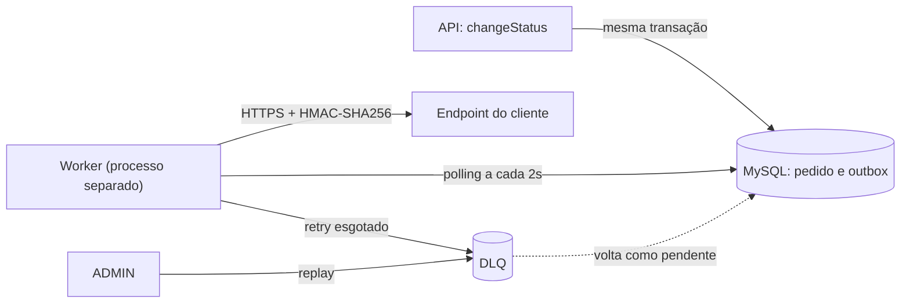

# RFC-001: Sistema de Webhooks de Notificação de Pedidos

| Campo | Valor | Fonte |
| --- | --- | --- |
| Título | RFC-001: Sistema de Webhooks de Notificação de Pedidos | — |
| Autora | Larissa (Tech Lead). Redação: João Paulo Constantino, com apoio de IA | [09:50] Larissa ("Eu vou abrir o doc de design da feature") |
| Status | Em revisão | — |
| Data | 2026-10-16 | — |
| Revisores | Marcos (Product Manager), Bruno (Engenheiro Pleno, Pedidos), Diego (Engenheiro Sênior, Plataforma), Sofia (Engenheira de Segurança) | Participantes da reunião ([TRANSCRICAO.md](../TRANSCRICAO.md)) |
| Documentos | [PRD](./PRD.md) · [FDD](./FDD.md) · [ADRs](./adrs/README.md) | — |

Proposta aberta para revisão; decisões fechadas nos ADRs, implementação no [FDD](./FDD.md).

## 1. TL;DR

- Clientes B2B fazem polling em `GET /orders` e querem aviso em menos de 10s quando o status muda ([09:00] Marcos, [09:02] Marcos).
- Outbox no MySQL existente, na transação do `changeStatus`, lida por um worker separado em polling de 2s ([09:08] Larissa, [09:10] Larissa).
- Request HTTPS assinado com HMAC-SHA256 e secret por endpoint ([09:22] Sofia); at-least-once com `X-Event-Id` ([09:26] Larissa).
- Retry 1m/5m/30m/2h/12h, depois DLQ com replay por ADMIN ([09:17] Larissa, [09:36] Larissa).
- Sem stack nova ([09:30] Larissa); 3 sprints, para o fim de novembro ([09:47] Larissa, [09:45] Marcos).

## 2. Contexto e problema

Três clientes B2B fazem polling em `GET /orders` para saber se seus pedidos mudaram, o que deixa a integração "lenta e cara"; a Atlas sinalizou que pode migrar para o concorrente ([09:00] Marcos). Abaixo de 10s já é "tempo real", e o fluxo é só de saída ([09:02] Marcos).

O OMS não tem mecanismo de eventos: `src/modules/` só tem `auth`, `customers`, `orders`, `products` e `users`. O status muda em `changeStatus` (`src/modules/orders/order.service.ts`), numa transação que "já é pesada" ([09:04] Bruno). Duas forças: cliente lento não pode travar mudanças de status ([09:04] Bruno), e o time é pequeno, por isso a solução usa o MySQL existente, sem subir mais infraestrutura ([09:07] Larissa, [09:07] Diego).

## 3. Proposta técnica

**PROP-01 Captura.** Uma função que recebe o client da transação do `changeStatus` ([09:41] Bruno) grava o evento na outbox: commit e rollback valem para status e evento ([09:06] Diego), e falha na inserção desfaz a mudança de status ([09:40] Bruno). O evento é um snapshot enxuto do pedido, sem items ([09:52] Bruno, [09:43] Diego), gravado só se algum webhook do customer quer aquele status ([09:34] Bruno). → [ADR-001](./adrs/ADR-001-outbox-transacional-no-mysql.md), [ADR-007](./adrs/ADR-007-payload-snapshot-enxuto-com-filtro-na-insercao.md)

**PROP-02 Despacho.** Processo próprio, com entry-point `src/worker.ts` **(novo, a criar)** ([09:11] Larissa), para não cair junto com a API ([09:11] Diego). A cada 2s, lê os pendentes mais antigos ([09:09] Diego): até 2s de espera, dentro da meta de 10s, salvo endpoint lento na fila (leitura de [09:10] Larissa no ADR-002). Instância única: ordem só por pedido ([09:13] Larissa), com a ressalva do PC-03. → [ADR-002](./adrs/ADR-002-worker-em-processo-separado-com-polling.md)

**PROP-03 Entrega segura.** O worker assina o corpo com HMAC-SHA256 ([09:22] Sofia) e envia a assinatura no `X-Signature` ([09:20] Sofia). Cada endpoint tem secret própria, gerada pela plataforma ([09:31] Marcos) e rotacionável, com a antiga válida por 24h ([09:21] Sofia). URL só HTTPS ([09:23] Sofia); payload acima de 64KB é erro, não truncamento ([09:23] Sofia, [09:24] Larissa). → [ADR-004](./adrs/ADR-004-assinatura-hmac-sha256-com-secret-por-endpoint.md)

**PROP-04 Confiabilidade.** At-least-once ([09:26] Larissa): o cliente deduplica pelo `X-Event-Id`, UUID gerado na entrada da outbox ([09:25] Diego). Timeout de 10s é falha ([09:42] Diego). Retentativas em 1m/5m/30m/2h/12h ([09:17] Larissa), lidas como 1 envio inicial + 5 retentativas em 14h36m (PC-01). Esgotadas, o evento vai para a DLQ, tabela separada ([09:18] Diego), e só volta por replay de um ADMIN, com registro de quem fez ([09:36] Sofia). → [ADR-003](./adrs/ADR-003-retry-com-backoff-exponencial-e-dlq.md), [ADR-005](./adrs/ADR-005-entrega-at-least-once-com-x-event-id.md)

**PROP-05 Configuração e API.** Cadastrar webhook com URL e lista de status ([09:31] Marcos); editar, remover e listar os de um customer ([09:33] Bruno); rotacionar a secret ([09:21] Sofia); ver as últimas 100 entregas ([09:34] Marcos); reprocessar a DLQ ([09:18] Diego). O customer vem na requisição, não do JWT ([09:32] Larissa). Replay só para ADMIN ([09:36] Larissa); o resto, "por enquanto", qualquer role autenticada ([09:37] Sofia). → [ADR-007](./adrs/ADR-007-payload-snapshot-enxuto-com-filtro-na-insercao.md), [ADR-004](./adrs/ADR-004-assinatura-hmac-sha256-com-secret-por-endpoint.md)

**PROP-06 Padrões do projeto.** Webhook vira "módulo igual aos outros" ([09:30] Larissa), em `src/modules/webhooks/` **(novo, a criar)** ([09:27] Bruno): `AppError` (`src/shared/errors/app-error.ts`) com prefixo `WEBHOOK_` ([09:29] Larissa), error middleware e Pino ([09:29] Bruno), Zod, `requireRole` ([09:36] Larissa) e UUID ([09:51] Larissa). O worker tem instância própria do Prisma ([09:30] Bruno). → [ADR-006](./adrs/ADR-006-reuso-dos-padroes-existentes-do-projeto.md)

## 4. Alternativas consideradas

Seleção das alternativas descartadas na reunião; as demais estão nos ADRs.

| ID | Alternativa | Trade-off que levou ao descarte | Fonte | ADR |
| --- | --- | --- | --- | --- |
| ALT-01 | HTTP síncrono dentro do `changeStatus` | Cliente lento travaria mudanças de status de outros pedidos; cliente fora do ar não justifica rollback | [09:04] Bruno | [ADR-001](./adrs/ADR-001-outbox-transacional-no-mysql.md) |
| ALT-02 | Redis Streams ou outra fila externa | Mais infraestrutura, "overengineering" para um time pequeno | [09:07] Larissa, [09:07] Diego | [ADR-001](./adrs/ADR-001-outbox-transacional-no-mysql.md) |
| ALT-03 | Trigger de banco, "pra ser mais reativo" | MySQL sem LISTEN/NOTIFY; avisar o worker exigiria improviso, e o polling de 2s já atende | [09:09] Bruno, [09:09] Diego | [ADR-002](./adrs/ADR-002-worker-em-processo-separado-com-polling.md) |
| ALT-05 | Retry indefinido | Evento "pendurado pra sempre se o cliente sumiu" | [09:15] Diego | [ADR-003](./adrs/ADR-003-retry-com-backoff-exponencial-e-dlq.md) |
| ALT-09 | Exactly-once | "exigiria coordenação dos dois lados e fica muito mais complexo" | [09:25] Diego | [ADR-005](./adrs/ADR-005-entrega-at-least-once-com-x-event-id.md) |

## 5. Questões em aberto

Adiados ou não decididos na reunião; nenhum é requisito desta entrega. Dono e momento são sugestões deste RFC.

| ID | Questão | Status na reunião | Dono e momento sugeridos | Fonte |
| --- | --- | --- | --- | --- |
| OQ-01 | Rate limiting de saída: 50 mudanças num minuto viram 50 chamadas? | "observar e decidir depois" | Diego, após medir o volume real | [09:38] Diego, [09:39] Larissa |
| OQ-02 | Vários workers sem perder a ordem por pedido (partição por `order_id` ou lock pessimista) | "problema do futuro" | Diego, quando um worker não der vazão | [09:13] Diego |
| OQ-03 | Email ao cliente após falhas seguidas | "Talvez próxima fase, depois que a gente medir o impacto" | Marcos, depois de medir o impacto | [09:37] Marcos, [09:37] Larissa |
| OQ-04 | Endurecer a autorização do CRUD: hoje qualquer usuário autenticado gerencia webhooks de qualquer customer (`User` sem vínculo com `Customer`, `prisma/schema.prisma`) | "Mais pra frente a gente pode endurecer" | Sofia, na próxima fase | [09:37] Sofia |
| OQ-05 | Retenção da outbox: arquivar as entregues "depois de 30 dias ou assim" | "fora do escopo dessa feature" | Diego, antes de afetar o worker (R-01) | [09:08] Diego |

## 6. Pontos para confirmação dos revisores

**Não foram discutidos na reunião.** São leituras da análise da transcrição e do código, que os revisores precisam confirmar ou corrigir.

- **PC-01 Contagem de tentativas.** O "5 tentativas" de [09:17] Larissa foi lido como 1 envio inicial + 5 retentativas, única leitura que usa os cinco intervalos: 14h36m, perto das "quase 15 horas" de [09:17] Diego. Lido como 5 envios no total ("total 5 tentativas", [09:48] Larissa), a janela cai para 2h36m. → [ADR-003](./adrs/ADR-003-retry-com-backoff-exponencial-e-dlq.md)
- **PC-02 Formato da assinatura.** Ninguém disse como a secret antiga "fica válida" num envio de saída ([09:21] Sofia), nem se o timestamp do envio ([09:44] Diego) entra no HMAC. Proposta: duas assinaturas, nova e antiga, durante as 24h, e timestamp fora do cálculo, leitura literal da decisão ([09:22] Sofia); tudo a validar na revisão de segurança ([09:46] Sofia). → [ADR-004](./adrs/ADR-004-assinatura-hmac-sha256-com-secret-por-endpoint.md)
- **PC-03 Ordem sob retry.** Mesmo com um único worker ([09:12] Diego), um evento em backoff pode ser ultrapassado pelo seguinte do mesmo pedido. Proposta: limitação conhecida, sem bloqueio por pedido; os clientes só querem saber se cada pedido mudou ([09:14] Marcos). → [ADR-002](./adrs/ADR-002-worker-em-processo-separado-com-polling.md), [ADR-003](./adrs/ADR-003-retry-com-backoff-exponencial-e-dlq.md)
- **PC-04 Armazenamento da secret.** O HMAC exige a secret recuperável, não um hash como a senha (`prisma/schema.prisma`). Proposta: deixar a forma de guardá-la para a revisão de segurança ([09:46] Sofia) e mostrar a secret só na criação e na rotação. → [ADR-004](./adrs/ADR-004-assinatura-hmac-sha256-com-secret-por-endpoint.md)
- **PC-05 Id da DLQ.** O replay recebe o id do evento na DLQ ([09:18] Diego), mas a reunião não previu listar a DLQ. Proposta: expor o id no log e no histórico de entregas, sem endpoint novo. → [ADR-003](./adrs/ADR-003-retry-com-backoff-exponencial-e-dlq.md)

## 7. Impacto e riscos

- **IMP-01 Código.** A transação do `changeStatus` ganha a leitura dos webhooks inscritos e a inserção na outbox ([09:34] Bruno, [09:40] Bruno), e o contrato de `PATCH /orders/:id/status` não muda (`src/modules/orders/order.routes.ts`).
- **IMP-02 Operação.** Um processo a mais para operar ([09:11] Diego), consultando o MySQL a cada 2s.
- **IMP-03 Clientes.** Verificar a assinatura ([09:20] Sofia) e deduplicar pelo `X-Event-Id` ([09:25] Diego), com documentação no portal ([09:26] Marcos).

| ID | Risco | Mitigação proposta | Fonte |
| --- | --- | --- | --- |
| R-01 | Outbox acumula eventos e o worker fica lento | Índices e leitura só dos pendentes ([09:08] Diego); OQ-05 | [09:07] Bruno |
| R-02 | Worker parado: eventos acumulam sem entrega | Evento gravado não se perde ([09:06] Diego); monitoramento no FDD | [09:06] Diego |
| R-03 | Eventos do mesmo pedido fora de ordem | Instância única ([09:13] Larissa); PC-03 e OQ-02 | [09:12] Diego |
| R-04 | Vazamento de secret pelo cliente | Secret por endpoint e rotação ([09:21] Sofia) | [09:22] Diego |
| R-05 | Cliente fora do ar por mais de 14h36m perde a entrega automática | DLQ e replay manual, aceito pelo PM | [09:17] Marcos |
| R-06 | Atraso faz a Atlas migrar para o concorrente | 3 sprints; Marcos confirma o prazo com a Atlas ([09:47] Marcos) | [09:00] Marcos |

**Plano de entrega.** Outbox e DLQ (uma sprint), worker e retry (uma), CRUD e histórico (meia), integração e testes ponta a ponta (meia), HMAC e validações ("mais um pouco") ([09:46] Larissa): 3 sprints, com a revisão de segurança de pelo menos dois dias úteis ([09:46] Sofia) no fim ([09:47] Larissa).

## 8. Decisões relacionadas

- [ADR-001: Outbox transacional no MySQL](./adrs/ADR-001-outbox-transacional-no-mysql.md): mesma transação do `changeStatus`.
- [ADR-002: Worker em processo separado com polling de 2s](./adrs/ADR-002-worker-em-processo-separado-com-polling.md): instância única.
- [ADR-003: Retry com backoff exponencial e DLQ em tabela separada](./adrs/ADR-003-retry-com-backoff-exponencial-e-dlq.md): janela de 14h36m.
- [ADR-004: Assinatura HMAC-SHA256 com secret por endpoint](./adrs/ADR-004-assinatura-hmac-sha256-com-secret-por-endpoint.md): antiga válida por 24h.
- [ADR-005: Entrega at-least-once com `X-Event-Id`](./adrs/ADR-005-entrega-at-least-once-com-x-event-id.md): deduplicação no cliente.
- [ADR-006: Reuso dos padrões existentes do projeto](./adrs/ADR-006-reuso-dos-padroes-existentes-do-projeto.md): sem stack nova.
- [ADR-007: Payload snapshot enxuto, renderizado e filtrado na inserção](./adrs/ADR-007-payload-snapshot-enxuto-com-filtro-na-insercao.md): sem items, filtro na inserção.
